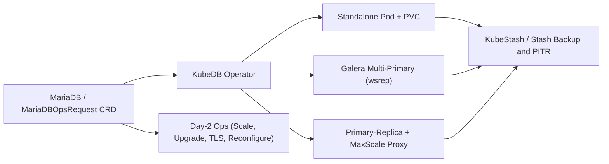

# KubeDB MariaDB Documentation (v2026.7.10)

Welcome to the offline copy of the KubeDB MariaDB documentation.

- 🇬🇧 [English Version (EN)](en/README.md)
- 🇫🇷 [Version Française (FR)](fr/README.md)

## Architecture Overview

