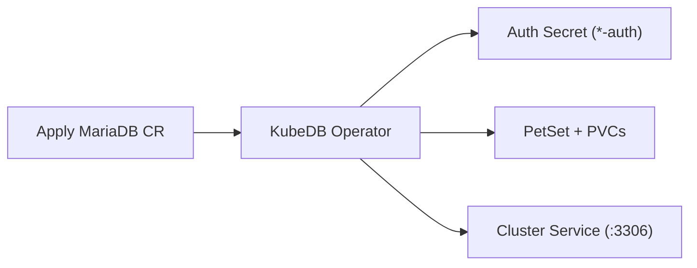

# Deploy Standalone and Galera MariaDB

In this tutorial, you learn how KubeDB provisions standalone and 3-node Galera MariaDB databases from declarative Kubernetes manifests.

## Prerequisites

- A Kubernetes cluster (`kind` or managed cluster) with `kubectl` configured.
- KubeDB operator installed with `MariaDBVersion` catalog resources (`12.1.2` or `11.8.5`).



## 1. Create an Isolated Namespace

```bash
kubectl create ns demo
```

## 2. Deploy a Standalone MariaDB Instance

Create a `MariaDB` resource named `sample-mariadb` using `kubedb.com/v1`:

```yaml
apiVersion: kubedb.com/v1
kind: MariaDB
metadata:
  name: sample-mariadb
  namespace: demo
spec:
  version: "12.1.2"
  storageType: Durable
  storage:
    storageClassName: "standard"
    accessModes:
      - ReadWriteOnce
    resources:
      requests:
        storage: 1Gi
  deletionPolicy: Delete
```

Apply the manifest and wait for the `Ready` phase:

```bash
kubectl apply -f sample-mariadb.yaml
kubectl get mariadb -n demo sample-mariadb
kubectl get pods,svc,pvc,secret -n demo
```

## 3. Connect and Run a Verification Query

Open a shell in `sample-mariadb-0` and query the database engine:

```bash
kubectl exec -it -n demo sample-mariadb-0 -- bash
```

```mysql
MariaDB [(none)]> SELECT VERSION();
+-----------------+
| VERSION()       |
+-----------------+
| 12.1.2-MariaDB  |
+-----------------+
1 row in set (0.001 sec)
```

## 4. Deploy a 3-Node Galera Cluster

For multi-primary synchronous clustering, set `spec.replicas: 3` and `spec.topology.mode: GaleraCluster`:

```yaml
apiVersion: kubedb.com/v1
kind: MariaDB
metadata:
  name: galera-mariadb
  namespace: demo
spec:
  version: "11.8.5"
  replicas: 3
  topology:
    mode: GaleraCluster
  storageType: Durable
  storage:
    storageClassName: "standard"
    accessModes:
      - ReadWriteOnce
    resources:
      requests:
        storage: 1Gi
  deletionPolicy: WipeOut
```

Apply the cluster manifest and check `wsrep_cluster_size`:

```bash
kubectl apply -f galera-mariadb.yaml
kubectl get pods -n demo -l app.kubernetes.io/instance=galera-mariadb
```

```mysql
MariaDB [(none)]> SHOW STATUS LIKE 'wsrep_cluster_size';
+--------------------+-------+
| Variable_name      | Value |
+--------------------+-------+
| wsrep_cluster_size | 3     |
+--------------------+-------+
1 row in set (0.001 sec)
```

## Cleanup and Next Steps

```bash
kubectl delete mariadb -n demo sample-mariadb galera-mariadb
kubectl delete ns demo
```

- Continue with [Backup and PITR Workflow](02-backup-and-pitr-workflow.md).
- Compare clustering designs in [Clustering and Failover Architecture](../04-explanation/01-clustering-and-failover-architecture.md).
- See full upstream details in [QuickStart](../quickstart/overview.md) and [Galera Cluster](../clustering/galera-cluster.md).
