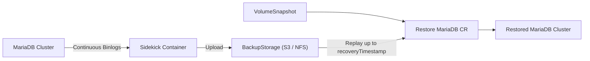

# Backup and Point-in-Time Recovery with KubeStash

In this tutorial, you learn how KubeStash and `MariaDBArchiver` combine full volume snapshots with continuous binlog archiving to recover dropped data.



## 1. Prepare Storage Credentials and `BackupStorage`

Create the storage secret and `BackupStorage` custom resource in namespace `demo`:

```yaml
apiVersion: v1
kind: Secret
metadata:
  name: s3-secret
  namespace: demo
type: Opaque
stringData:
  AWS_ACCESS_KEY_ID: "replace-with-access-key"
  AWS_SECRET_ACCESS_KEY: "replace-with-secret-key"
```

```yaml
apiVersion: storage.kubestash.com/v1alpha1
kind: BackupStorage
metadata:
  name: s3-storage
  namespace: demo
spec:
  storage:
    provider: s3
    s3:
      bucket: kubedb-mariadb-backups
      region: us-east-1
      secretName: s3-secret
  usagePolicy:
    allowedNamespaces:
      from: Same
  default: true
```

```bash
kubectl apply -f s3-secret.yaml
kubectl apply -f s3-storage.yaml
```

## 2. Configure `RetentionPolicy`, `Secret`, and `MariaDBArchiver`

Enable continuous binlog archiving alongside full scheduled backups:

```yaml
apiVersion: storage.kubestash.com/v1alpha1
kind: RetentionPolicy
metadata:
  name: demo-retention
  namespace: demo
spec:
  maxRetentionPeriod: "30d"
  successfulSnapshots:
    last: 5
  failedSnapshots:
    last: 2
```

```yaml
apiVersion: v1
kind: Secret
metadata:
  name: encrypt-secret
  namespace: demo
type: Opaque
stringData:
  RESTIC_PASSWORD: "replace-with-restic-passphrase"
```

```yaml
apiVersion: archiver.kubedb.com/v1alpha1
kind: MariaDBArchiver
metadata:
  name: mariadb-archiver
  namespace: demo
spec:
  pause: false
  databases:
    namespaces:
      from: Selector
      selector:
        matchLabels:
          kubernetes.io/metadata.name: demo
    selector:
      matchLabels:
        archiver: "true"
  retentionPolicy:
    name: demo-retention
    namespace: demo
  encryptionSecret:
    name: encrypt-secret
    namespace: demo
  fullBackup:
    driver: VolumeSnapshotter
    task:
      params:
        volumeSnapshotClassName: "longhorn-snapshot-vsc"
    scheduler:
      successfulJobsHistoryLimit: 1
      failedJobsHistoryLimit: 1
      schedule: "*/5 * * * *"
    sessionHistoryLimit: 2
  backupStorage:
    ref:
      name: s3-storage
      namespace: demo
```

```bash
kubectl apply -f retention.yaml
kubectl apply -f encrypt-secret.yaml
kubectl apply -f mariadb-archiver.yaml
kubectl get mariadbarchiver,backupconfiguration,volumesnapshots -n demo
```

## 3. Record Timestamp Before Simulated Drop

Insert sample rows and capture `NOW()` before dropping `demo_table`:

```mysql
MariaDB [hello]> SELECT COUNT(*) FROM demo_table;
+----------+
| COUNT(*) |
+----------+
|       10 |
+----------+
1 row in set (0.001 sec)

MariaDB [hello]> SELECT NOW();
+---------------------+
| NOW()               |
+---------------------+
| 2026-08-12 10:15:00 |
+---------------------+
1 row in set (0.000 sec)
```

## 4. Restore Using `spec.init.archiver`

Deploy a new `MariaDB` resource targeting `recoveryTimestamp`:

```yaml
apiVersion: kubedb.com/v1
kind: MariaDB
metadata:
  name: restore-mariadb
  namespace: demo
spec:
  version: "11.8.5"
  replicas: 3
  storageType: Durable
  storage:
    storageClassName: "longhorn"
    accessModes:
      - ReadWriteOnce
    resources:
      requests:
        storage: 10Gi
  init:
    archiver:
      encryptionSecret:
        name: encrypt-secret
        namespace: demo
      fullDBRepository:
        name: mariadb-full
        namespace: demo
      recoveryTimestamp: "2026-08-12T10:15:00Z"
  deletionPolicy: WipeOut
```

```bash
kubectl apply -f restore-mariadb.yaml
kubectl get mariadb -n demo
```

## Next Steps

- Execute production PITR steps in [Perform Backup and PITR Recovery](../02-how-to-guides/03-perform-backup-and-pitr-recovery.md).
- Inspect the architecture in [Storage, Backup, and Day-2 Reconciliation](../04-explanation/02-storage-backup-and-day2-reconciliation.md) and [PITR Overview](../pitr/overview.md).
