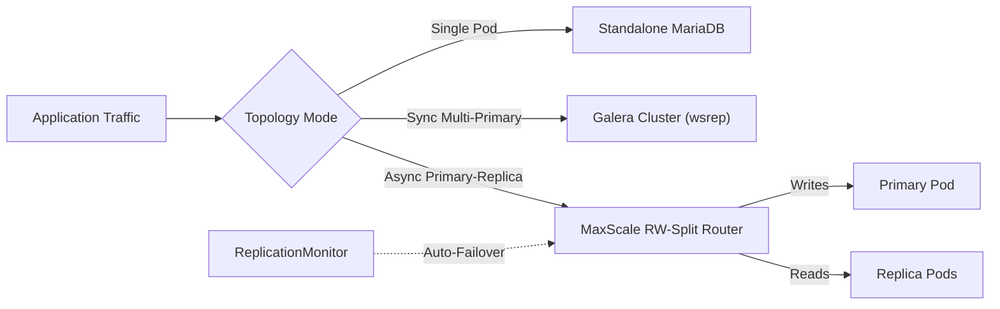

# Clustering and Failover Architecture

KubeDB provisions three distinct MariaDB deployment topologies depending on write concurrency, consistency guarantees, and read scalability requirements.

## Galera Synchronous Multi-Primary vs Replication

- **Galera Cluster (`GaleraCluster`)** replicates transactions virtually synchronously at commit time via the `wsrep` API (`ports 4567/4568/4444`). Every node accepts reads and writes, preventing stale reads at the cost of inter-node write certification latency.
- **Standard Replication with MaxScale (`MariaDBReplication`)** streams binary logs asynchronously with GTIDs from one primary node to read replicas. Client applications connect through MaxScale's read-write split router (`port 3306`), reducing write latency and offloading read queries.

## MaxScale Automated Failover Behavior

When MaxScale's `ReplicationMonitor` detects an unreachable primary (through pings and status probes), it selects the replica with minimal lag, promotes it to primary (`STOP SLAVE; RESET SLAVE ALL;`), repoints remaining replicas, and updates routing tables without manual DNS rewrites.

## Deletion Policies and Stateful Continuity

Unlike stateless deployments, `MariaDB` resources decouple pod lifetimes from `PersistentVolumeClaim` (PVC) and authentication `Secret` objects. Choosing `Halt` removes compute pods while preserving data volumes, whereas `DoNotTerminate` activates KubeDB admission webhooks to block accidental deletion. See [CRDs and Operations Matrix](../03-reference/01-crds-and-operations-matrix.md) for the exact retention matrix.
