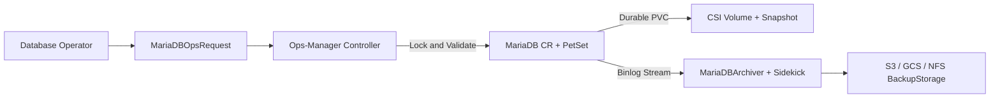

# Storage, Backup, and Day-2 Reconciliation

KubeDB separates base cluster declarations (`MariaDB`) from imperative lifecycle transitions (`MariaDBOpsRequest`) and backup workflows (`KubeStash` / `Stash`).

## Operator Control Loops and `PetSet` Management

The KubeDB operator reconciles `MariaDB` manifests into `PetSet` controllers, headless services, Prometheus exporter sidecars (`*-stats`), and generated root credential `Secret` objects. Updating mutable Day-2 properties (database version, replica count, CPU/memory limits, storage size, `my.cnf`, or TLS certificates) passes through `MariaDBOpsRequest` validation webhooks, avoiding destructive recreate cycles and enforcing ordered rolling transitions.

## Logical Backups vs Continuous PITR Archiving

- **Logical Backups (`KubeStash` / `Stash`)** stream `mariadb-dump` output directly to encrypted Restic repositories via `AppBinding` credentials, minimizing local scratch storage.
- **Continuous Point-in-Time Recovery (`MariaDBArchiver`)** pairs scheduled CSI `VolumeSnapshot` full backups with a `mariadb-sidekick` container that uploads closed transaction binlogs continuously, enabling exact timestamp restoration via `spec.init.archiver.recoveryTimestamp`.
