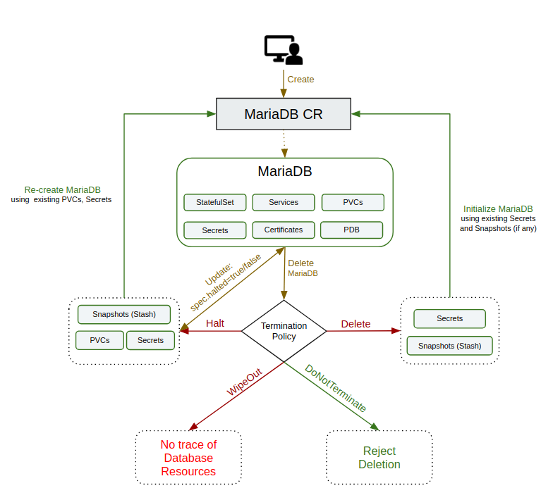

> New to KubeDB? Please start [here](https://kubedb.com/docs/v2026.7.10/README).

## Supported MariaDB Features

| Features | Availability |
| --- | --- |
| Clustering | ✓ |
| Persistent Volume | ✓ |
| Instant Backup | ✓ |
| Scheduled Backup | ✓ |
| Continuous Archiving using `wal-g` | ✓ |
| Initialize using Snapshot | ✓ |
| Initialize using Script (\*.sql, \*sql.gz and/or \*.sh) | ✓ |
| Custom Configuration | ✓ |
| Using Custom docker image | ✓ |
| Builtin Prometheus Discovery | ✓ |
| Using Prometheus operator | ✓ |

## Life Cycle of a MariaDB Object

## User Guide

* [Quickstart MariaDB](quickstart/overview.md) with KubeDB Operator.
* Detail concepts of [MariaDB object](concepts/mariadb.md).
* Detail concepts of [MariaDBVersion object](concepts/mariadb-version.md).
* Create [MariaDB Cluster](clustering/galera-cluster.md).
* Create [MariaDB with Custom Configuration](configuration/using-config-file.md).
* Use [Custom RBAC](custom-rbac/using-custom-rbac.md).
* Use [private Docker registry](private-registry/quickstart.md) to deploy MySQL with KubeDB.
* Initialize [MariaDB with Script](initialization/using-script.md).
* Backup and Restore [MariaDB](backup/stash/overview.md).
* Want to hack on KubeDB? Check our [contribution guidelines](https://kubedb.com/docs/v2026.7.10/CONTRIBUTING).