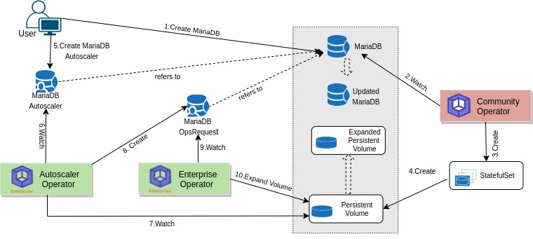

> New to KubeDB? Please start [here](https://kubedb.com/docs/v2026.7.10/README).

# MariaDB Vertical Autoscaling

This guide will give an overview on how KubeDB Autoscaler operator autoscales the database storage using `mariadbautoscaler` crd.

## Before You Begin

* You should be familiar with the following `KubeDB` concepts:
  + [MariaDB](../../concepts/mariadb.md)
  + [MariaDBAutoscaler](../../concepts/autoscaler.md)
  + [MariaDBOpsRequest](../../concepts/opsrequest.md)

## How Storage Autoscaling Works

The following diagram shows how KubeDB Autoscaler operator autoscales the resources of `MariaDB` database components. Open the image in a new tab to see the enlarged version.

  

Fig: Storage Autoscaling process of MariaDB

The Auto Scaling process consists of the following steps:

1. At first, a user creates a `MariaDB` Custom Resource (CR).
2. `KubeDB` Community operator watches the `MariaDB` CR.
3. When the operator finds a `MariaDB` CR, it creates required number of `PetSets` and related necessary stuff like secrets, services, etc.
4. Each PetSet creates a Persistent Volume according to the Volume Claim Template provided in the petset configuration. This Persistent Volume will be expanded by the `KubeDB` Enterprise operator.
5. Then, in order to set up storage autoscaling of the `MariaDB` database the user creates a `MariaDBAutoscaler` CRO with desired configuration.
6. `KubeDB` Autoscaler operator watches the `MariaDBAutoscaler` CRO.
7. `KubeDB` Autoscaler operator continuously watches persistent volumes of the databases to check if it exceeds the specified usage threshold.
8. If the usage exceeds the specified usage threshold, then `KubeDB` Autoscaler operator creates a `MariaDBOpsRequest` to expand the storage of the database.
9. `KubeDB` Enterprise operator watches the `MariaDBOpsRequest` CRO.
10. Then the `KubeDB` Enterprise operator will expand the storage of the database component as specified on the `MariaDBOpsRequest` CRO.

In the next docs, we are going to show a step by step guide on Autoscaling storage of various MariaDB database components using `MariaDBAutoscaler` CRD.