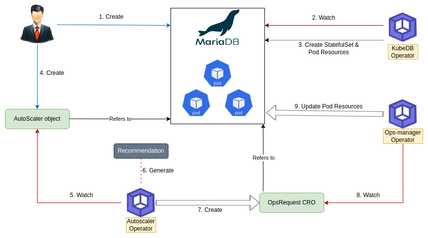

> New to KubeDB? Please start [here](https://kubedb.com/docs/v2026.7.10/README).

# Distributed MariaDB Compute Resource Autoscaling

This guide will give an overview on how KubeDB Autoscaler operator autoscales the compute resources i.e. cpu and memory of a **distributed** MariaDB cluster using `mariadbautoscaler` crd.

## Before You Begin

* You should be familiar with the following `KubeDB` concepts:
  + [MariaDB](../../../concepts/mariadb.md)
  + [MariaDBAutoscaler](../../../concepts/autoscaler.md)
  + [MariaDBOpsRequest](../../../concepts/opsrequest.md)
  + [Distributed MariaDB Overview](../../overview.md)

## How Compute Autoscaling Works

The following diagram shows how KubeDB Autoscaler operator autoscales the resources of `MariaDB` database components. Open the image in a new tab to see the enlarged version.

Fig: Auto Scaling process of MariaDB

The Auto Scaling process consists of the following steps:

1. At first, the user creates a `PlacementPolicy` Custom Resource (CR) with `monitoring.prometheus.url` configured for each spoke cluster. This allows the autoscaler to scrape metrics from the Prometheus instance running in each spoke cluster.
2. The user creates a `MariaDB` Custom Resource Object (CRO) with `spec.distributed: true` and a reference to the `PlacementPolicy`.
3. `KubeDB` Community operator watches the `MariaDB` CRO.
4. When the operator finds a `MariaDB` CRO, it creates required number of `PetSets` and distributes them across spoke clusters as defined by the `PlacementPolicy`.
5. Then, in order to set up autoscaling of the CPU & Memory resources of the `MariaDB` database the user creates a `MariaDBAutoscaler` CRO with desired configuration.
6. `KubeDB` Autoscaler operator watches the `MariaDBAutoscaler` CRO.
7. `KubeDB` Autoscaler operator utilizes the modified version of Kubernetes official [VPA-Recommender](https://github.com/kubernetes/autoscaler/tree/master/vertical-pod-autoscaler/pkg) for different components of the database, as specified in the `mariadbautoscaler` CRO.
   It generates recommendations based on resource usages by querying Prometheus endpoints configured in the `PlacementPolicy`, & stores them in the `status` section of the autoscaler CRO.
8. If the generated recommendation doesn’t match the current resources of the database, then `KubeDB` Autoscaler operator creates a `MariaDBOpsRequest` CRO to scale the database to match the recommendation provided by the VPA object.
9. `KubeDB Ops-Manager operator` watches the `MariaDBOpsRequest` CRO.
10. Lastly, the `KubeDB Ops-Manager operator` will scale the database component vertically as specified on the `MariaDBOpsRequest` CRO.

> **Key Difference from Non-Distributed Autoscaling**: For distributed MariaDB, the `PlacementPolicy` must include a `monitoring.prometheus.url` for each spoke cluster’s `distributionRules` entry. The autoscaler uses these Prometheus endpoints to collect resource metrics from pods running across multiple Kubernetes clusters.

In the next docs, we are going to show a step by step guide on Autoscaling of Distributed MariaDB database using `MariaDBAutoscaler` CRD.