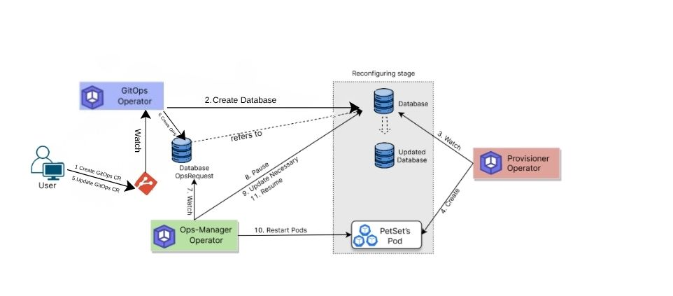

> New to KubeDB? Please start [here](https://kubedb.com/docs/v2026.7.10/README).

# GitOps Overview for MariaDB

This guide will give you an overview of how KubeDB `gitops` operator works with MariaDB databases using the `gitops.kubedb.com/v1alpha1` API. It will help you understand the GitOps workflow for
managing MariaDB databases in Kubernetes.

## Before You Begin

* You should be familiar with the following `KubeDB` concepts:
  + [MariaDB](../concepts/mariadb.md)
  + [MariaDBOpsRequest](../concepts/opsrequest.md)

## Workflow GitOps with MariaDB

The following diagram shows how the `KubeDB` GitOps Operator used to sync with your database. Open the image in a new tab to see the enlarged version.

Fig: GitOps process of MariaDB

1. **Define GitOps MariaDB**: Create Custom Resource (CR) of kind `MariaDB` using the `gitops.kubedb.com/v1alpha1` API.
2. **Store in Git**: Push the CR to a Git repository.
3. **Automated Deployment**: Use a GitOps tool (like `ArgoCD` or `FluxCD`) to monitor the Git repository and synchronize the state of the Kubernetes cluster with the desired state defined in Git.
4. **Create Database**: The GitOps operator creates a corresponding KubeDB MariaDB CR in the Kubernetes cluster to deploy the database.
5. **Handle Updates**: When you update the MariaDBGitOps CR, the operator generates an Ops Request to safely apply the update(e.g. `VerticalScaling`, `HorizontalScaling`, `VolumeExapnsion`, `Reconfigure`, `RotateAuth`, `ReconfigureTLS`, `VersionUpdate`, ans `Restart`.

This flow makes managing MariaDB databases efficient, reliable, and fully integrated with GitOps practices.

In the next doc, we are going to show a step by step guide on running MariaDB using GitOps.