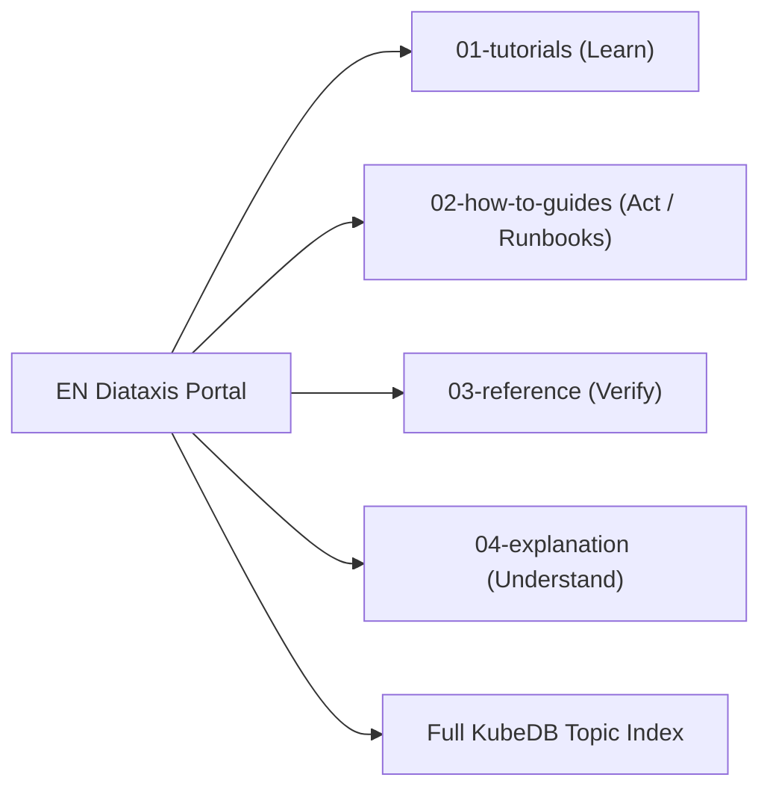

# KubeDB MariaDB Documentation Portal (EN)

Welcome to the structured English documentation for KubeDB MariaDB (`v2026.7.10`), organized using the Diátaxis framework.

## Quadrants

- [Tutorials](01-tutorials/index.md): Guided, reproducible learning labs for deploying MariaDB and setting up KubeStash PITR.
- [How-To Guides](02-how-to-guides/index.md): Goal-oriented operational runbooks in ASD-STE100 covering MaxScale replication, scaling, PITR, and failover.
- [Reference](03-reference/index.md): Neutral lookup tables for KubeDB CRDs, `MariaDBOpsRequest` types, ports, deletion policies, and `kubectl`/`maxctrl` commands.
- [Explanation](04-explanation/index.md): Architecture overviews covering clustering trade-offs, PetSet reconciliation, storage durability, and backup pipelines.

## Complete Upstream Guide Index

Browse every upstream topic by category in the [Complete Documentation Index](README.md), or switch to the [French Documentation Portal](../fr/index.md).
