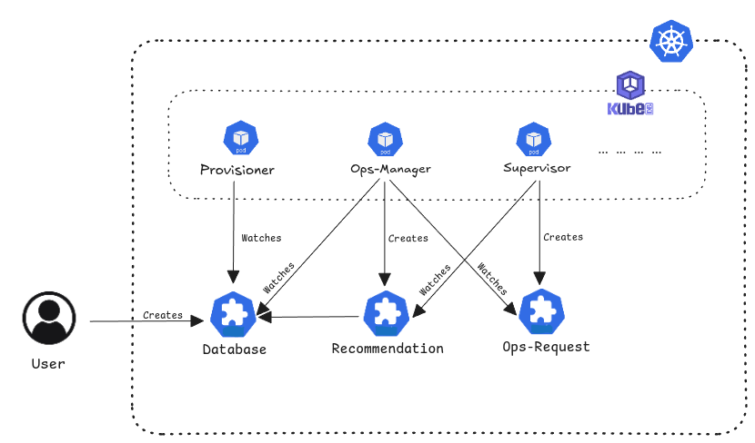

> New to KubeDB? Please start [here](https://kubedb.com/docs/v2026.7.10/README).

# MariaDB Recommendation

## Overview

A `Recommendation` is a Kubernetes-native CRD created by the **KubeDB Ops-Manager** and reconciled by the **KubeDB Supervisor**. For a MariaDB instance managed by KubeDB, the Ops-Manager watches the database’s state and emits a Recommendation whenever it detects an action you should take — a newer version, an expiring TLS certificate, or an authentication secret nearing its rotation deadline.

Nothing runs until the Recommendation is approved — either by you (`status.approvalStatus: Approved`) or automatically through an `ApprovalPolicy` bound to a `MaintenanceWindow`. Once approved, the Supervisor creates the corresponding `MariaDBOpsRequest` and tracks it to completion.

This page is the **MariaDB-specific intro**: which recommendations apply to MariaDB and which spec fields trigger them. For prerequisites, Helm flags that control generation timing, and the full Recommendation lifecycle, see:

* [Recommendation Configuration](https://kubedb.com/docs/v2026.7.10/operatormanual/recommendation/configuration) — prerequisites, Supervisor CRD install, and all Helm flags.
* [Recommendation Overview](https://kubedb.com/docs/v2026.7.10/operatormanual/recommendation) — architecture and lifecycle walkthrough.



---

## Relevant KubeDB concepts

* [MariaDBOpsRequest](../concepts/opsrequest.md)
* [MariaDBRotateAuth](../rotate-auth/overview.md)
* [MariaDBReconfigureTLS](../tls/overview.md)
* [MariaDBUpdateVersion](../update-version/overview.md)

---

## Recommendation types for MariaDB

| Type | Triggered when | Walkthrough |
| --- | --- | --- |
| **Version Update** | A newer major, minor, or patch version becomes available | [Version Update Recommendation](https://kubedb.com/docs/v2026.7.10/operatormanual/recommendation/version-update-recommendation) |
| **Same-Version Update** | The container image for your *current* version is refreshed (e.g. security patch) | [Version Update Recommendation](https://kubedb.com/docs/v2026.7.10/operatormanual/recommendation/version-update-recommendation) |
| **TLS Certificate Rotation** | An issued certificate is approaching its expiry threshold | [TLS Certificate Rotation Recommendation](https://kubedb.com/docs/v2026.7.10/operatormanual/recommendation/rotate-tls-recommendation) |
| **Authentication Secret Rotation** | The auth secret is approaching its `rotateAfter` deadline | [Authentication Secret Rotation Recommendation](https://kubedb.com/docs/v2026.7.10/operatormanual/recommendation/rotate-auth-recommendation) |

---

## Triggers specific to MariaDB

This section shows the minimal MariaDB CR fields that cause each recommendation to be generated. For deeper, end-to-end walkthroughs use the links in the table above.

### Authentication Secret Rotation

```yaml
apiVersion: kubedb.com/v1
kind: MariaDB
metadata:
  name: mariadb-recommendation
  namespace: demo
spec:
  version: "10.5.23"
  authSecret:
    kind: Secret
    name: mariadb-auth
    rotateAfter: 1h
```

In this configuration:

* The `rotateAfter` field defines how long the authentication secret remains valid

KubeDB monitors the configured lifecycle and generates a RotateAuth Recommendation based on the following conditions:

* If the secret lifespan is greater than one month, a recommendation is generated when less than one month of validity remains
* If the secret lifespan is less than one month, a recommendation is generated when approximately one-third of its validity remains

Once approved, KubeDB creates an opsrequest to rotate the credentials automatically, ensuring:

* No expired credentials
* Improved security posture
* Reduced manual intervention

### TLS Certificate Rotation

```yaml
apiVersion: kubedb.com/v1
kind: MariaDB
metadata:
  name: mariadb-recommendation
  namespace: demo
spec:
  version: "10.5.23"
  tls:
    issuerRef:
      apiGroup: cert-manager.io
      kind: Issuer
      name: mariadb-ca-issuer
    certificates:
      - alias: client
        duration: 1h20m
      - alias: server
        duration: 2h10m
```

In this configuration:

* The `spec.tls.certificates.duration` field defines how long each certificate remains valid

KubeDB monitors the configured lifecycle and generates a RotateTLS Recommendation based on the following conditions:

* If the certificate duration is greater than one month, a recommendation is generated when less than one month of validity remains
* If the certificate duration is less than one month, a recommendation is generated when approximately one-third of its validity remains

Once approved, KubeDB creates an opsrequest to reconfigure TLS automatically, ensuring:

* Continuous secure communication
* No unexpected certificate expiry
* Seamless certificate renewal

### Version Update

```yaml
apiVersion: kubedb.com/v1
kind: MariaDB
metadata:
  name: mariadb-recommendation
  namespace: demo
spec:
  version: "10.5.23"
```

In this configuration:

* KubeDB monitors the running version of the database

KubeDB monitors the configured lifecycle and generates a VersionUpdate Recommendation based on the following conditions:

* If a newer container image is available for the current version, a recommendation is generated
* If a patch version is released, a recommendation is generated
* If a newer minor or major version becomes available, a recommendation is generated
* If changes are introduced in the existing version image (e.g., security fixes or image updates without a version bump), a recommendation is generated

For example: Recommending version update from `10.5.23` to `10.6.16`

Once approved, KubeDB creates an opsrequest to perform the version upgrade automatically, ensuring:

* Timely adoption of security patches and fixes
* Access to new features and improvements
* Consistent performance and stability across deployments

### Same-Version Update

```yaml
apiVersion: kubedb.com/v1
kind: MariaDB
metadata:
  name: mariadb-recommendation
  namespace: demo
spec:
  version: "10.5.23"
```

In this configuration:

* KubeDB monitors the container image of the current database version

KubeDB monitors the configured lifecycle and generates a SameVersionUpdate Recommendation based on the following conditions:

* If the container image backing the current version is updated (e.g., security patches or rebuilds without a version change), a recommendation is generated

Once approved, KubeDB creates an opsrequest to update the running workload automatically, ensuring:

* Security patches are applied without requiring a version upgrade
* Consistency with the latest available container image
* Improved reliability and maintainability

---

For prerequisites, Helm configuration flags, and the full cross-database Recommendation lifecycle, see the [Recommendation Configuration](https://kubedb.com/docs/v2026.7.10/operatormanual/recommendation/configuration) and [Recommendation Overview](https://kubedb.com/docs/v2026.7.10/operatormanual/recommendation) in the operator manual.