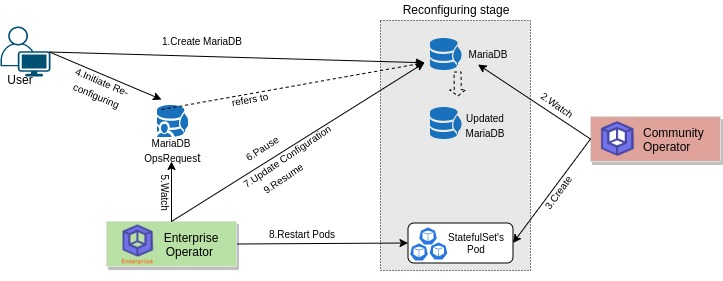

> New to KubeDB? Please start [here](https://kubedb.com/docs/v2026.7.10/README).

# Reconfiguring MariaDB

This guide will give an overview on how KubeDB Ops Manger reconfigures `MariaDB`.

## Before You Begin

* You should be familiar with the following `KubeDB` concepts:
  + [MariaDB](../concepts/mariadb.md)
  + [MariaDBOpsRequest](../concepts/opsrequest.md)

## How Reconfiguring MariaDB Process Works

The following diagram shows how KubeDB Ops Manager reconfigures `MariaDB` database components. Open the image in a new tab to see the enlarged version.

  

Fig: Reconfiguring process of MariaDB

The Reconfiguring MariaDB process consists of the following steps:

1. At first, a user creates a `MariaDB` Custom Resource (CR).
2. `KubeDB` Community operator watches the `MariaDB` CR.
3. When the operator finds a `MariaDB` CR, it creates required number of `PetSets` and related necessary stuff like secrets, services, etc.
4. Then, in order to reconfigure the `MariaDB` standalone or cluster the user creates a `MariaDBOpsRequest` CR with desired information.
5. `KubeDB` Enterprise operator watches the `MariaDBOpsRequest` CR.
6. When it finds a `MariaDBOpsRequest` CR, it halts the `MariaDB` object which is referred from the `MariaDBOpsRequest`. So, the `KubeDB` Community operator doesn’t perform any operations on the `MariaDB` object during the reconfiguring process.
7. Then the `KubeDB` Enterprise operator will replace the existing configuration with the new configuration provided or merge the new configuration with the existing configuration according to the `MariaDBOpsRequest` CR.
8. Then the `KubeDB` Enterprise operator will restart the related PetSet Pods so that they restart with the new configuration defined in the `MariaDBOpsRequest` CR.
9. After the successful reconfiguring of the `MariaDB`, the `KubeDB` Enterprise operator resumes the `MariaDB` object so that the `KubeDB` Community operator resumes its usual operations.

In the next docs, we are going to show a step by step guide on reconfiguring MariaDB database components using `MariaDBOpsRequest` CRD.