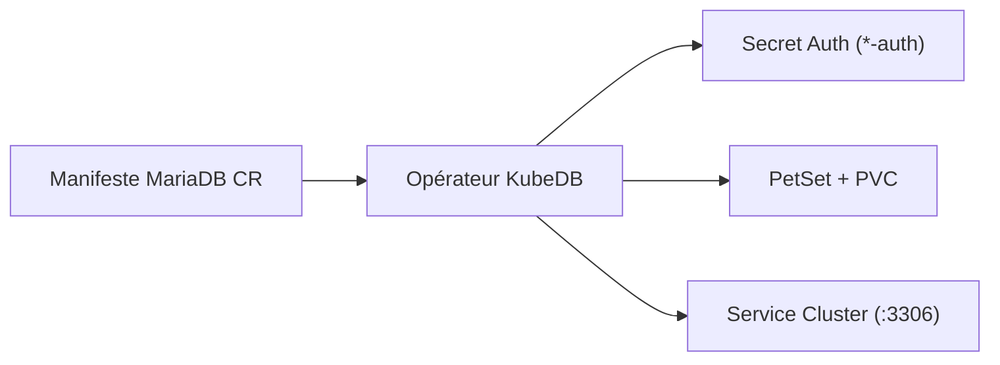

# Déployer MariaDB autonome et cluster Galera

Dans ce tutoriel, vous apprenez comment KubeDB provisionne une instance MariaDB autonome puis un cluster Galera à 3 nœuds à partir de manifestes déclaratifs.

## Prérequis

- Un cluster Kubernetes (`kind` ou managé) avec l'outil `kubectl` configuré.
- L'opérateur KubeDB installé avec les ressources catalogue `MariaDBVersion` (`12.1.2` ou `11.8.5`).



## 1. Créer un espace de noms isolé

```bash
kubectl create ns demo
```

## 2. Déployer une instance MariaDB autonome

Créez une ressource `MariaDB` nommée `sample-mariadb` avec l'API `kubedb.com/v1` :

```yaml
apiVersion: kubedb.com/v1
kind: MariaDB
metadata:
  name: sample-mariadb
  namespace: demo
spec:
  version: "12.1.2"
  storageType: Durable
  storage:
    storageClassName: "standard"
    accessModes:
      - ReadWriteOnce
    resources:
      requests:
        storage: 1Gi
  deletionPolicy: Delete
```

Appliquez ce manifeste et observez le passage en phase `Ready` :

```bash
kubectl apply -f sample-mariadb.yaml
kubectl get mariadb -n demo sample-mariadb
kubectl get pods,svc,pvc,secret -n demo
```

## 3. Se connecter et exécuter une requête de contrôle

Ouvrez un shell dans le pod `sample-mariadb-0` puis interrogez le moteur SQL :

```bash
kubectl exec -it -n demo sample-mariadb-0 -- bash
```

```mysql
MariaDB [(none)]> SELECT VERSION();
+-----------------+
| VERSION()       |
+-----------------+
| 12.1.2-MariaDB  |
+-----------------+
1 row in set (0.001 sec)
```

## 4. Déployer un cluster Galera à 3 nœuds

Pour activer le mode multi-primaire synchrone, définissez `spec.replicas: 3` et `spec.topology.mode: GaleraCluster` :

```yaml
apiVersion: kubedb.com/v1
kind: MariaDB
metadata:
  name: galera-mariadb
  namespace: demo
spec:
  version: "11.8.5"
  replicas: 3
  topology:
    mode: GaleraCluster
  storageType: Durable
  storage:
    storageClassName: "standard"
    accessModes:
      - ReadWriteOnce
    resources:
      requests:
        storage: 1Gi
  deletionPolicy: WipeOut
```

Appliquez le manifeste du cluster et contrôlez `wsrep_cluster_size` :

```bash
kubectl apply -f galera-mariadb.yaml
kubectl get pods -n demo -l app.kubernetes.io/instance=galera-mariadb
```

```mysql
MariaDB [(none)]> SHOW STATUS LIKE 'wsrep_cluster_size';
+--------------------+-------+
| Variable_name      | Value |
+--------------------+-------+
| wsrep_cluster_size | 3     |
+--------------------+-------+
1 row in set (0.001 sec)
```

## Nettoyage et suite

```bash
kubectl delete mariadb -n demo sample-mariadb galera-mariadb
kubectl delete ns demo
```

- Poursuivez avec [Sauvegarde KubeStash et récupération ponctuelle (PITR)](02-sauvegarde-kubestash-et-pitr.md).
- Comparez les topologies dans [Architecture de clustering et basculement](../04-explications/01-architecture-clustering-et-basculement.md).
- Consultez les guides complets [Démarrage rapide](../quickstart/overview.md) et [Cluster Galera](../clustering/galera-cluster.md).
