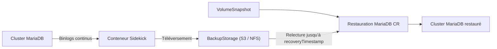

# Sauvegarde KubeStash et récupération ponctuelle (PITR)

Dans ce tutoriel, vous apprenez comment KubeStash et `MariaDBArchiver` associent clichés de volume et archivage continu des binlogs pour restaurer des données perdues.



## 1. Préparer les identifiants et `BackupStorage`

Créez le secret d'accès S3 et la ressource `BackupStorage` dans l'espace de noms `demo` :

```yaml
apiVersion: v1
kind: Secret
metadata:
  name: s3-secret
  namespace: demo
type: Opaque
stringData:
  AWS_ACCESS_KEY_ID: "replace-with-access-key"
  AWS_SECRET_ACCESS_KEY: "replace-with-secret-key"
```

```yaml
apiVersion: storage.kubestash.com/v1alpha1
kind: BackupStorage
metadata:
  name: s3-storage
  namespace: demo
spec:
  storage:
    provider: s3
    s3:
      bucket: kubedb-mariadb-backups
      region: us-east-1
      secretName: s3-secret
  usagePolicy:
    allowedNamespaces:
      from: Same
  default: true
```

```bash
kubectl apply -f s3-secret.yaml
kubectl apply -f s3-storage.yaml
```

## 2. Configurer `RetentionPolicy` et `MariaDBArchiver`

Activez l'archivage continu des binlogs avec des sauvegardes complètes planifiées :

```yaml
apiVersion: storage.kubestash.com/v1alpha1
kind: RetentionPolicy
metadata:
  name: demo-retention
  namespace: demo
spec:
  maxRetentionPeriod: 30d
  successfulSnapshots: 5
  failedSnapshots: 2
```

```yaml
apiVersion: archiver.kubedb.com/v1alpha1
kind: MariaDBArchiver
metadata:
  name: mariadb-archiver
  namespace: demo
spec:
  pause: false
  databaseRef:
    name: mariadb
    namespace: demo
  fullBackup:
    driver: VolumeSnapshotter
    task:
      name: mariadb-volumesnapshot-backup
    schedule: "*/5 * * * *"
    retentionPolicy:
      name: demo-retention
      namespace: demo
    backupStorage:
      name: s3-storage
      namespace: demo
```

```bash
kubectl apply -f retention.yaml
kubectl apply -f mariadb-archiver.yaml
kubectl get backupconfiguration,volumesnapshots -n demo
```

## 3. Relever l'horodatage avant suppression simulée

Insérez des lignes de test et relevez `NOW()` avant de supprimer `demo_table` :

```mysql
MariaDB [hello]> SELECT COUNT(*) FROM demo_table;
+----------+
| COUNT(*) |
+----------+
|       10 |
+----------+
1 row in set (0.001 sec)

MariaDB [hello]> SELECT NOW();
+---------------------+
| NOW()               |
+---------------------+
| 2026-08-12 10:15:00 |
+---------------------+
1 row in set (0.000 sec)
```

## 4. Restaurer avec `spec.init.archiver`

Déployez un nouvel objet `MariaDB` ciblant `recoveryTimestamp` :

```yaml
apiVersion: kubedb.com/v1
kind: MariaDB
metadata:
  name: restore-mariadb
  namespace: demo
spec:
  version: "11.8.5"
  replicas: 3
  storageType: Durable
  storage:
    storageClassName: "longhorn"
    accessModes:
      - ReadWriteOnce
    resources:
      requests:
        storage: 10Gi
  init:
    archiver:
      recoveryTimestamp: "2026-08-12T10:15:00Z"
  deletionPolicy: WipeOut
```

```bash
kubectl apply -f restore-mariadb.yaml
kubectl get mariadb -n demo
```

## Prochaines étapes

- Exécutez la procédure en production via [Exécuter une sauvegarde et une restauration PITR](../02-guides-pratiques/03-executer-sauvegarde-et-restauration-pitr.md).
- Étudiez l'architecture dans [Stockage, sauvegarde et réconciliation](../04-explications/02-stockage-sauvegarde-et-reconciliation.md) et [Aperçu PITR](../pitr/overview.md).
