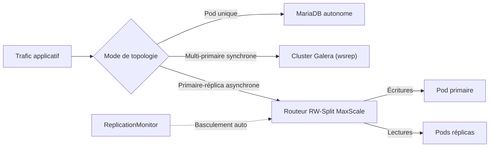

# Architecture de clustering et basculement

KubeDB provisionne trois topologies MariaDB distinctes selon les besoins de concurrence en écriture, de cohérence et de passage à l'échelle en lecture.

## Réplication synchrone Galera face à la réplication asynchrone

- **Cluster Galera (`GaleraCluster`)** réplique les transactions de manière quasi synchrone lors de la validation via l'API `wsrep` (`ports 4567/4568/4444`). Chaque nœud accepte lectures et écritures, évitant les lectures périmées au prix d'une latence de certification inter-nœuds.
- **Réplication standard avec MaxScale (`MariaDBReplication`)** diffuse les journaux binaires de manière asynchrone avec GTID depuis un nœud primaire unique vers les réplicas en lecture seule. Le routeur `RW-Split` de MaxScale (`port 3306`) oriente écritures et lectures de manière transparente.

## Mécanisme de basculement automatique MaxScale

Lorsque `ReplicationMonitor` détecte la défaillance du primaire par sondes SQL, il choisit le réplica présentant le retard minimal, le promeut (`STOP SLAVE; RESET SLAVE ALL;`), réoriente les autres réplicas et met à jour les tables de routage applicatives.

## Politiques de suppression et persistance des données

Les ressources `MariaDB` dissocient la durée de vie des pods de celle des `PersistentVolumeClaim` (PVC) et `Secret`. La politique `Halt` supprime les pods tout en préservant volumes et secrets, tandis que `DoNotTerminate` active le webhook de validation bloquant toute suppression accidentelle. Voir la [Matrice des CRD et opérations](../03-reference/01-matrice-crd-et-operations.md).
