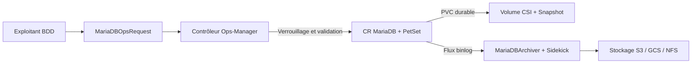

# Stockage, sauvegarde et réconciliation

KubeDB sépare les déclarations initiales de cluster (`MariaDB`) des transitions administratives Jour 2 (`MariaDBOpsRequest`) et des chaînes de sauvegarde (`KubeStash` / `Stash`).

## Boucles de contrôle de l'opérateur et `PetSet`

L'opérateur KubeDB traduit chaque ressource `MariaDB` en contrôleurs `PetSet`, services headless, sidecars exportateurs Prometheus (`*-stats`) et secrets d'authentification générés. Les évolutions de version, de réplicas, de ressources CPU/mémoire, de taille PVC ou de certificats TLS passent par `MariaDBOpsRequest` afin de garantir des mises à jour progressives sans recréation destructrice.

## Sauvegardes logiques face à l'archivage continu PITR

- **Sauvegardes logiques (`KubeStash` / `Stash`)** diffusent la sortie de `mariadb-dump` vers un dépôt Restic chiffré à partir des accès lus dans `AppBinding`, limitant l'espace disque temporaire requis.
- **Récupération ponctuelle (`MariaDBArchiver`)** associe des instantanés CSI planifiés (`VolumeSnapshot`) à un conteneur `mariadb-sidekick` qui archive en continu chaque binlog fermé pour restaurer à un horodatage cible via `spec.init.archiver.recoveryTimestamp`.
