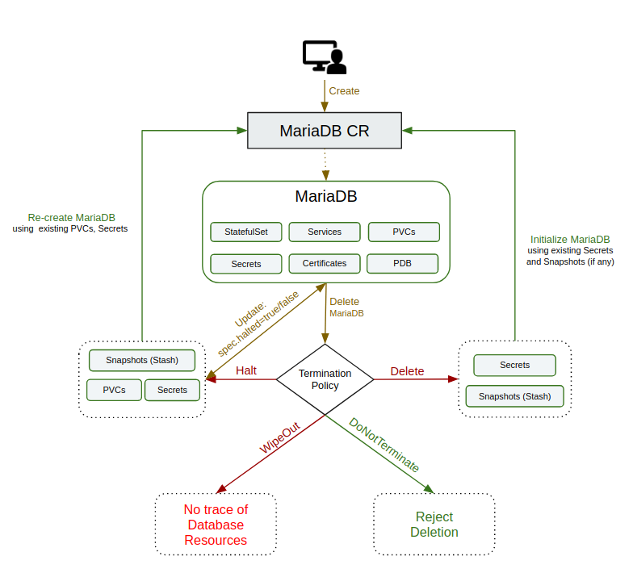

> Vous êtes nouveau sur KubeDB ? Veuillez commencer [ici](https://kubedb.com/docs/v2026.7.10/README).

## Fonctionnalités MariaDB prises en charge

| Caractéristiques | Disponibilité |
| --- | --- |
| Regroupement | ✓ |
| Volume persistant | ✓ |
| Sauvegarde instantanée | ✓ |
| Sauvegarde planifiée | ✓ |
| Archivage continu à l'aide `wal-g` | ✓ |
| Initialiser à l'aide d'un instantané | ✓ |
| Initialiser à l'aide d'un script (\*.sql, \*sql.gz et/ou \*.sh) | ✓ |
| Configuration personnalisée | ✓ |
| Utilisation d'une image Docker personnalisée | ✓ |
| Découverte Prometheus intégrée | ✓ |
| Utiliser l'opérateur Prometheus | ✓ |

## Cycle de vie d'un objet MariaDB

## Guide de l'utilisateur

* [Démarrage rapide MariaDB](quickstart/overview.md) avec l'opérateur KubeDB.
* Concepts détaillés de [Objet MariaDB](concepts/mariadb.md).
* Concepts détaillés de [Objet MariaDBVersion](concepts/mariadb-version.md).
* Créer [Cluster MariaDB](clustering/galera-cluster.md).
* Créer [MariaDB avec configuration personnalisée](configuration/using-config-file.md).
* Utiliser [RBAC personnalisé](custom-rbac/using-custom-rbac.md).
* Utiliser [registre Docker privé](private-registry/quickstart.md) pour déployer MySQL avec KubeDB.
* Initialiser [MariaDB avec script](initialization/using-script.md).
* Sauvegarde et restauration [MariaDB](backup/stash/overview.md).
* Vous voulez pirater KubeDB ? Consultez notre [directives de contribution](https://kubedb.com/docs/v2026.7.10/CONTRIBUTING).