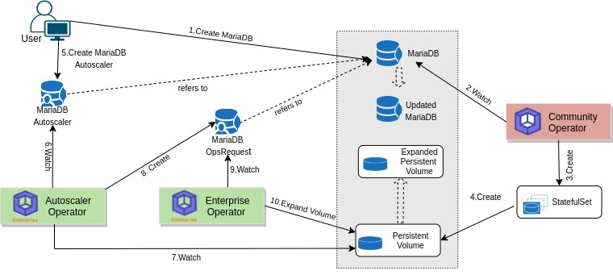

> Vous êtes nouveau sur KubeDB ? Veuillez commencer [ici](https://kubedb.com/docs/v2026.7.10/README).

# Mise à l'échelle verticale automatique de MariaDB

Ce guide donnera un aperçu de la façon dont l'opérateur KubeDB Autoscaler met automatiquement à l'échelle le stockage de la base de données à l'aide de `mariadbautoscaler` crd.

## Avant de commencer

* Vous devriez être familier avec ce qui suit `KubeDB` notions :
  + [MariaDB](../../concepts/mariadb.md)
  + [MariaDBAutoscaler](../../concepts/autoscaler.md)
  + [MariaDBOpsDemande](../../concepts/opsrequest.md)

## Fonctionnement de la mise à l'échelle automatique du stockage

Le diagramme suivant montre comment l'opérateur KubeDB Autoscaler met automatiquement à l'échelle les ressources de `MariaDB` composants de base de données. Ouvrez l'image dans un nouvel onglet pour voir la version agrandie.

  

Fig : Processus de mise à l'échelle automatique du stockage de MariaDB

Le processus Auto Scaling comprend les étapes suivantes :

1. Dans un premier temps, un utilisateur crée un `MariaDB` Ressource personnalisée (CR).
2. `KubeDB` L'opérateur communautaire surveille `MariaDB` CR.
3. Lorsque l'opérateur trouve un `MariaDB` CR, il crée le nombre requis de `PetSets` et les éléments nécessaires connexes comme les secrets, les services, etc.
4. Chaque PetSet crée un volume persistant selon le modèle de réclamation de volume fourni dans la configuration du petset. Ce volume persistant sera étendu par le `KubeDB` Opérateur d'entreprise.
5. Ensuite, afin de configurer l'autoscaling du stockage du `MariaDB` base de données, l'utilisateur crée un `MariaDBAutoscaler` CRO avec la configuration souhaitée.
6. `KubeDB` L'opérateur de l'autoscaler surveille le `MariaDBAutoscaler` CRO.
7. `KubeDB` L'opérateur Autoscaler surveille en permanence les volumes persistants des bases de données pour vérifier s'ils dépassent le seuil d'utilisation spécifié.
8. Si l'utilisation dépasse le seuil d'utilisation spécifié, alors `KubeDB` L'opérateur Autoscaler crée un `MariaDBOpsRequest` pour étendre le stockage de la base de données.
9. `KubeDB` L'opérateur d'entreprise surveille le `MariaDBOpsRequest` CRO.
10. Puis le `KubeDB` L'opérateur d'entreprise étendra le stockage du composant de base de données comme spécifié sur le `MariaDBOpsRequest` CRO.

Dans la prochaine documentation, nous allons montrer un guide étape par étape sur la mise à l'échelle automatique du stockage de divers composants de base de données MariaDB à l'aide de `MariaDBAutoscaler` CRD.