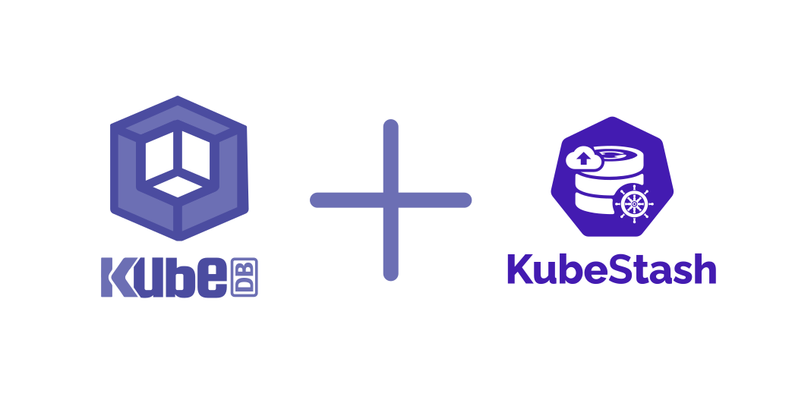
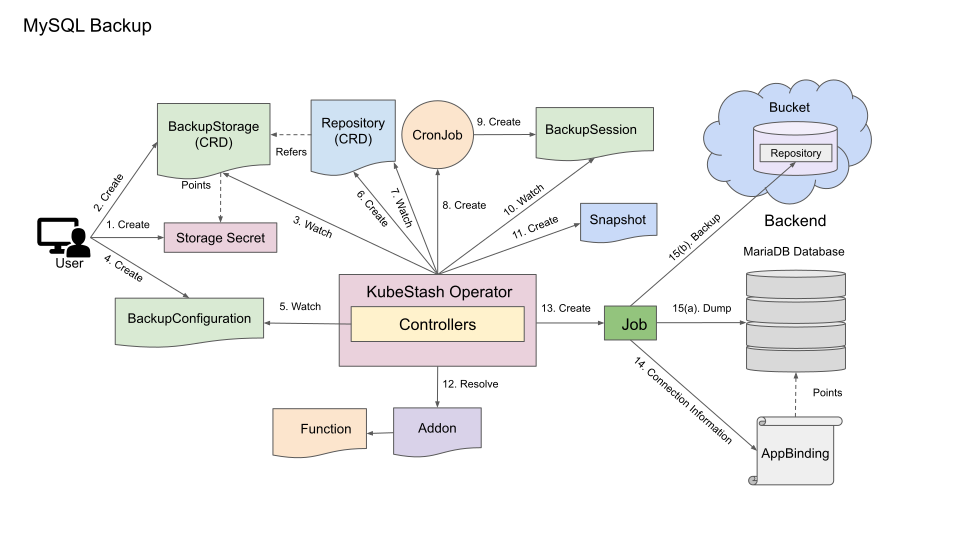
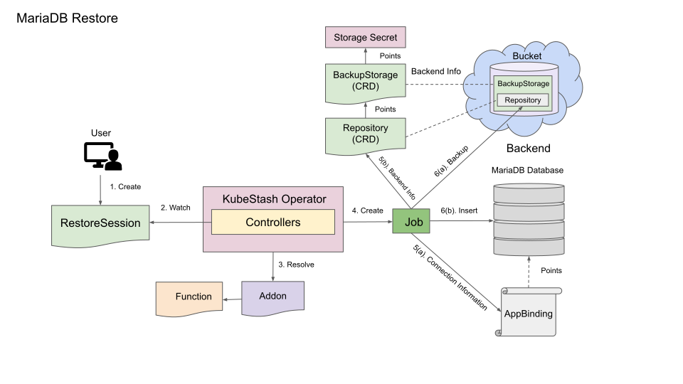

> Vous êtes nouveau sur KubeDB ? Veuillez commencer [ici](https://kubedb.com/docs/v2026.7.10/README).

Veuillez installer [KubeStash](https://kubestash.com/docs/latest/setup/install/kubestash/) pour essayer cette fonctionnalité. La sauvegarde de la base de données avec KubeStash est déjà incluse dans la licence KubeDB. Vous n’avez donc pas besoin d’une licence distincte pour KubeStash.

# Présentation de la sauvegarde et de la restauration MariaDB

KubeDB utilise également [KubeStash](https://kubestash.com) pour sauvegarder et restaurer des bases de données. KubeStash d'AppsCode est une solution cloud native de sauvegarde et de récupération de données pour les charges de travail et les bases de données Kubernetes. KubeStash utilise [restique](https://github.com/restic/restic) pour sauvegarder en toute sécurité des applications avec état sur n'importe quel backend de stockage cloud ou sur site (par exemple, S3, GCS, stockage Azure Blob, Minio, NetApp, Dell EMC, etc.).

  

Fig : Sauvegarder les bases de données KubeDB à l'aide de KubeStash

## Comment fonctionne la sauvegarde

Le diagramme suivant montre comment KubeStash effectue la sauvegarde d'un `MariaDB` base de données. Ouvrez l'image dans un nouvel onglet pour voir la version agrandie.

  

Figure : Présentation de la sauvegarde MariaDB

Le processus de sauvegarde comprend les étapes suivantes :

1. Dans un premier temps, un utilisateur crée un `Secret`. Ce secret contient les informations d'identification permettant d'accéder au backend où les données sauvegardées seront stockées.
2. Ensuite, elle crée un `BackupStorage` ressource personnalisée qui spécifie les informations du backend, ainsi que les `Secret` contenant les informations d'identification nécessaires pour accéder au backend.
3. L'opérateur KubeStash surveille `BackupStorage` ressources personnalisées. Lorsqu'il trouve un `BackupStorage` objet, il initialise le `BackupStorage` en téléchargeant le `metadata.yaml` fichier vers le backend spécifié.
4. Ensuite, elle crée un `BackupConfiguration` ressource personnalisée qui spécifie la base de données cible, les informations complémentaires (y compris les tâches de sauvegarde), les planifications de sauvegarde, les backends de stockage pour stocker les données de sauvegarde et d'autres paramètres supplémentaires.
5. L'opérateur KubeStash surveille `BackupConfiguration` objets.
6. Une fois que l'opérateur KubeStash trouve un `BackupConfiguration` objet, il crée `Repository` avec les informations spécifiées dans le `BackupConfiguration`.
7. L'opérateur KubeStash surveille `Repository` ressources personnalisées. Lorsqu'il trouve le `Repository` objet, il initialise `Repository` en téléchargeant `repository.yaml` déposer dans le `spec.sessions[*].repositories[*].directory` chemin spécifié dans `BackupConfiguration`.
8. Ensuite, cela crée un `CronJob` pour chaque séance selon l'horaire précisé dans `BackupConfiguration` pour déclencher une sauvegarde périodiquement.
9. L'opérateur KubeStash déclenche une sauvegarde instantanée dès que le `BackupConfiguration` est prêt. Les sauvegardes sont autrement déclenchées par le `CronJob` en fonction du calendrier spécifié.
10. L'opérateur KubeStash surveille `BackupSession` ressources personnalisées.
11. Lorsqu'il trouve un `BackupSession` objet, il crée un `Snapshot` ressource personnalisée pour chacun `Repository` précisé dans le `BackupConfiguration`.
12. Ensuite, il résout le problème respectif `Addon` et `Function` et prépare la sauvegarde `Job` définition.
13. Ensuite, il crée le `Job` pour sauvegarder la cible `MariaDB` base de données.
14. La sauvegarde `Job` lit les informations nécessaires (par exemple, secret d'authentification, port) pour se connecter à la base de données à partir du `AppBinding` CR. Il lit également les informations du backend et accède aux informations d'identification à partir de `BackupStorage` CR, secret de stockage et `Repository` chemin respectivement.
15. Ensuite, le `Job` jette la cible `MariaDB` base de données et télécharge la sortie vers le backend. KubeStash redirige la sortie de la commande dump vers le processus de téléchargement. Par conséquent, sauvegarde `Job` ne nécessite pas un volume important pour contenir la totalité de la sortie de vidage.
16. Une fois le processus de sauvegarde terminé, la sauvegarde `Job` met à jour le `status.components[dump]` domaine de la `Snapshot` ressources avec les informations de sauvegarde de la cible `MariaDB` base de données.

## Comment fonctionne le processus de restauration

Le diagramme suivant montre comment KubeStash restaure les données sauvegardées dans un `MariaDB` base de données. Ouvrez l'image dans un nouvel onglet pour voir la version agrandie.

  

Fig : Présentation du processus de restauration MariaDB

Le processus de restauration comprend les étapes suivantes :

1. Dans un premier temps, un utilisateur crée un `MariaDB` base de données où les données seront restaurées ou l'utilisateur pourra utiliser la même `MariaDB` base de données.
2. Ensuite, elle crée un `RestoreSession` ressource personnalisée qui spécifie la base de données cible dans laquelle les données sauvegardées seront restaurées, les informations sur le module complémentaire (y compris les tâches de restauration), l'instantané cible à restaurer, le référentiel contenant cet instantané et d'autres paramètres supplémentaires.
3. L'opérateur KubeStash surveille `RestoreSession` ressources personnalisées.
4. Lorsqu'il trouve un `RestoreSession` ressource personnalisée, il résout les problèmes respectifs `Addon` et `Function` et prépare une restauration `Job` définition.
5. Ensuite, il crée le `Job` pour restaurer la cible.
6. Le `Job` lit les informations nécessaires pour se connecter à la base de données à partir de leurs `AppBinding` CR. Il lit également les informations du backend et accède aux informations d'identification à partir de `Repository` CR et stockage `Secret` respectivement.
7. Ensuite, le `Job` télécharge les données sauvegardées depuis le backend et les injecte dans la base de données souhaitée. KubeStash dirige les données téléchargées vers l'outil de base de données correspondant pour les injecter dans la base de données. Par conséquent, restaurez `Job` ne nécessite pas un volume important pour télécharger l’intégralité des données de sauvegarde qu’il contient.
8. Enfin, lorsque le processus de restauration est terminé, le `Job` met à jour le `status.components[*]` domaine de la `RestoreSession` avec les informations de restauration de la base de données cible.

## Prochaines étapes

* Sauvegarder un `MariaDB` base de données utilisant KubeStash par les guides suivants de [ici](logical.md).