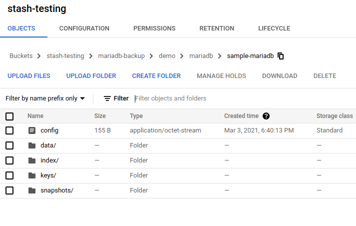
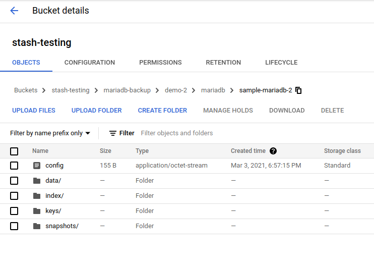
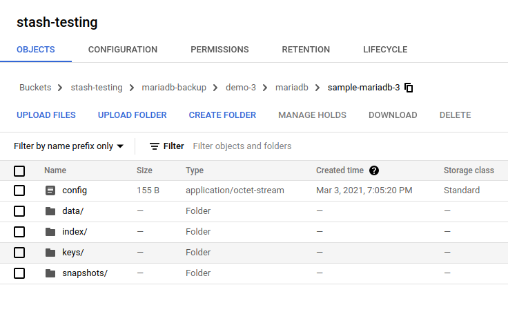

# Sauvegarder MariaDB à l'aide de la sauvegarde automatique Stash

Stash peut être configuré pour sauvegarder automatiquement n'importe quelle base de données MariaDB de votre cluster. Stash permet aux administrateurs de cluster de déployer des plans de sauvegarde à l'avance afin que les propriétaires de bases de données puissent facilement sauvegarder leur base de données avec seulement quelques annotations.

Dans ce didacticiel, nous allons montrer comment configurer un plan de sauvegarde pour les bases de données MariaDB dans votre cluster et les sauvegarder avec quelques annotations.

## Avant de commencer

* Dans un premier temps, vous devez disposer d'un cluster Kubernetes, et le `kubectl` L'outil de ligne de commande doit être configuré pour communiquer avec votre cluster.
* Installez Stash dans votre cluster en suivant les étapes [ici](https://stash.run/docs/latest/setup/install/stash/).
* Installez KubeDB dans votre cluster en suivant les étapes [ici](https://kubedb.com/docs/v2026.7.10/setup/README).
* Si vous n'êtes pas familier avec la façon dont Stash sauvegarde et restaure les bases de données MariaDB, veuillez consulter le guide suivant [ici](overview.md).
* Si vous n'êtes pas familier avec le fonctionnement de la sauvegarde automatique dans Stash, veuillez consulter le guide suivant [ici](https://stash.run/docs/latest/guides/auto-backup/overview/).
* Si vous n'êtes pas familier avec les options de sauvegarde automatique disponibles pour les bases de données dans Stash, veuillez consulter le guide suivant [ici](https://stash.run/docs/latest/guides/auto-backup/database/).

Vous devriez être familier avec ce qui suit `Stash` notions :

* [Plan de sauvegarde](https://stash.run/docs/latest/concepts/crds/backupblueprint/)
* [SauvegardeConfiguration](https://stash.run/docs/latest/concepts/crds/backupconfiguration/)
* [Session de sauvegarde](https://stash.run/docs/latest/concepts/crds/backupsession/)
* [Dépôt](https://stash.run/docs/latest/concepts/crds/repository/)
* [Fonction](https://stash.run/docs/latest/concepts/crds/function/)
* [Tâche](https://stash.run/docs/latest/concepts/crds/task/)

Dans ce tutoriel, nous allons montrer la sauvegarde de trois bases de données MariaDB différentes sur trois espaces de noms différents nommés `demo`, `demo-2`, et `demo-3`. Create the namespaces as below if you haven’t done it already.

```bash
❯ kubectl create ns demo
namespace/demo created

❯ kubectl create ns demo-2
namespace/demo-2 created

❯ kubectl create ns demo-3
namespace/demo-3 created
```

Lorsque vous installez Stash, il installe automatiquement tous les modules complémentaires de base de données officiels. Vérifiez qu'il a installé les modules complémentaires MariaDB à l'aide de la commande suivante.

```bash
❯ kubectl get tasks.stash.appscode.com | grep mariadb
mariadb-backup-11.8.5    62m
mariadb-restore-11.8.5   62m
```

## Préparer le plan de sauvegarde

Pour sauvegarder une base de données MariaDB à l'aide de Stash, vous devez créer un `` contenant les informations d'identification du backend, un `Repository` contenant les informations du backend, et un `BackupConfiguration` contenant le calendrier et les informations sur la cible. UN `BackupBlueprint` vous permet de spécifier un modèle pour le `Repository` et le `BackupConfiguration`.

Le `BackupBlueprint` est un CRD sans espace de noms. Ainsi, une fois que vous avez créé un `BackupBlueprint`, vous pouvez l'utiliser pour sauvegarder n'importe quelle base de données MariaDB de n'importe quel espace de noms simplement en créant le stockage `` dans cet espace de noms et en ajoutant quelques annotations à votre CRO MariaDB. Ensuite, Stash créera automatiquement un `Repository` et un `BackupConfiguration` selon le modèle pour sauvegarder la base de données.

Ci-dessous se trouve le `BackupBlueprint` objet que nous allons utiliser dans ce tutoriel,

```yaml
apiVersion: stash.appscode.com/v1beta1
kind: BackupBlueprint
metadata:
  name: mariadb-backup-template
spec:
  # ============== Blueprint for Repository ==========================
  backend:
    gcs:
      bucket: stash-testing
      prefix: mariadb-backup/${TARGET_NAMESPACE}/${TARGET_APP_RESOURCE}/${TARGET_NAME}
  # ============== Blueprint for BackupConfiguration =================
  schedule: "*/5 * * * *"
  retentionPolicy:
    name: 'keep-last-5'
    keepLast: 5
    prune: true
```

Ici, nous utilisons un bucket GCS comme backend. Nous fournissons `gcs-` à la `storageName` champ. Par conséquent, nous devons créer un nom `gcs-` avec les informations d'identification d'accès de notre compartiment dans chaque espace de noms où nous souhaitons activer la sauvegarde via ce plan.

Remarquez le `prefix` domaine de `backend` section. Nous avons utilisé quelques variables sous forme de `${VARIABLE_NAME}`. Stash résoudra automatiquement ces variables à partir des informations de la base de données pour rendre le préfixe backend unique pour chaque instance de base de données.

Créons le `BackupBlueprint` nous l'avons montré ci-dessus,

```bash
❯ kubectl apply -f https://github.com/kubedb/docs/raw/v2026.7.10/docs/guides/mariadb/backup/auto-backup/examples/backupblueprint.yaml
backupblueprint.stash.appscode.com/mariadb-backup-template created
```

Nous sommes maintenant prêts à sauvegarder nos bases de données MariaDB en utilisant quelques annotations. Vous pouvez vérifier les annotations de sauvegarde automatique disponibles pour une base de données à partir de [ici](https://stash.run/docs/latest/guides/auto-backup/database/#available-auto-backup-annotations-for-database).

## Sauvegarde automatique avec configurations par défaut

Dans cette section, nous allons sauvegarder une base de données MariaDB de `demo` espace de noms. Nous allons utiliser les configurations par défaut spécifiées dans le `BackupBlueprint`.

### Créer un stockage

Dans un premier temps, créons le `gcs-` dans `demo` espace de noms avec les informations d'identification d'accès à notre bucket GCS.

```bash
❯ echo -n 'changeit' > RESTIC_PASSWORD
❯ echo -n '<your-project-id>' > GOOGLE_PROJECT_ID
❯ cat downloaded-sa-key.json > GOOGLE_SERVICE_ACCOUNT_JSON_KEY
❯ kubectl create  generic -n demo gcs- \
    --from-file=./RESTIC_PASSWORD \
    --from-file=./GOOGLE_PROJECT_ID \
    --from-file=./GOOGLE_SERVICE_ACCOUNT_JSON_KEY
/gcs- created
```

### Créer une base de données

Maintenant, nous allons créer un CRO MariaDB dans `demo` espace de noms. Ci-dessous se trouve le YAML de l'objet MariaDB que nous allons créer,

```yaml
apiVersion: kubedb.com/v1
kind: MariaDB
metadata:
  name: sample-mariadb
  namespace: demo
  annotations:
    stash.appscode.com/backup-blueprint: mariadb-backup-template
spec:
  version: "12.1.2"
  replicas: 1
  storageType: Durable
  storage:
    storageClassName: "standard"
    accessModes:
    - ReadWriteOnce
    resources:
      requests:
        storage: 1Gi
  deletionPolicy: WipeOut
```

Remarquez le `annotations` section. Nous pointons du doigt le `BackupBlueprint` que nous avons créé plus tôt cependant `stash.appscode.com/backup-blueprint` annotation. Stash surveillera cette annotation et créera un `Repository` et un `BackupConfiguration` selon le `BackupBlueprint`.

Créons le MariaDB CRO ci-dessus,

```bash
❯ kubectl apply -f https://github.com/kubedb/docs/raw/v2026.7.10/docs/guides/mariadb/backup/auto-backup/examples/sample-mariadb.yaml
mariadb.kubedb.com/sample-mariadb created
```

### Vérifier la sauvegarde automatique configurée

Dans cette section, nous allons vérifier si Stash a créé le fichier respectif `Repository` et `BackupConfiguration` pour notre base de données MariaDB que nous venons de déployer ou non.

#### Vérifier le référentiel

Dans un premier temps, vérifions si Stash a créé un `Repository` pour notre MariaDB ou pas.

```bash
❯ kubectl get repository -n demo
NAME                 INTEGRITY   SIZE   SNAPSHOT-COUNT   LAST-SUCCESSFUL-BACKUP   AGE
app-sample-mariadb                                                                10s
```

Maintenant, vérifions le YAML du `Repository`.

```yaml
❯ kubectl get repository -n demo app-sample-mariadb -o yaml
apiVersion: stash.appscode.com/v1alpha1
kind: Repository
metadata:
...  
  name: app-sample-mariadb
  namespace: demo
spec:
  backend:
    gcs:
      bucket: stash-testing
      prefix: mariadb-backup/demo/mariadb/sample-mariadb
    storageName: gcs-
```

Ici, vous pouvez voir que Stash a résolu les variables dans `prefix` champ et les a remplacés par les informations équivalentes de cette base de données.

#### Vérifier la configuration de la sauvegarde

Si tout se passe bien, Stash devrait créer un `BackupConfiguration` pour notre MariaDB en `demo` espace de noms et la phase de celui-ci `BackupConfiguration` devrait être `Ready`. Vérifiez le `BackupConfiguration` crd par la commande suivante,

```bash
❯ kubectl get backupconfiguration -n demo
NAME                 TASK                    SCHEDULE      PAUSED   PHASE   AGE
app-sample-mariadb   mariadb-backup-11.8.5   */5 * * * *            Ready   7m28s
```

Maintenant, vérifions le YAML du `BackupConfiguration`.

```yaml
❯ kubectl get backupconfiguration -n demo app-sample-mariadb -o yaml
apiVersion: stash.appscode.com/v1beta1
kind: BackupConfiguration
metadata:
  name: app-sample-mariadb
  namespace: demo
  ...
  spec:
  driver: Restic
  repository:
    name: app-sample-mariadb
  retentionPolicy:
    keepLast: 5
    name: keep-last-5
    prune: true
  runtimeSettings: {}
  schedule: '*/5 * * * *'
  target:
    ref:
      apiVersion: appcatalog.appscode.com/v1alpha1
      kind: AppBinding
      name: sample-mariadb
  tempDir: {}
status:
  conditions:
  - lastTransitionTime: "2021-02-25T05:14:51Z"
    message: Repository demo/app-sample-mariadb exist.
    reason: RepositoryAvailable
    status: "True"
    type: RepositoryFound
  - lastTransitionTime: "2021-02-25T05:14:51Z"
    message: Backend  demo/gcs- exist.
    reason: BackendAvailable
    status: "True"
    type: BackendFound
  - lastTransitionTime: "2021-02-25T05:14:51Z"
    message: Backup target appcatalog.appscode.com/v1alpha1 appbinding/sample-mariadb
      found.
    reason: TargetAvailable
    status: "True"
    type: BackupTargetFound
  - lastTransitionTime: "2021-02-25T05:14:51Z"
    message: Successfully created backup triggering CronJob.
    reason: CronJobCreationSucceeded
    status: "True"
    type: CronJobCreated
  observedGeneration: 1
```

Remarquez le `target` section. Stash a automatiquement ajouté MariaDB comme cible de ce `BackupConfiguration`.

#### Vérifier la sauvegarde

Maintenant, attendons la fin d’une sauvegarde. Vous pouvez surveiller `BackupSession` comme ci-dessous,

```bash
❯ kubectl get backupsession -n demo -w
NAME                            INVOKER-TYPE          INVOKER-NAME         PHASE       AGE
app-sample-mariadb-1614230401   BackupConfiguration   app-sample-mariadb   Succeeded   5m40s
app-sample-mariadb-1614230701   BackupConfiguration   app-sample-mariadb   Running     39s
```

Une fois la sauvegarde terminée avec succès, vous devriez voir que les données sauvegardées ont été stockées dans le compartiment dans le répertoire pointé par le `prefix` domaine de la `Repository`.



Fig : Sauvegarder les données dans le compartiment GCS

## Sauvegarde automatique avec un calendrier personnalisé

Dans cette section, nous allons sauvegarder une base de données MariaDB de `demo-2` espace de noms. Cette fois, nous allons écraser le planning par défaut utilisé dans le `BackupBlueprint`.

### Créer un stockage

Dans un premier temps, créons le `gcs-` dans `demo-2` espace de noms avec les informations d'identification d'accès à notre bucket GCS.

```bash
❯ kubectl create  generic -n demo-2 gcs- \
    --from-file=./RESTIC_PASSWORD \
    --from-file=./GOOGLE_PROJECT_ID \
    --from-file=./GOOGLE_SERVICE_ACCOUNT_JSON_KEY
/gcs- created
```

### Créer une base de données

Maintenant, nous allons créer un CRO MariaDB dans `demo-2` espace de noms. Ci-dessous se trouve le YAML de l'objet MariaDB que nous allons créer,

```yaml
apiVersion: kubedb.com/v1
kind: MariaDB
metadata:
  name: sample-mariadb-2
  namespace: demo-2
  annotations:
    stash.appscode.com/backup-blueprint: mariadb-backup-template
    stash.appscode.com/schedule: "*/3 * * * *"
spec:
  version: "12.1.2"
  replicas: 1
  storageType: Durable
  storage:
    storageClassName: "standard"
    accessModes:
    - ReadWriteOnce
    resources:
      requests:
        storage: 1Gi
  deletionPolicy: WipeOut
```

Remarquez le `annotations` section. Cette fois, nous avons passé un planning via `stash.appscode.com/schedule` annotation avec le `stash.appscode.com/backup-blueprint` annotation.

Créons le MariaDB CRO ci-dessus,

```bash
❯ kubectl apply -f https://github.com/kubedb/docs/raw/v2026.7.10/docs/guides/mariadb/backup/auto-backup/examples/sample-mariadb-2.yaml
mariadb.kubedb.com/sample-mariadb-2 created
```

### Vérifier la sauvegarde automatique configurée

Vérifions maintenant si la sauvegarde automatique a été configurée correctement ou non.

#### Vérifier le référentiel

Dans un premier temps, vérifions si Stash a créé un `Repository` pour notre MariaDB ou pas.

```bash
❯ kubectl get repository -n demo-2
NAME                   INTEGRITY   SIZE   SNAPSHOT-COUNT   LAST-SUCCESSFUL-BACKUP   AGE
app-sample-mariadb-2                                                                4s
```

Maintenant, vérifions le YAML du `Repository`.

```yaml
❯ kubectl get repository -n demo-2 app-sample-mariadb-2  -o yaml
apiVersion: stash.appscode.com/v1alpha1
kind: Repository
metadata:
  name: app-sample-mariadb-2
  namespace: demo-2
  ...
spec:
  backend:
    gcs:
      bucket: stash-testing
      prefix: mariadb-backup/demo-2/mariadb/sample-mariadb-2
    storageName: gcs-
```

Ici, vous pouvez voir que Stash a résolu les variables dans `prefix` champ et les a remplacés par les informations équivalentes de cette nouvelle base de données.

#### Vérifier la configuration de la sauvegarde

Si tout se passe bien, Stash devrait créer un `BackupConfiguration` pour notre MariaDB en `demo-2` espace de noms et la phase de celui-ci `BackupConfiguration` devrait être `Ready`. Vérifiez le `BackupConfiguration` crd par la commande suivante,

```bash
❯ kubectl get backupconfiguration -n demo-2
NAME                   TASK                    SCHEDULE      PAUSED   PHASE   AGE
app-sample-mariadb-2   mariadb-backup-11.8.5   */3 * * * *            Ready   3m24s
```

Maintenant, vérifions le YAML du `BackupConfiguration`.

```yaml
❯ kubectl get backupconfiguration -n demo-2 app-sample-mariadb-2 -o yaml

apiVersion: stash.appscode.com/v1beta1
kind: BackupConfiguration
metadata:
  name: app-sample-mariadb-2
  namespace: demo-2
  ...
  ownerReferences:
  - apiVersion: appcatalog.appscode.com/v1alpha1
    blockOwnerDeletion: true
    controller: true
    kind: AppBinding
    name: sample-mariadb-2
    uid: 7cbdf140-5fd1-487a-b04f-1847def418e8
  resourceVersion: "56888"
  selfLink: /apis/stash.appscode.com/v1beta1/namespaces/demo-2/backupconfigurations/app-sample-mariadb-2
  uid: e85dd3db-fa41-48b8-b253-5731ee8cc956
spec:
  driver: Restic
  repository:
    name: app-sample-mariadb-2
  retentionPolicy:
    keepLast: 5
    name: keep-last-5
    prune: true
  runtimeSettings: {}
  schedule: '*/3 * * * *'
  target:
    ref:
      apiVersion: appcatalog.appscode.com/v1alpha1
      kind: AppBinding
      name: sample-mariadb-2
  tempDir: {}
status:
  conditions:
  - lastTransitionTime: "2021-02-25T06:10:14Z"
    message: Repository demo-2/app-sample-mariadb-2 exist.
    reason: RepositoryAvailable
    status: "True"
    type: RepositoryFound
  - lastTransitionTime: "2021-02-25T06:10:14Z"
    message: Backend  demo-2/gcs- exist.
    reason: BackendAvailable
    status: "True"
    type: BackendFound
  - lastTransitionTime: "2021-02-25T06:10:14Z"
    message: Backup target appcatalog.appscode.com/v1alpha1 appbinding/sample-mariadb-2
      found.
    reason: TargetAvailable
    status: "True"
    type: BackupTargetFound
  - lastTransitionTime: "2021-02-25T06:10:14Z"
    message: Successfully created backup triggering CronJob.
    reason: CronJobCreationSucceeded
    status: "True"
    type: CronJobCreated
  observedGeneration: 1
```

Remarquez le `schedule` section. Cette fois le `BackupConfiguration` a été créé avec le calendrier que nous avons fourni via annotation.

Notez également le `target` section. Stash a automatiquement ajouté la nouvelle MariaDB comme cible de ce `BackupConfiguration`.

#### Vérifier la sauvegarde

Maintenant, attendons la fin d’une sauvegarde. Vous pouvez surveiller `BackupSession` comme ci-dessous,

```bash
❯ kubectl get backupsession -n demo-2 -w
NAME                              INVOKER-TYPE          INVOKER-NAME           PHASE       AGE
app-sample-mariadb-2-1614233715   BackupConfiguration   app-sample-mariadb-2   Succeeded   3m2s
app-sample-mariadb-2-1614233880   BackupConfiguration   app-sample-mariadb-2   Running     17s
```

Une fois la sauvegarde terminée avec succès, vous devriez voir que Stash a créé un nouveau répertoire comme indiqué par le `prefix` domaine du nouveau `Repository` et y ont stocké les données sauvegardées.



Fig : Sauvegarder les données dans le compartiment GCS

## Sauvegarde automatique avec paramètres personnalisés

Dans cette section, nous allons sauvegarder une base de données MariaDB de `demo-3` espace de noms. Cette fois, nous allons transmettre certains paramètres de la tâche via les annotations.

### Créer un stockage

Dans un premier temps, créons le `gcs-` dans `demo-3` espace de noms avec les informations d'identification d'accès à notre bucket GCS.

```bash
❯ kubectl create  generic -n demo-3 gcs- \
    --from-file=./RESTIC_PASSWORD \
    --from-file=./GOOGLE_PROJECT_ID \
    --from-file=./GOOGLE_SERVICE_ACCOUNT_JSON_KEY
/gcs- created
```

### Créer une base de données

Maintenant, nous allons créer un CRO MariaDB dans `demo-3` espace de noms. Ci-dessous se trouve le YAML de l'objet MariaDB que nous allons créer,

```yaml
apiVersion: kubedb.com/v1
kind: MariaDB
metadata:
  name: sample-mariadb-3
  namespace: demo-3
  annotations:
    stash.appscode.com/backup-blueprint: mariadb-backup-template
    params.stash.appscode.com/args: --databases mysql
spec:
  version: "12.1.2"
  replicas: 1
  storageType: Durable
  storage:
    storageClassName: "standard"
    accessModes:
    - ReadWriteOnce
    resources:
      requests:
        storage: 1Gi
  deletionPolicy: WipeOut
```

Remarquez le `annotations` section. Cette fois, nous avons passé un argument via `params.stash.appscode.com/args` annotation avec le `stash.appscode.com/backup-blueprint` annotation.

Créons le MariaDB CRO ci-dessus,

```bash
❯ kubectl apply -f https://github.com/kubedb/docs/raw/v2026.7.10/docs/guides/mariadb/backup/auto-backup/examples/sample-mariadb-3.yaml
mariadb.kubedb.com/sample-mariadb-3 created
```

### Vérifier la sauvegarde automatique configurée

Vérifions maintenant si les ressources de sauvegarde automatique ont été créées ou non.

#### Vérifier le référentiel

Dans un premier temps, vérifions si Stash a créé un `Repository` pour notre MariaDB ou pas.

```bash
❯ kubectl get repository -n demo-3
NAME                   INTEGRITY   SIZE   SNAPSHOT-COUNT   LAST-SUCCESSFUL-BACKUP   AGE
app-sample-mariadb-3                                                                8s
```

Maintenant, vérifions le YAML du `Repository`.

```yaml
❯ kubectl get repository -n demo-3 app-sample-mariadb-3 -o yaml
apiVersion: stash.appscode.com/v1alpha1
kind: Repository
metadata:
  name: app-sample-mariadb-3
  namespace: demo-3
  ...
spec:
  backend:
    gcs:
      bucket: stash-testing
      prefix: mariadb-backup/demo-3/mariadb/sample-mariadb-3
    storageName: gcs-
```

Ici, vous pouvez voir que Stash a résolu les variables dans `prefix` champ et les a remplacés par les informations équivalentes de cette nouvelle base de données.

#### Vérifier la configuration de la sauvegarde

Si tout se passe bien, Stash devrait créer un `BackupConfiguration` pour notre MariaDB en `demo-3` espace de noms et la phase de celui-ci `BackupConfiguration` devrait être `Ready`. Vérifiez le `BackupConfiguration` crd par la commande suivante,

```bash
❯ kubectl get backupconfiguration -n demo-3
NAME                   TASK                    SCHEDULE      PAUSED   PHASE   AGE
app-sample-mariadb-3   mariadb-backup-11.8.5   */5 * * * *            Ready   106s
```

Maintenant, vérifions le YAML du `BackupConfiguration`.

```yaml
❯ kubectl get backupconfiguration -n demo-3 app-sample-mariadb-3 -o yaml
apiVersion: stash.appscode.com/v1beta1
kind: BackupConfiguration
metadata:
  name: app-sample-mariadb-3
  namespace: demo-3
  ...
spec:
  driver: Restic
  repository:
    name: app-sample-mariadb-3
  retentionPolicy:
    keepLast: 5
    name: keep-last-5
    prune: true
  runtimeSettings: {}
  schedule: '*/5 * * * *'
  target:
    ref:
      apiVersion: appcatalog.appscode.com/v1alpha1
      kind: AppBinding
      name: sample-mariadb-3
  task:
    params:
    - name: args
      value: --databases mysql
  tempDir: {}
status:
  conditions:
  - lastTransitionTime: "2021-02-25T11:58:12Z"
    message: Repository demo-3/app-sample-mariadb-3 exist.
    reason: RepositoryAvailable
    status: "True"
    type: RepositoryFound
  - lastTransitionTime: "2021-02-25T11:58:12Z"
    message: Backend  demo-3/gcs- exist.
    reason: BackendAvailable
    status: "True"
    type: BackendFound
  - lastTransitionTime: "2021-02-25T11:58:12Z"
    message: Backup target appcatalog.appscode.com/v1alpha1 appbinding/sample-mariadb-3
      found.
    reason: TargetAvailable
    status: "True"
    type: BackupTargetFound
  - lastTransitionTime: "2021-02-25T11:58:12Z"
    message: Successfully created backup triggering CronJob.
    reason: CronJobCreationSucceeded
    status: "True"
    type: CronJobCreated
  observedGeneration: 1
```

Remarquez le `task` section. Le `args` Le paramètre que nous avions passé via les annotations a été ajouté au `params` section.

Notez également le `target` section. Stash a automatiquement ajouté la nouvelle MariaDB comme cible de ce `BackupConfiguration`.

#### Vérifier la sauvegarde

Maintenant, attendons la fin d’une sauvegarde. Vous pouvez surveiller `BackupSession` comme ci-dessous,

```bash
❯ kubectl get backupsession -n demo-3 -w
NAME                              INVOKER-TYPE          INVOKER-NAME           PHASE       AGE
app-sample-mariadb-3-1614254408   BackupConfiguration   app-sample-mariadb-3   Succeeded   5m23s
app-sample-mariadb-3-1614254708   BackupConfiguration   app-sample-mariadb-3   Running     23s
```

Une fois la sauvegarde terminée avec succès, vous devriez voir que Stash a créé un nouveau répertoire comme indiqué par le `prefix` domaine du nouveau `Repository` et y ont stocké les données sauvegardées.



Fig : Sauvegarder les données dans le compartiment GCS

## Nettoyage

Pour nettoyer les ressources créées par ce didacticiel, exécutez les commandes suivantes :

```bash
❯ kubectl delete -f https://github.com/kubedb/docs/raw/v2026.7.10/docs/guides/mariadb/backup/auto-backup/examples/
backupblueprint.stash.appscode.com "mariadb-backup-template" deleted
mariadb.kubedb.com "sample-mariadb-2" deleted
mariadb.kubedb.com "sample-mariadb-3" deleted
mariadb.kubedb.com "sample-mariadb" deleted

❯ kubectl delete repository -n demo --all
repository.stash.appscode.com "app-sample-mariadb" deleted
❯ kubectl delete repository -n demo-2 --all
repository.stash.appscode.com "app-sample-mariadb-2" deleted
❯ kubectl delete repository -n demo-3 --all
repository.stash.appscode.com "app-sample-mariadb-3" deleted
```