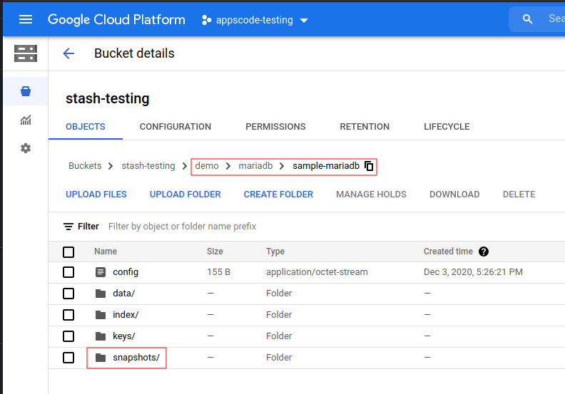

# Sauvegarder une instance MariaDB autonome gérée par KubeDB avec Stash

Planque `v0.11.8+` prend en charge la sauvegarde et la restauration des bases de données MariaDB. Ce guide vous montrera comment effectuer une sauvegarde logique de vos bases de données MariaDB et les restaurer à l'aide de Stash.

## Avant de commencer

* Dans un premier temps, vous devez disposer d'un cluster Kubernetes, et le `kubectl` L'outil de ligne de commande doit être configuré pour communiquer avec votre cluster.
* Installez l'opérateur KubeDB dans votre cluster à partir de [ici](https://kubedb.com/docs/latest/setup).
* Installez Stash dans votre cluster en suivant les étapes [ici](https://stash.run/docs/latest/setup/install/stash/).
* Installer la cachette `kubectl` plugin en suivant les étapes [ici](https://stash.run/docs/latest/setup/install/kubectl-plugin/).
* Si vous n'êtes pas familier avec la façon dont Stash sauvegarde et restaure les bases de données MariaDB, veuillez consulter le guide suivant [ici](../overview.md).

Vous devez être familier avec les ressources personnalisées suivantes :

* [Liaison d'application](https://kubedb.com/docs/v2026.7.10/guides/elasticsearch/concepts/appbinding/)
* [Fonction](https://stash.run/docs/latest/concepts/crds/function/)
* [Tâche](https://stash.run/docs/latest/concepts/crds/task/)
* [BackupConfiguration](https://stash.run/docs/latest/concepts/crds/backupconfiguration/)
* [Session de sauvegarde](https://stash.run/docs/latest/concepts/crds/backupsession/)
* [Restaurer la session](https://stash.run/docs/latest/concepts/crds/restoresession/)

Pour garder les choses isolées, nous allons utiliser un espace de noms distinct appelé `demo` tout au long de ce tutoriel. Créer `demo` espace de noms si vous ne l’avez pas encore créé.

```bash
$ kubectl create ns demo
namespace/demo created
```

## Préparer MariaDB

Dans cette section, nous allons déployer une base de données MariaDB à l'aide de KubeDB. Ensuite, nous allons y insérer quelques exemples de données.

### Déployer MariaDB à l'aide de KubeDB

Dans un premier temps, déployons une base de données autonome MariaDB nommée `sample-mariadb using` [KubeDB](https://kubedb.com/).

```yaml
apiVersion: kubedb.com/v1
kind: MariaDB
metadata:
  name: sample-mariadb
  namespace: demo
spec:
  version: "12.1.2"
  replicas: 1
  storageType: Durable
  storage:
    storageClassName: "standard"
    accessModes:
    - ReadWriteOnce
    resources:
      requests:
        storage: 1Gi
  deletionPolicy: WipeOut
```

```bash
$ kubectl apply -f https://github.com/logical/docs/raw/v2026.7.10/docs/guides/mariadb/backup/logical/standalone/examples/sample-mariadb.yaml
mariadb.kubedb.com/sample-mariadb created
```

Cet objet MariaDB créera le PetSet, Secret, Service etc. nécessaire pour la base de données. Vous pouvez facilement visualiser toutes les ressources créées par l'objet MariaDB en utilisant [ketall](https://github.com/corneliusweig/ketall) `kubectl` plugin comme ci-dessous,

```bash
$ kubectl get-all -n demo -l app.kubernetes.io/instance=sample-mariadb
NAME                                                  NAMESPACE  AGE
endpoints/sample-mariadb                              demo       28m  
endpoints/sample-mariadb-pods                         demo       28m  
persistentvolumeclaim/data-sample-mariadb-0           demo       28m  
pod/sample-mariadb-0                                  demo       28m  
secret/sample-mariadb-auth                            demo       28m  
serviceaccount/sample-mariadb                         demo       28m  
service/sample-mariadb                                demo       28m  
service/sample-mariadb-pods                           demo       28m  
appbinding.appcatalog.appscode.com/sample-mariadb     demo       28m  
controllerrevision.apps/sample-mariadb-7b7f58b68f     demo       28m  
petset.apps/sample-mariadb                       demo       28m  
poddisruptionbudget.policy/sample-mariadb             demo       28m  
rolebinding.rbac.authorization.k8s.io/sample-mariadb  demo       28m  
role.rbac.authorization.k8s.io/sample-mariadb         demo       28m
```

Maintenant, attendez le pod de la base de données `sample-mariadb-0` entrer dans `Running` État,

```bash
$ kubectl get pod -n demo sample-mariadb-0
NAME               READY   STATUS    RESTARTS   AGE
sample-mariadb-0   1/1     Running   0          29m
```

Une fois le pod de base de données installé `Running` état, vérifiez que la base de données est prête à accepter les connexions.

```bash
$ kubectl logs -n demo sample-mariadb-0
2021-02-22  9:41:37 0 [Note] Reading of all Master_info entries succeeded
2021-02-22  9:41:37 0 [Note] Added new Master_info '' to hash table
2021-02-22  9:41:37 0 [Note] mysqld: ready for connections.
Version: '11.8.5-MariaDB-1:11.8.5+maria~focal'  socket: '/run/mysqld/mysqld.sock'  port: 3306  mariadb.org binary distribution
```

À partir du journal ci-dessus, nous pouvons voir que la base de données est prête à accepter les connexions.

### Insérer des exemples de données

Maintenant, nous allons exécuter dans le pod de base de données et créer des exemples de données. Le `sample-mariadb` l'objet crée un secret contenant les informations d'identification de MariaDB et les définit comme variables d'environnement du pod `MYSQL_ROOT_USERNAME` et `MYSQL_ROOT_PASSWORD`.

Ici, nous allons utiliser l'utilisateur root (`MYSQL_ROOT_USERNAME`) informations d'identification `MYSQL_ROOT_PASSWORD` pour insérer les exemples de données. Maintenant, exécutons dans le pod de base de données et insérons quelques exemples de données,

```bash
$ kubectl exec -it -n demo sample-mariadb-0 -- bash
```

```mysql
root@sample-mariadb-0:/ mariadb -u${MYSQL_ROOT_USERNAME} -p${MYSQL_ROOT_PASSWORD}
Welcome to the MariaDB monitor.  Commands end with ; or \g.
Your MariaDB connection id is 341
Server version: 11.8.5-MariaDB-1:11.8.5+maria~focal mariadb.org binary distribution

Copyright (c) 2000, 2018, Oracle, MariaDB Corporation Ab and others.

Type 'help;' or '\h' for help. Type '\c' to clear the current input statement.

# Let's create a database named "company"
MariaDB [(none)]>  create database company;
Query OK, 1 row affected (0.000 sec)

# Verify that the database has been created successfully
MariaDB [(none)]> show databases;
+--------------------+
| Database           |
+--------------------+
| company            |
| information_schema |
| mysql              |
| performance_schema |
+--------------------+
4 rows in set (0.001 sec)

# Now, let's create a table called "employee" in the "company" table
MariaDB [(none)]> create table company.employees ( name varchar(50), salary int);
Query OK, 0 rows affected (0.018 sec)

# Verify that the table has been created successfully
MariaDB [(none)]> show tables in company;
+-------------------+
| Tables_in_company |
+-------------------+
| employees         |
+-------------------+
1 row in set (0.007 sec)

# Now, let's insert a sample row in the table
MariaDB [(none)]> insert into company.employees values ('John Doe', 5000);
Query OK, 1 row affected (0.003 sec)

# Insert another sample row
MariaDB [(none)]> insert into company.employees values ('James William', 7000);
Query OK, 1 row affected (0.002 sec)

# Verify that the rows have been inserted into the table successfully
MariaDB [(none)]>  select * from company.employees;
+---------------+--------+
| name          | salary |
+---------------+--------+
| John Doe      |   5000 |
| James William |   7000 |
+---------------+--------+
2 rows in set (0.001 sec)

MariaDB [(none)]> exit
Bye
```

Nous avons déployé avec succès une base de données MariaDB et y avons inséré quelques exemples de données. Dans les sections suivantes, nous allons sauvegarder ces données à l'aide de Stash.

## Préparer la sauvegarde

Dans cette section, nous allons préparer les ressources nécessaires (c'est-à-dire les informations de connexion à la base de données, les informations backend, etc.) avant la sauvegarde.

### Vérifier que le module complémentaire Stash MariaDB est installé

Lorsque vous installez Stash, il installe automatiquement tous les modules complémentaires de base de données officiels. Vérifiez qu'il a installé les modules complémentaires MariaDB à l'aide de la commande suivante.

```bash
$ kubectl get tasks.stash.appscode.com | grep mariadb
mariadb-backup-10.6.23    35s
mariadb-backup-10.6.23   35s
```

### Assurer la liaison d'application

Stash doit savoir comment se connecter à la base de données. Un `AppBinding` fournit exactement cette information. Il contient les informations de service et secrètes de la base de données. Vous devez indiquer le respectif `AppBinding` comme cible de sauvegarde au lieu de la base de données elle-même.

Stash s'attend à ce que le secret de votre base de données ait `username` et `password` clés. Si le secret de votre base de données ne les contient pas, le `AppBinding` peut également aider ici. Vous pouvez spécifier un `secretTransforms` section avec le mappage entre les touches actuelles et les touches souhaitées.

Vous n'avez pas à vous soucier des liaisons d'application si vous utilisez KubeDB. Il crée une liaison d'application contenant les informations nécessaires lorsque vous déployez la base de données. Assurons-nous que la liaison d'application est créée par `KubeDB` opérateur.

```bash
$ kubectl get appbinding -n demo 
NAME             TYPE                 VERSION   AGE
sample-mariadb   kubedb.com/mariadb   11.8.5      62m
```

Nous avons une liaison d'application nommée de la même manière que le nom de la base de données `sample-mariadb`. Nous l'utiliserons plus tard pour nous connecter à cette base de données.

### Préparer le back-end

Nous allons stocker nos données sauvegardées dans un bucket GCS. Nous devons donc créer un secret avec les informations d'identification GCS et un `Repository` objet avec les informations du compartiment. Si vous souhaitez utiliser un autre backend, veuillez lire le document de configuration du backend correspondant à partir de [ici](https://stash.run/docs/latest/guides/backends/overview/).

**Créer un secret de stockage :**

Dans un premier temps, créons un secret appelé `gcs-secret` avec les informations d'identification d'accès à notre compartiment GCS souhaité,

```bash
$ echo -n 'changeit' > RESTIC_PASSWORD
$ echo -n '<your-project-id>' > GOOGLE_PROJECT_ID
$ cat downloaded-sa-key.json > GOOGLE_SERVICE_ACCOUNT_JSON_KEY
$ kubectl create secret generic -n demo gcs-secret \
    --from-file=./RESTIC_PASSWORD \
    --from-file=./GOOGLE_PROJECT_ID \
    --from-file=./GOOGLE_SERVICE_ACCOUNT_JSON_KEY
secret/gcs-secret created
```

**Créer un référentiel :**

Maintenant, en Crète `Repository` objet avec les informations du compartiment souhaité. Ci-dessous se trouve le YAML de `Repository` objet que nous allons créer,

```yaml
apiVersion: stash.appscode.com/v1alpha1
kind: Repository
metadata:
  name: gcs-repo
  namespace: demo
spec:
  backend:
    gcs:
      bucket: stash-testing
      prefix: /demo/mariadb/sample-mariadb
    storageSecretName: gcs-secret
```

Créons le `Repository` nous l'avons montré ci-dessus,

```bash
$ kubectl apply -f https://github.com/logical/docs/raw/v2026.7.10/docs/guides/mariadb/backup/logical/standalone/examples/repository.yaml
repository.stash.appscode.com/gcs-repo created
```

Nous sommes maintenant prêts à sauvegarder notre base de données dans le backend souhaité.

### Sauvegarde

Pour planifier une sauvegarde, nous devons créer un `BackupConfiguration` objet ciblant le respectif `AppBinding` de notre base de données souhaitée. Ensuite, Stash créera un CronJob pour sauvegarder périodiquement la base de données.

#### Créer une configuration de sauvegarde

Vous trouverez ci-dessous le YAML pour `BackupConfiguration` objet que nous allons utiliser pour sauvegarder le `sample-mariadb` base de données que nous avons déployée plus tôt,

```yaml
apiVersion: stash.appscode.com/v1beta1
kind: BackupConfiguration
metadata:
  name: sample-mariadb-backup
  namespace: demo
spec:
  schedule: "*/5 * * * *"
  repository:
    name: gcs-repo
  target:
    ref:
      apiVersion: appcatalog.appscode.com/v1alpha1
      kind: AppBinding
      name: sample-mariadb
  retentionPolicy:
    name: keep-last-5
    keepLast: 5
    prune: true
```

Ici,

* `.spec.schedule` spécifie que nous souhaitons sauvegarder la base de données à intervalles de 5 minutes.
* `.spec.target.ref` fait référence à l'objet AppBinding qui contient les informations de connexion de notre base de données ciblée.

Créons le `BackupConfiguration` objet que nous avons montré ci-dessus,

```bash
$ kubectl apply -f https://github.com/logical/docs/raw/v2026.7.10/docs/guides/mariadb/backup/logical/standalone/examples/backupconfiguration.yaml
backupconfiguration.stash.appscode.com/sample-mariadb-backup created
```

#### Vérifier la configuration de la sauvegarde avec succès

Si tout se passe bien, la phase du `BackupConfiguration` devrait être `Ready`. Le `Ready` La phase indique que la configuration de la sauvegarde a réussi. Vérifions le `Phase` de la Configuration de Sauvegarde,

```bash
$ kubectl get backupconfiguration -n demo
NAME                    TASK                    SCHEDULE      PAUSED   PHASE      AGE
sample-mariadb-backup   mariadb-backup-10.6.23   */5 * * * *            Ready      11s
```

#### Vérifier CronJob

Stash créera un CronJob avec le calendrier spécifié dans `spec.schedule` domaine de `BackupConfiguration` objet.

Vérifiez que le CronJob a été créé à l'aide de la commande suivante,

```bash
$ kubectl get cronjob -n demo
NAME                                 SCHEDULE      SUSPEND   ACTIVE   LAST SCHEDULE   AGE
stash-backup-sample-mariadb-backup   */5 * * * *   False     0        15s             17s
```

#### Attendez la session de sauvegarde

Le `sample-mariadb-backup` CronJob déclenchera une sauvegarde sur chaque slot planifié en créant un `BackupSession` objet.

Maintenant, attendez qu'un calendrier apparaisse. Exécutez la commande suivante pour rechercher un `BackupSession` objet,

```bash
$ kubectl get backupsession -n demo -w
NAME                               INVOKER-TYPE          INVOKER-NAME            PHASE     AGE
sample-mariadb-backup-1606994706   BackupConfiguration   sample-mariadb-backup   Running   24s
sample-mariadb-backup-1606994706   BackupConfiguration   sample-mariadb-backup   Running   75s
sample-mariadb-backup-1606994706   BackupConfiguration   sample-mariadb-backup   Succeeded   103s
```

Ici, la phase `Succeeded` signifie que le processus de sauvegarde s'est terminé avec succès.

#### Vérifier la sauvegarde

Maintenant, nous allons vérifier si les données sauvegardées sont présentes ou non dans le backend. Une fois la sauvegarde terminée, Stash mettra à jour les fichiers respectifs `Repository` objet pour refléter l’achèvement de la sauvegarde. Vérifiez que le référentiel `gcs-repo` a été mis à jour par la commande suivante,

```bash
$ kubectl get repository -n demo gcs-repo
NAME       INTEGRITY   SIZE        SNAPSHOT-COUNT   LAST-SUCCESSFUL-BACKUP   AGE
gcs-repo   true        1.327 MiB   1                60s                      8m
```

Maintenant, si nous naviguons vers le compartiment GCS, nous verrons que les données sauvegardées ont été stockées dans `demo/mariadb/sample-mariadb` répertoire tel que spécifié par `.spec.backend.gcs.prefix` domaine de la `Repository` objet.



Fig : Sauvegarder les données dans le compartiment GCS

> Remarque : Stash conserve toutes les données sauvegardées cryptées. Ainsi, les données du backend n’auront aucun sens tant qu’elles ne seront pas déchiffrées.

## Restaurer MariaDB

Si vous avez correctement suivi les sections précédentes, vous devriez avoir une sauvegarde logique réussie de votre base de données MariaDB. Nous allons maintenant montrer comment restaurer la base de données à partir des données sauvegardées.

### Restaurer dans la même base de données

Vous pouvez restaurer vos données dans la même base de données que celle à partir de laquelle vous avez sauvegardé ou dans une autre base de données du même cluster ou d'un cluster différent. Dans cette section, nous allons vous montrer comment restaurer dans la même base de données ce qui peut être nécessaire lorsque vous avez accidentellement supprimé des données de la base de données en cours d'exécution.

#### Suspendre temporairement la sauvegarde

Dans un premier temps, arrêtons d’effectuer toute sauvegarde supplémentaire de la base de données afin qu’aucune sauvegarde ne soit exécutée après la suppression des exemples de données. Nous allons mettre en pause le `BackupConfiguration` objet. Stash cessera d'effectuer toute sauvegarde supplémentaire lorsque le `BackupConfiguration` est en pause.

Faisons une pause `sample-mariadb-backup` Configuration de sauvegarde,

```bash
$ kubectl patch backupconfiguration -n demo sample-mariadb-backup--type="merge" --patch='{"spec": {"paused": true}}'
backupconfiguration.stash.appscode.com/sample-mgo-rs-backup patched
```

Ou vous pouvez utiliser le Stash `kubectl` plugin pour mettre en pause le `BackupConfiguration`,

```bash
$ kubectl stash pause backup -n demo --backupconfig=sample-mariadb-backup
BackupConfiguration demo/sample-mariadb-backup has been paused successfully.
```

Vérifiez que le `BackupConfiguration` a été mis en pause,

```bash
$ kubectl get backupconfiguration -n demo sample-mariadb-backup
NAME                   TASK                    SCHEDULE      PAUSED   PHASE   AGE
sample-mariadb-backup  mariadb-backup-10.6.23   */5 * * * *   true     Ready   26m
```

Remarquez le `PAUSED` colonne. Valeur `true` pour ce champ signifie que le `BackupConfiguration` a été mis en pause.

Stash suspendra également le CronJob concerné.

```bash
$ kubectl get cronjob -n demo
NAME                                 SCHEDULE      SUSPEND   ACTIVE   LAST SCHEDULE   AGE
stash-backup-sample-mariadb-backup   */5 * * * *   True      0        2m59s           20m
```

#### Simuler une catastrophe

Maintenant, simulons un scénario de suppression accidentelle. Ici, nous allons exécuter dans le pod de base de données et supprimer le `company` base de données que nous avions créée précédemment.

```bash
$ kubectl exec -it -n demo sample-mariadb-0 -c mariadb -- bash
```

```mysql
root@sample-mariadb-0:/ mariadb -u${MYSQL_ROOT_USERNAME} -p${MYSQL_ROOT_PASSWORD}
Welcome to the MariaDB monitor.  Commands end with ; or \g.
Your MariaDB connection id is 341
Server version: 11.8.5-MariaDB-1:11.8.5+maria~focal mariadb.org binary distribution

Copyright (c) 2000, 2018, Oracle, MariaDB Corporation Ab and others.

Type 'help;' or '\h' for help. Type '\c' to clear the current input statement.

# View current databases
MariaDB [(none)]> show databases;
+--------------------+
| Database           |
+--------------------+
| company            |
| information_schema |
| mysql              |
| performance_schema |
+--------------------+
4 rows in set (0.001 sec)

# Let's delete the "company" database
MariaDB [(none)]> drop database company;
Query OK, 1 row affected (0.268 sec)

# Verify that the "company" database has been deleted
MariaDB [(none)]> show databases;
+--------------------+
| Database           |
+--------------------+
| information_schema |
| mysql              |
| performance_schema |
+--------------------+
3 rows in set (0.000 sec)

MariaDB [(none)]> exit
Bye
```

#### Créer une session de restauration

Pour restaurer la base de données, vous devez créer un `RestoreSession` objet pointant vers le `AppBinding` de la base de données ciblée.

Voici le YAML du `RestoreSession` objet que nous allons utiliser pour restaurer notre `sample-mariadb` base de données.

```yaml
apiVersion: stash.appscode.com/v1beta1
kind: RestoreSession
metadata:
  name: sample-mariadb-restore
  namespace: demo
spec:
  task:
    name: mariadb-backup-10.6.23
  repository:
    name: gcs-repo
  target:
    ref:
      apiVersion: appcatalog.appscode.com/v1alpha1
      kind: AppBinding
      name: sample-mariadb
  rules:
  - snapshots: [latest]
```

Ici,

* `.spec.task.name` spécifie le nom de l'objet Task qui spécifie les fonctions nécessaires et leur ordre d'exécution pour restaurer une base de données MariaDB.
* `.spec.repository.name` spécifie l'objet Repository qui contient les informations backend dans lesquelles nos données sauvegardées ont été stockées.
* `.spec.target.ref` fait référence à l'AppBinding respectif du `sample-mariadb` base de données.
* `.spec.rules` spécifie que nous restaurons les données à partir du dernier instantané de sauvegarde de la base de données.

Créons le `RestoreSession` objet objet que nous avons montré ci-dessus,

```bash
$ kubectl apply -f https://github.com/logical/docs/raw/v2026.7.10/docs/guides/mariadb/backup/logical/standalone/examples/restoresession.yaml
restoresession.stash.appscode.com/sample-mariadb-restore created
```

Une fois que vous avez créé le `RestoreSession` objet, Stash créera une tâche de restauration. Exécutez la commande suivante pour regarder la phase du `RestoreSession` objet,

```bash
$ kubectl get restoresession -n demo -w
NAME                     REPOSITORY   PHASE     AGE
sample-mariadb-restore   gcs-repo     Running   15s
sample-mariadb-restore   gcs-repo     Succeeded   18s
```

Le `Succeeded` Cette phase signifie que le processus de restauration s'est terminé avec succès.

#### Vérifier les données restaurées

Maintenant, exécutons le pod de base de données et vérifions si les données réelles ont été restaurées ou non,

```bash
$ kubectl exec -it -n demo sample-mariadb-0 -c mariadb -- bash
```

```mysql
root@sample-mariadb-0:/ mariadb -u${MYSQL_ROOT_USERNAME} -p${MYSQL_ROOT_PASSWORD}
Welcome to the MariaDB monitor.  Commands end with ; or \g.
Your MariaDB connection id is 341
Server version: 11.8.5-MariaDB-1:11.8.5+maria~focal mariadb.org binary distribution

Copyright (c) 2000, 2018, Oracle, MariaDB Corporation Ab and others.

Type 'help;' or '\h' for help. Type '\c' to clear the current input statement.

# Verify that the "company" database has been restored
MariaDB [(none)]> show databases;
+--------------------+
| Database           |
+--------------------+
| company            |
| information_schema |
| mysql              |
| performance_schema |
+--------------------+
4 rows in set (0.001 sec)

# Verify that the tables of the "company" database have been restored
MariaDB [(none)]> show tables from company;
+-------------------+
| Tables_in_company |
+-------------------+
| employees         |
+-------------------+
1 row in set (0.000 sec)

# Verify that the sample data of the "employees" table has been restored
MariaDB [(none)]> select * from company.employees;
+---------------+--------+
| name          | salary |
+---------------+--------+
| John Doe      |   5000 |
| James William |   7000 |
+---------------+--------+
2 rows in set (0.000 sec)

MariaDB [(none)]> exit
Bye
```

Par conséquent, nous pouvons voir à partir du résultat ci-dessus que les données supprimées ont été restaurées avec succès à partir de la sauvegarde.

#### Reprendre la sauvegarde

Puisque nos données ont été restaurées avec succès, nous pouvons désormais reprendre notre processus de sauvegarde habituel. Reprendre le `BackupConfiguration` en utilisant la commande suivante,

```bash
$ kubectl patch backupconfiguration -n demo sample-mariadb-backup --type="merge" --patch='{"spec": {"paused": false}}'
backupconfiguration.stash.appscode.com/sample-mariadb-backup patched
```

Ou vous pouvez utiliser le Stash `kubectl` plugin pour reprendre le `BackupConfiguration`,

```bash
$ kubectl stash resume -n demo --backupconfig=sample-mariadb-backup
BackupConfiguration demo/sample-mariadb-backup has been resumed successfully.
```

Vérifiez que le `BackupConfiguration` a été repris,

```bash
$ kubectl get backupconfiguration -n demo sample-mariadb-backup
NAME                    TASK                    SCHEDULE      PAUSED   PHASE   AGE
sample-mariadb-backup   mariadb-backup-10.6.23   */5 * * * *   false    Ready   29m
```

Ici, `false` dans le `PAUSED` La colonne signifie que la sauvegarde a été reprise avec succès. Le CronJob devrait également être repris maintenant.

```bash
$ kubectl get cronjob -n demo
NAME                                 SCHEDULE      SUSPEND   ACTIVE   LAST SCHEDULE   AGE
stash-backup-sample-mariadb-backup   */5 * * * *   False     0        2m59s           29m
```

Ici, `False` dans le `SUSPEND` La colonne signifie que le CronJob n'est plus suspendu et se déclenchera lors de la prochaine planification.

### Restaurer dans une base de données différente du même espace de noms

Si vous souhaitez restaurer les données sauvegardées dans une autre base de données du même espace de noms, vous devez utiliser le `AppBinding` de la base de données souhaitée. Ensuite, vous devez créer le `RestoreSession` pointant vers le nouveau `AppBinding`.

### Restaurer dans un espace de noms différent

Si vous souhaitez restaurer dans un espace de noms différent du même cluster, vous devez créer le référentiel, backend Secret dans l'espace de noms souhaité. Vous pouvez utiliser [Plugin Kubectl de cache](https://stash.run/docs/latest/guides/cli/kubectl-plugin/) pour copier facilement les ressources dans un nouvel espace de noms. Ensuite, vous devez créer le `RestoreSession` objet dans l'espace de noms souhaité pointant vers le référentiel, AppBinding de cet espace de noms.

### Restaurer dans un cluster différent

Si vous souhaitez restaurer dans un autre cluster, vous devez installer Stash dans le cluster souhaité. Ensuite, vous devez également installer le module complémentaire Stash MariaDB dans ce cluster. Ensuite, vous devez créer le référentiel, backend Secret, AppBinding, dans le cluster souhaité. Enfin, vous devez créer le `RestoreSession` objet dans le cluster souhaité pointant vers le référentiel, AppBinding de ce cluster.

## Nettoyage

Pour nettoyer les ressources Kubernetes créées par ce tutoriel, exécutez :

```bash
kubectl delete -n demo backupconfiguration sample-mariadb-backup
kubectl delete -n demo restoresession sample-mariadb-restore
kubectl delete -n demo repository gcs-repo
# delete the database resources
kubectl delete ns demo
```