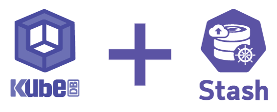
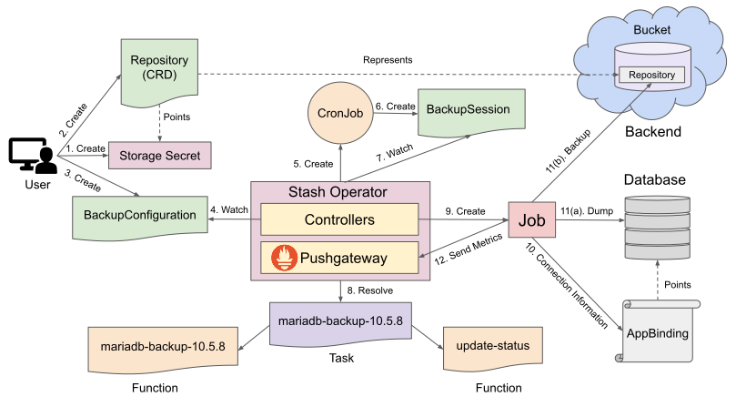
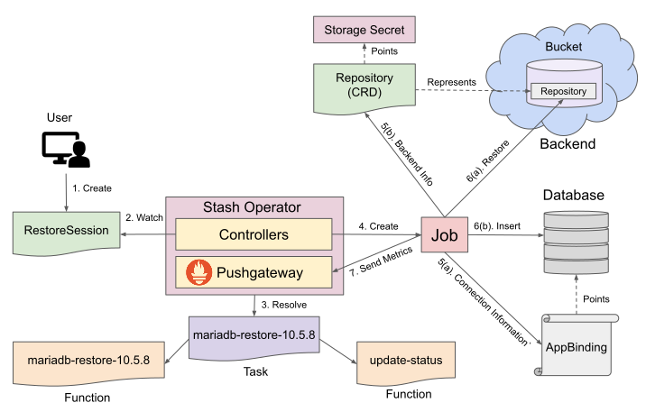

> Vous êtes nouveau sur KubeDB ? Veuillez commencer [ici](https://kubedb.com/docs/v2026.7.10/README).

Veuillez installer [Planque](https://stash.run/docs/latest/setup/install/stash/) pour essayer cette fonctionnalité. La sauvegarde de la base de données avec Stash est déjà incluse dans la licence KubeDB. Vous n’avez donc pas besoin d’une licence distincte pour Stash.

# Présentation de la sauvegarde et de la restauration MariaDB

KubeDB utilise [Planque](https://stash.run) pour sauvegarder et restaurer des bases de données. Stash by AppsCode est une solution cloud native de sauvegarde et de récupération de données pour les charges de travail Kubernetes. Stash utilise [restique](https://github.com/restic/restic) pour sauvegarder en toute sécurité des applications avec état sur n'importe quel backend de stockage cloud ou sur site (par exemple, S3, GCS, stockage Azure Blob, Minio, NetApp, Dell EMC, etc.).

  

Fig : Sauvegarder les bases de données KubeDB à l'aide de Stash

# Comment stocker les sauvegardes et les restaurations de la base de données MariaDB

Stash 0.9.0+ prend en charge les opérations de sauvegarde et de restauration de nombreuses bases de données. Ce guide vous donnera un aperçu du fonctionnement du processus de sauvegarde et de restauration de la base de données MariaDB dans Stash.

## Sauvegarde logique

Stash prend en charge la prise [sauvegarde logique](https://mariadb.com/kb/en/backup-and-restore-overview/#logical-vs-physical-backups) des bases de données MariaDB utilisant [mysqldump](https://mariadb.com/kb/en/mysqldump/). Il s'agit du moyen le plus flexible d'effectuer une sauvegarde et une restauration, et constitue un bon choix lorsque la taille des données est relativement petite.

### Comment fonctionne la sauvegarde logique

Le diagramme suivant montre comment Stash effectue la sauvegarde logique d'une base de données MariaDB. Ouvrez l'image dans un nouvel onglet pour voir la version agrandie.

  

Fig : Présentation de la sauvegarde logique MariaDB

Le processus de sauvegarde comprend les étapes suivantes :

1. Dans un premier temps, un utilisateur crée un secret avec les informations d'identification d'accès au backend où les données sauvegardées seront stockées.
2. Ensuite, elle crée un `Repository` crd qui spécifie les informations du backend ainsi que le secret contenant les informations d'identification pour accéder au backend.
3. Ensuite, elle crée un `BackupConfiguration` crd ciblant le [Liaison d'application](../../concepts/appbinding.md) crd de la base de données souhaitée. Le `BackupConfiguration` l'objet spécifie également le `Task` à utiliser pour sauvegarder la base de données.
4. L'opérateur de la cachette surveille `BackupConfiguration` crd.
5. Une fois que l'opérateur Stash trouve un `BackupConfiguration` crd, il crée un CronJob avec le planning spécifié dans `BackupConfiguration` objet pour déclencher une sauvegarde périodiquement.
6. Sur le prochain slot planifié, le CronJob déclenche une sauvegarde en créant un `BackupSession` crd.
7. L'opérateur de cachette surveille également `BackupSession` crd.
8. Lorsqu'il trouve un `BackupSession` objet, il résout le problème respectif `Task` et `Function` et prépare une définition de travail à sauvegarder.
9. Ensuite, il crée le Job pour sauvegarder la base de données ciblée.
10. Le Job de sauvegarde lit les informations nécessaires pour se connecter à la base de données à partir du `AppBinding` crd. Il lit également les informations du backend et accède aux informations d'identification à partir de `Repository` crd et Storage Secret respectivement.
11. Ensuite, le Job vide la base de données ciblée et télécharge la sortie vers le backend. Stash redirige la sortie de la commande dump vers le processus de téléchargement. Par conséquent, le travail de sauvegarde ne nécessite pas un volume important pour contenir la totalité de la sortie de vidage.
12. Enfin, une fois la sauvegarde terminée, le Job envoie les métriques Prometheus au Pushgateway exécuté dans le pod de l'opérateur Stash. Il met également à jour le `BackupSession` et `Repository` statut pour refléter la procédure de sauvegarde.

### Comment fonctionne la restauration à partir d'une sauvegarde logique

Le diagramme suivant montre comment Stash restaure une base de données MariaDB à partir d'une sauvegarde logique. Ouvrez l'image dans un nouvel onglet pour voir la version agrandie.

  

Fig : Présentation du processus de restauration logique MariaDB

Le processus de restauration comprend les étapes suivantes :

1. Dans un premier temps, un utilisateur crée un `RestoreSession` crd ciblant le `AppBinding` de la base de données souhaitée où les données sauvegardées seront restaurées. Il précise également le `Repository` crd qui contient les informations du backend et le `Task` à utiliser pour restaurer la cible.
2. L'opérateur de la cachette surveille `RestoreSession` objet.
3. Une fois qu'il a trouvé un `RestoreSession` objet, il résout le problème respectif `Task` et `Function` et prépare une définition de travail à restaurer.
4. Ensuite, il crée le Job pour restaurer la cible.
5. Le Job lit les informations nécessaires pour se connecter à la base de données à partir des `AppBinding` crd. Il lit également les informations du backend et accède aux informations d'identification à partir de `Repository` crd et Storage Secret respectivement.
6. Ensuite, le travail télécharge les données sauvegardées depuis le backend et les injecte dans la base de données souhaitée. Stash redirige les données téléchargées vers l'outil de base de données respectif pour les injecter dans la base de données. Par conséquent, le travail de restauration ne nécessite pas un volume important pour télécharger l’intégralité des données de sauvegarde qu’il contient.
7. Enfin, une fois le processus de restauration terminé, le Job envoie les métriques Prometheus au Pushgateway et met à jour le `RestoreSession` état pour refléter l’achèvement de la restauration.

## Prochaines étapes

* Sauvegardez une base de données MariaDB autonome à l'aide de Stash en suivant le guide de [ici](logical/standalone.md).
* Sauvegardez un cluster MariaDB à l'aide de Stash en suivant le guide de [ici](logical/cluster.md).
* Configurez un modèle de sauvegarde générique pour toutes les bases de données MariaDB de votre cluster à l'aide de la sauvegarde automatique Stash en suivant le guide de [ici](auto-backup.md).
* Personnalisez le processus de sauvegarde et de restauration de votre cluster en suivant les guides de [ici](customization.md).