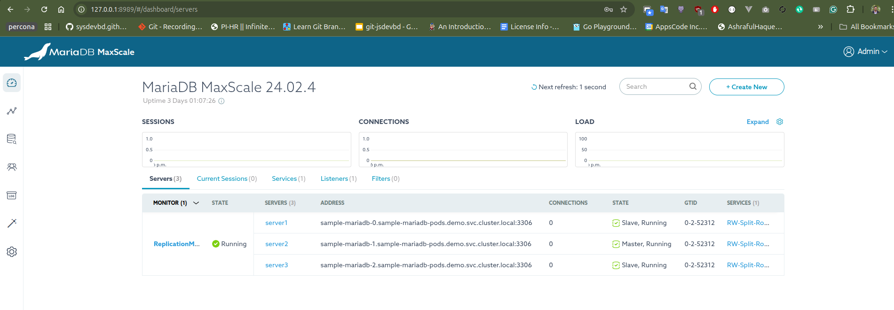

> Vous êtes nouveau sur KubeDB ? Veuillez commencer [ici](https://kubedb.com/docs/v2026.7.10/README).

# KubeDB-Cluster MariaDB

Ce didacticiel vous montrera comment utiliser KubeDB pour provisionner une réplication standard MariaDB en mode maître unique.

## Avant de commencer

Avant de continuer :

* Lire [ce](overview.md#mariadb-standard-replication) pour en savoir plus sur la réplication standard MariaDB.
* Vous devez disposer d'un cluster Kubernetes et l'outil de ligne de commande kubectl doit être configuré pour communiquer avec votre cluster. Si vous n'avez pas encore de cluster, vous pouvez en créer un en utilisant [gentil](https://kind.sigs.k8s.io/docs/user/quick-start/).
* Maintenant, installez l'opérateur KubeDB dans votre cluster en suivant les étapes [ici](https://kubedb.com/docs/v2026.7.10/setup/README).
* Pour garder les choses isolées, ce didacticiel utilise un espace de noms distinct appelé `demo` tout au long de ce tutoriel. Exécutez la commande suivante pour préparer votre cluster pour ce didacticiel :

  ```bash
  $ kubectl create ns demo
  namespace/demo created
  ```

> Remarque : Les fichiers yaml utilisés dans ce didacticiel sont stockés dans [docs/guides/mariadb/clustering/mariadb-replication/examples](https://github.com/kubedb/docs/tree/v2026.7.10/docs/guides/mariadb/clustering/mariadb-replication/examples) dossier dans le référentiel GitHub [kubedb/docs](https://github.com/kubedb/docs).

## Déployer le cluster MariaDB

Ce qui suit est un exemple `MariaDB` objet qui crée un cluster de réplication standard MariaDB à maître unique avec trois membres.

```yaml
apiVersion: kubedb.com/v1
kind: MariaDB
metadata:
  name: sample-mariadb
  namespace: demo
spec:
  version: "12.1.2"
  replicas: 3
  topology:
    mode: MariaDBReplication
    maxscale:
      replicas: 3
      enableUI: true
      storageType: Durable
      storage:
        accessModes:
          - ReadWriteOnce
        resources:
          requests:
            storage: 50Mi
  storageType: Durable
  storage:
    accessModes:
    - ReadWriteOnce
    resources:
      requests:
        storage: 1Gi
  deletionPolicy: WipeOut
```

```bash
$ kubectl create -f https://github.com/kubedb/docs/raw/v2026.7.10/docs/guides/mariadb/clustering/mariadb-replication/examples/demo-1.yaml
mariadb.kubedb.com/sample-mariadb created
```

Ici,

* `spec.replicas` Définit le nombre de pods (instances) MariaDB dans le cluster.
* `spec.storage` Spécifie la StorageClass de PVC allouée dynamiquement pour stocker les données de cette base de données. Cette spécification de stockage sera transmise au PetSet créé par l'opérateur KubeDB pour exécuter les pods de base de données. Ainsi, chaque membre disposera d’un pod de cette configuration de stockage. Vous pouvez spécifier n'importe quelle StorageClass disponible dans votre cluster avec les demandes de ressources appropriées.
* `spec.topology` Configure la topologie de la base de données et les composants associés.
* `spec.topology.maxscale` Spécifie la configuration du serveur proxy Maxscale.
* `spec.topology.maxscale.replicas` Définit le nombre de réplicas MaxScale dans le petset géré par l'opérateur KubeDB.
* `spec.topology.maxscale.enableUI` Un paramètre booléen (par exemple vrai ou faux) qui contrôle si l'interface graphique MaxScale (accessible via l'API REST) ​​est activée pour l'instance MaxScale.

L'opérateur KubeDB surveille `MariaDB` objets à l’aide de l’API Kubernetes. Quand un `MariaDB` est créé, l'opérateur KubeDB créera un nouveau PetSet et un service avec le nom d'objet MariaDB correspondant. L'opérateur KubeDB créera également un service de gouvernance pour le PetSet avec le nom `<mariadb-object-name>-pods`.

```bash
$ kubectl get mariadb -n demo sample-mariadb -o yaml
apiVersion: kubedb.com/v1
kind: MariaDB
metadata:
  name: sample-mariadb
  namespace: demo
spec:
  allowedSchemas:
    namespaces:
      from: Same
  authSecret:
    activeFrom: "2025-04-08T06:42:36Z"
    name: sample-mariadb-auth
  deletionPolicy: WipeOut
  healthChecker:
    failureThreshold: 1
    periodSeconds: 10
    timeoutSeconds: 10
  podTemplate:
    spec:
      containers:
      - name: mariadb
        resources:
          limits:
            memory: 1Gi
          requests:
            cpu: 500m
            memory: 1Gi
        securityContext:
          allowPrivilegeEscalation: false
          capabilities:
            drop:
            - ALL
          runAsGroup: 999
          runAsNonRoot: true
          runAsUser: 999
          seccompProfile:
            type: RuntimeDefault
      - name: md-coordinator
        resources:
          limits:
            memory: 256Mi
          requests:
            cpu: 200m
            memory: 256Mi
        securityContext:
          allowPrivilegeEscalation: false
          capabilities:
            drop:
            - ALL
          runAsGroup: 999
          runAsNonRoot: true
          runAsUser: 999
          seccompProfile:
            type: RuntimeDefault
      initContainers:
      - name: mariadb-init
        resources:
          limits:
            memory: 512Mi
          requests:
            cpu: 200m
            memory: 256Mi
        securityContext:
          allowPrivilegeEscalation: false
          capabilities:
            drop:
            - ALL
          runAsGroup: 999
          runAsNonRoot: true
          runAsUser: 999
          seccompProfile:
            type: RuntimeDefault
      podPlacementPolicy:
        name: default
      securityContext:
        fsGroup: 999
      serviceAccountName: sample-mariadb
  replicas: 3
  storage:
    accessModes:
    - ReadWriteOnce
    resources:
      requests:
        storage: 1Gi
  storageType: Durable
  topology:
    maxscale:
      enableUI: true
      podTemplate:
        spec:
          containers:
          - name: maxscale
            securityContext:
              allowPrivilegeEscalation: false
              capabilities:
                drop:
                - ALL
              runAsNonRoot: true
              runAsUser: 997
              seccompProfile:
                type: RuntimeDefault
          initContainers:
          - name: maxscale-init
            resources:
              limits:
                memory: 512Mi
              requests:
                cpu: 200m
                memory: 256Mi
            securityContext:
              allowPrivilegeEscalation: false
              capabilities:
                drop:
                - ALL
              runAsNonRoot: true
              runAsUser: 997
              seccompProfile:
                type: RuntimeDefault
          podPlacementPolicy:
            name: default
          securityContext:
            fsGroup: 997
          serviceAccountName: sample-mariadb
      replicas: 3
      storage:
        accessModes:
        - ReadWriteOnce
        resources:
          requests:
            storage: 50Mi
      storageType: Durable
    mode: MariaDBReplication
  version: 12.1.2
status:
  conditions:
  ...
  observedGeneration: 2
  phase: Ready


$ kubectl get petset,svc,secret,pvc,pv,pod -n demo
NAME                                             AGE
petset.apps.k8s.appscode.com/sample-mariadb      53s
petset.apps.k8s.appscode.com/sample-mariadb-mx   56s


NAME                          TYPE        CLUSTER-IP      EXTERNAL-IP   PORT(S)    AGE
service/sample-mariadb           ClusterIP   10.43.110.13    <none>        3306/TCP            60s
service/sample-mariadb-mx        ClusterIP   10.43.149.170   <none>        3306/TCP,8989/TCP   60s
service/sample-mariadb-mx-pods   ClusterIP   None            <none>        3306/TCP            60s
service/sample-mariadb-pods      ClusterIP   None            <none>        3306/TCP            60s
service/sample-mariadb-standby   ClusterIP   10.43.84.224    <none>        3306/TCP            60s

NAME                                TYPE                                  DATA   AGE
secret/default-token-696cj          kubernetes.io/service-account-token   3      121m
secret/sample-mariadb-auth          kubernetes.io/basic-auth              2      116m
secret/sample-mariadb-token-dk4dx   kubernetes.io/service-account-token   3      116m

NAME                                             STATUS   VOLUME                                     CAPACITY   ACCESS MODES   STORAGECLASS   AGE
persistentvolumeclaim/data-sample-mariadb-0      Bound    pvc-ce1faccf-8e33-49c6-8520-7b8bb24bb01a   1Gi        RWO            local-path     <unset>                 3m6s
persistentvolumeclaim/data-sample-mariadb-1      Bound    pvc-2fd2d566-0a32-45d8-af0d-88a1f755ccbc   1Gi        RWO            local-path     <unset>                 3m6s
persistentvolumeclaim/data-sample-mariadb-2      Bound    pvc-77a2cc33-4f8b-4de7-a591-acd97ceb3dce   1Gi        RWO            local-path     <unset>                 3m6s
persistentvolumeclaim/data-sample-mariadb-mx-0   Bound    pvc-c6b54166-9c42-4211-9439-ab63fd1aae89   50Mi       RWO            local-path     <unset>                 3m9s
persistentvolumeclaim/data-sample-mariadb-mx-1   Bound    pvc-eaec319b-33d1-4fac-8234-7eadfbad0e61   50Mi       RWO            local-path     <unset>                 3m9s
persistentvolumeclaim/data-sample-mariadb-mx-2   Bound    pvc-733c4cde-3756-44ab-b652-17425e0e210f   50Mi       RWO            local-path     <unset>                 3m9s

NAME                                                        CAPACITY    ACCESS MODES   RECLAIM POLICY   STATUS   CLAIM                           STORAGECLASS   REASON   AGE
persistentvolume/pvc-1d0b5bcd-2699-4b87-b57b-3072ddc1027f   1Gi         RWO            Delete           Bound    demo/data-sample-mariadb-1      local-path              116m
persistentvolume/pvc-1e259abc-5937-421a-990c-b903a83d2d8a   1Gi         RWO            Delete           Bound    demo/data-sample-mariadb-0      local-path              116m
persistentvolume/pvc-5b85a06e-17f5-487a-9150-e928f5cf4590   1Gi         RWO            Delete           Bound    demo/data-sample-mariadb-2      local-path              116m
persistentvolume/pvc-c6b54166-9c42-4211-9439-ab63fd1aae89   50Mi        RWO            Delete           Bound    demo/data-sample-mariadb-mx-0   local-path              116m
persistentvolume/pvc-c6b54166-9c42-4211-9439-ab63fd1aae89   50Mi        RWO            Delete           Bound    demo/data-sample-mariadb-mx-1   local-path              116m
persistentvolume/pvc-eaec319b-33d1-4fac-8234-7eadfbad0e61   50Mi        RWO            Delete           Bound    demo/data-sample-mariadb-mx-2   local-path              116m

NAME                   READY   STATUS    RESTARTS   AGE
pod/sample-mariadb-0      2/2     Running   0          3m6s
pod/sample-mariadb-1      2/2     Running   0          3m6s
pod/sample-mariadb-2      2/2     Running   0          3m6s
pod/sample-mariadb-mx-0   1/1     Running   0          3m9s
pod/sample-mariadb-mx-1   1/1     Running   0          3m9s
pod/sample-mariadb-mx-2   1/1     Running   0          3m9s
```

## Vérifier l'état du cluster

Nous sommes maintenant prêts à vérifier l’état du cluster nouvellement créé. Connectez-vous au pod maxscale et exécutez les commandes suivantes à partir de l’un des pods maxscale et vous obtiendrez le même résultat.

```bash
$ kubectl exec -it -n demo svc/sample-mariadb-mx -- bash
bash-4.4$ maxctrl list servers
```

```text
┌─────────┬─────────────────────────────────────────────────────────────┬──────┬─────────────┬─────────────────┬─────────┬────────────────────┐
│ Server  │ Address                                                     │ Port │ Connections │ State           │ GTID    │ Monitor            │
├─────────┼─────────────────────────────────────────────────────────────┼──────┼─────────────┼─────────────────┼─────────┼────────────────────┤
│ server1 │ sample-mariadb-0.sample-mariadb-pods.demo.svc.cluster.local │ 3306 │ 0           │ Master, Running │ 0-1-125 │ ReplicationMonitor │
├─────────┼─────────────────────────────────────────────────────────────┼──────┼─────────────┼─────────────────┼─────────┼────────────────────┤
│ server2 │ sample-mariadb-1.sample-mariadb-pods.demo.svc.cluster.local │ 3306 │ 0           │ Slave, Running  │ 0-1-125 │ ReplicationMonitor │
├─────────┼─────────────────────────────────────────────────────────────┼──────┼─────────────┼─────────────────┼─────────┼────────────────────┤
│ server3 │ sample-mariadb-2.sample-mariadb-pods.demo.svc.cluster.local │ 3306 │ 0           │ Slave, Running  │ 0-1-125 │ ReplicationMonitor │
└─────────┴─────────────────────────────────────────────────────────────┴──────┴─────────────┴─────────────────┴─────────┴────────────────────┘
```

## Connexion à la base de données MariaDB

Une fois la base de données en cours d’exécution, nous pouvons nous connecter à chacun des trois nœuds. Nous utiliserons les identifiants de connexion `MYSQL_ROOT_USERNAME` et `MYSQL_ROOT_PASSWORD` enregistré en tant que variable d’environnement du conteneur.

## Créer un utilisateur test

L'écriture sur une réplique esclave peut entraîner un problème de conflit de journal binaire (binlog). Initialement, la réplique esclave est en mode lecture seule. Mais les utilisateurs disposant de super privilèges peuvent toujours écrire dans la base de données en mode lecture seule. L'utilisateur root possède les privilèges de superutilisateur, lui permettant de modifier une base de données même en mode lecture seule.

Nous vous recommandons d'utiliser un utilisateur non root pour les environnements de production. L'utilisateur root dispose de privilèges étendus, ce qui peut présenter des risques de sécurité. Par conséquent, il est conseillé de créer un utilisateur dédié avec les autorisations appropriées pour une utilisation en production.

```bash
$ kubectl exec -it -n demo svc/sample-mariadb -- bash
mysql@sample-mariadb-0:/ mariadb -u${MYSQL_ROOT_USERNAME} -p${MYSQL_ROOT_PASSWORD}
Welcome to the MariaDB monitor.  Commands end with ; or \g.
Your MariaDB connection id is 11
Server version: 11.8.5-MariaDB-1:11.8.5+maria~focal mariadb.org binary distribution

Copyright (c) 2000, 2018, Oracle, MariaDB Corporation Ab and others.

Type 'help;' or '\h' for help. Type '\c' to clear the current input statement.

# create user
MariaDB [(none)]> CREATE USER 'testuser'@'%' IDENTIFIED BY 'testpassword';
Query OK, 0 rows affected (0.001 sec)

# Grant all privileges to the user on all databases
MariaDB [(none)]> GRANT SELECT, INSERT, UPDATE, DELETE, CREATE, DROP, INDEX, ALTER, SHOW DATABASES ON *.* TO 'testuser'@'%' WITH GRANT OPTION;
Query OK, 0 rows affected (0.002 sec)

MariaDB [(none)]> FLUSH PRIVILEGES;
Query OK, 0 rows affected (0.000 sec)

MariaDB [(none)]> quit;
Bye
mysql@sample-mariadb-0:/ exit
exit
```

## Vérifier la connectivité à l'aide de l'utilisateur test

```bash
# Master Node
$ kubectl exec -it -n demo svc/sample-mariadb -- bash
```

```mysql
mysql@sample-mariadb-0:/ mariadb -utestuser -ptestpassword
Welcome to the MariaDB monitor.  Commands end with ; or \g.
Your MariaDB connection id is 26
Server version: 11.8.5-MariaDB-1:11.8.5+maria~focal mariadb.org binary distribution

Copyright (c) 2000, 2018, Oracle, MariaDB Corporation Ab and others.

Type 'help;' or '\h' for help. Type '\c' to clear the current input statement.

MariaDB [(none)]> SELECT 1; 
+---+
| 1 |
+---+
| 1 |
+---+
1 row in set (0.000 sec)

MariaDB [(none)]> quit;
Bye
```

```bash
# Slave Node
$ kubectl exec -it -n demo svc/sample-mariadb-standby -- bash
```

```mysql
mysql@sample-mariadb-1:/ mariadb -utestuser -ptestpassword
Welcome to the MariaDB monitor.  Commands end with ; or \g.
Your MariaDB connection id is 94
Server version: 11.8.5-MariaDB-1:11.8.5+maria~focal mariadb.org binary distribution

Copyright (c) 2000, 2018, Oracle, MariaDB Corporation Ab and others.

Type 'help;' or '\h' for help. Type '\c' to clear the current input statement.

MariaDB [(none)]> SELECT 1;
+---+
| 1 |
+---+
| 1 |
+---+
1 row in set (0.000 sec)

MariaDB [(none)]> quit;
Bye

MariaDB [(none)]> quit;
Bye
```

## Insérer des données et vérifier la disponibilité

Dans un cluster de réplication MariaDB, seul le membre maître peut écrire et le membre esclave peut lire. Dans cette section, nous insérerons les données du nœud maître et verrons si nous pouvons obtenir les données de tous les autres membres esclaves.
`sample-mariadb-0` est le nœud maître dans notre cas.

> Lisez le commentaire écrit pour les commandes suivantes. Ils contiennent les instructions et explications des commandes.

```bash
# master node
$ kubectl exec -it -n demo sample-mariadb-0 -- bash
```

```mysql
mysql@sample-mariadb-0:/ mariadb -utestuser -ptestpassword
Welcome to the MariaDB monitor.  Commands end with ; or \g.
Your MariaDB connection id is 202
Server version: 11.8.5-MariaDB-1:11.8.5+maria~focal mariadb.org binary distribution

Copyright (c) 2000, 2018, Oracle, MariaDB Corporation Ab and others.

Type 'help;' or '\h' for help. Type '\c' to clear the current input statement.

MariaDB [(none)]> CREATE DATABASE playground;
Query OK, 1 row affected (0.013 sec)

# Create table in Node 1
MariaDB [(none)]> CREATE TABLE playground.equipment ( id INT NOT NULL AUTO_INCREMENT, type VARCHAR(50), quant INT, color VARCHAR(25), PRIMARY KEY(id));
Query OK, 0 rows affected (0.053 sec)

# Insert sample data into Node 1
MariaDB [(none)]> INSERT INTO playground.equipment (type, quant, color) VALUES ('slide', 2, 'blue');
Query OK, 1 row affected (0.003 sec)

# Read data from Node 1
MariaDB [(none)]> SELECT * FROM playground.equipment;
+----+-------+-------+-------+
| id | type  | quant | color |
+----+-------+-------+-------+
|  1 | slide |     2 | blue  |
+----+-------+-------+-------+
1 row in set (0.001 sec)

MariaDB [(none)]> quit;
Bye
```

```bash
mysql@sample-mariadb-0:/ exit
exit

# check slave node data

$ kubectl exec -it -n demo sample-mariadb-1 -- bash
```

```mysql
mysql@sample-mariadb-1:/ mariadb -utestuser -ptestpassword
Welcome to the MariaDB monitor.  Commands end with ; or \g.
Your MariaDB connection id is 209
Server version: 11.8.5-MariaDB-1:11.8.5+maria~focal mariadb.org binary distribution

Copyright (c) 2000, 2018, Oracle, MariaDB Corporation Ab and others.

Type 'help;' or '\h' for help. Type '\c' to clear the current input statement.

# Read data from Node 2
MariaDB [(none)]> SELECT * FROM playground.equipment;
+----+-------+-------+-------+
| id | type  | quant | color |
+----+-------+-------+-------+
|  1 | slide |     2 | blue  |
+----+-------+-------+-------+
1 row in set (0.001 sec)
MariaDB [(none)]> quit;
Bye
```

```bash
mysql@sample-mariadb-1:/ exit
exit
~ $ kubectl exec -it -n demo sample-mariadb-2 -- bash
```

```mysql
mysql@sample-mariadb-2:/  mariadb -utestuser -ptestpassword
Welcome to the MariaDB monitor.  Commands end with ; or \g.
Your MariaDB connection id is 209
Server version: 11.8.5-MariaDB-1:11.8.5+maria~focal mariadb.org binary distribution

Copyright (c) 2000, 2018, Oracle, MariaDB Corporation Ab and others.

Type 'help;' or '\h' for help. Type '\c' to clear the current input statement.

# Read data from Node 3
MariaDB [(none)]> SELECT * FROM playground.equipment;
+----+-------+-------+-------+
| id | type  | quant | color |
+----+-------+-------+-------+
|  1 | slide |     2 | blue  |
+----+-------+-------+-------+
3 rows in set (0.000 sec)

MariaDB [(none)]> quit
Bye
```

```bash
mysql@sample-mariadb-2:/# exit
exit
```

## Basculement automatique

Pour tester le basculement automatique, nous forcerons le redémarrage des pods maîtres et vérifierons s'il peut changer de maître et rejoindre le cluster.

> Lisez le commentaire écrit pour les commandes suivantes. Ils contiennent les instructions et explications des commandes.

```bash
# Forcefully delete master node
~ $ kubectl delete pod -n demo sample-mariadb-0
pod "sample-mariadb-0" deleted

Now exec into maxscale server and run the following command to check the server status and ensure the failover is working.

$ kubectl exec -it -n demo svc/sample-mariadb-mx -- bash
Defaulted container "maxscale" out of: maxscale, maxscale-init (init)
bash-4.4$ maxctrl list servers
```

```text
┌─────────┬─────────────────────────────────────────────────────────────┬──────┬─────────────┬─────────────────┬───────────┬────────────────────┐
│ Server  │ Address                                                     │ Port │ Connections │ State           │ GTID      │ Monitor            │
├─────────┼─────────────────────────────────────────────────────────────┼──────┼─────────────┼─────────────────┼───────────┼────────────────────┤
│ server1 │ sample-mariadb-0.sample-mariadb-pods.demo.svc.cluster.local │ 3306 │ 0           │ Down            │ 0-1-14545 │ ReplicationMonitor │
├─────────┼─────────────────────────────────────────────────────────────┼──────┼─────────────┼─────────────────┼───────────┼────────────────────┤
│ server2 │ sample-mariadb-1.sample-mariadb-pods.demo.svc.cluster.local │ 3306 │ 0           │ Master, Running │ 0-1-14545 │ ReplicationMonitor │
├─────────┼─────────────────────────────────────────────────────────────┼──────┼─────────────┼─────────────────┼───────────┼────────────────────┤
│ server3 │ sample-mariadb-2.sample-mariadb-pods.demo.svc.cluster.local │ 3306 │ 0           │ Slave, Running  │ 0-1-14545 │ ReplicationMonitor │
└─────────┴─────────────────────────────────────────────────────────────┴──────┴─────────────┴─────────────────┴───────────┴────────────────────┘
```

```bash
# sample-mariadb-1 is new master.
# Wait some time to up sample-mariadb-0 and check the server list again

bash-4.4$ maxctrl list servers
```

```text
┌─────────┬─────────────────────────────────────────────────────────────┬──────┬─────────────┬─────────────────┬───────────┬────────────────────┐
│ Server  │ Address                                                     │ Port │ Connections │ State           │ GTID      │ Monitor            │
├─────────┼─────────────────────────────────────────────────────────────┼──────┼─────────────┼─────────────────┼───────────┼────────────────────┤
│ server1 │ sample-mariadb-0.sample-mariadb-pods.demo.svc.cluster.local │ 3306 │ 0           │ Slave, Running  │ 0-2-14551 │ ReplicationMonitor │
├─────────┼─────────────────────────────────────────────────────────────┼──────┼─────────────┼─────────────────┼───────────┼────────────────────┤
│ server2 │ sample-mariadb-1.sample-mariadb-pods.demo.svc.cluster.local │ 3306 │ 0           │ Master, Running │ 0-2-14551 │ ReplicationMonitor │
├─────────┼─────────────────────────────────────────────────────────────┼──────┼─────────────┼─────────────────┼───────────┼────────────────────┤
│ server3 │ sample-mariadb-2.sample-mariadb-pods.demo.svc.cluster.local │ 3306 │ 0           │ Slave, Running  │ 0-2-14551 │ ReplicationMonitor │
└─────────┴─────────────────────────────────────────────────────────────┴──────┴─────────────┴─────────────────┴───────────┴────────────────────┘
```

```bash
All replicas up and srunning now.

# Now check `sample-mariadb-0` data
$ kubectl exec -it -n demo sample-mariadb-0 -- bash
```

```mysql
mysql@sample-mariadb-0:/ mariadb -utestuser -ptestpassword
Welcome to the MariaDB monitor.  Commands end with ; or \g.
Your MariaDB connection id is 10
Server version: 11.8.5-MariaDB-1:11.8.5+maria~focal mariadb.org binary distribution

Copyright (c) 2000, 2018, Oracle, MariaDB Corporation Ab and others.

Type 'help;' or '\h' for help. Type '\c' to clear the current input statement.

# Check data after rejoining
MariaDB [(none)]> SELECT * FROM playground.equipment;
+----+-------+-------+-------+
| id | type  | quant | color |
+----+-------+-------+-------+
|  1 | slide |     2 | blue  |
+----+-------+-------+-------+
3 rows in set (0.002 sec)

MariaDB [(none)]> quit
Bye
```

## Vérification du proxy et de la répartition lecture-écriture à l'aide de Maxscale

Pour tester le routage du trafic via le serveur MaxScale, créons d'abord un pod contenant l'image de base Ubuntu. Nous utiliserons le yaml suivant.

```yaml
apiVersion: apps/v1
kind: Deployment
metadata:
  labels:
    app: ubuntu
  name: ubuntu
  namespace: demo
spec:
  replicas: 1
  selector:
    matchLabels:
      app: ubuntu
  strategy: {}
  template:
    metadata:
      labels:
        app: ubuntu
    spec:
      containers:
        - image: ubuntu
          imagePullPolicy: IfNotPresent
          name: ubuntu
          command: ["/bin/sleep", "3650d"]
          resources: {}
```

Appliquons le yaml.

```bash
$ kubectl apply -f https://github.com/kubedb/docs/raw/v2026.7.10/docs/guides/mariadb/clustering/mariadb-replication/examples/ubuntu.yaml
```

```yaml
deployment.apps/ubuntu created
```

Exécutons dans le pod et installons mariadb-client.

```bash
$ kubectl exec -it -n demo pod/ubuntu-bb47d8d6c-4vhjv -- bash                12:00
mysql@ubuntu-bb47d8d6c-4vhjv:/# apt update
... ... ..
mysql@ubuntu-bb47d8d6c-4vhjv:/# apt install mariadb-client -y
Reading package lists... Done
... .. ...
mysql@ubuntu-bb47d8d6c-4vhjv:/#
```

Essayons maintenant de nous connecter au serveur proxy Maxscale via le `sample-mariadb-mx` service comme le `testuser` utilisateur.

```bash
mysql@ubuntu-bb47d8d6c-4vhjv:/# mariadb -utestuser -ptestpassword -hsample-mariadb-mx.demo -P3306
Welcome to the MariaDB monitor.  Commands end with ; or \g.
Your MariaDB connection id is 1
Server version: 11.8.5-MariaDB-1:11.8.5+maria~ubu2004-log mariadb.org binary distribution

Copyright (c) 2000, 2018, Oracle, MariaDB Corporation Ab and others.

Type 'help;' or '\h' for help. Type '\c' to clear the current input statement.

MariaDB [(none)]>
```

Nous avons réussi à nous connecter en tant que `testuser` utilisateur. Exécutons quelques requêtes de lecture et d'écriture en utilisant cette connexion.

```mysql
MariaDB [(none)]> show databases;
+--------------------+
| Database           |
+--------------------+
| information_schema |
| kubedb_system      |
| mysql              |
| performance_schema |
| playground         |
| sys                |
+--------------------+
6 rows in set (0.001 sec)

MariaDB [(none)]> use playground;
Database changed

MariaDB [playground]> show tables;
+----------------------+
| Tables_in_playground |
+----------------------+
| equipment            |
+----------------------+
1 row in set (0.001 sec)

mysql> INSERT INTO equipment (type, quant, color) VALUES ('pot', 2, 'black');
Query OK, 1 row affected (0.01 sec)


MariaDB [playground]> select * from equipment;
+----+-------+-------+-------+
| id | type  | quant | color |
+----+-------+-------+-------+
|  1 | slide |     2 | blue  |
|  2 | pot   |     2 | black |
+----+-------+-------+-------+
2 rows in set (0.001 sec)


# Currently our server state is -
➤ kubectl exec -it -n demo pod/sample-mariadb-mx-0 -- bash
Defaulted container "maxscale" out of: maxscale, maxscale-init (init)
```

```bash
bash-4.4$ maxctrl list servers
```

```text
┌─────────┬─────────────────────────────────────────────────────────────┬──────┬─────────────┬─────────────────┬───────────┬────────────────────┐
│ Server  │ Address                                                     │ Port │ Connections │ State           │ GTID      │ Monitor            │
├─────────┼─────────────────────────────────────────────────────────────┼──────┼─────────────┼─────────────────┼───────────┼────────────────────┤
│ server1 │ sample-mariadb-0.sample-mariadb-pods.demo.svc.cluster.local │ 3306 │ 1           │ Slave, Running  │ 0-2-52054 │ ReplicationMonitor │
├─────────┼─────────────────────────────────────────────────────────────┼──────┼─────────────┼─────────────────┼───────────┼────────────────────┤
│ server2 │ sample-mariadb-1.sample-mariadb-pods.demo.svc.cluster.local │ 3306 │ 1           │ Master, Running │ 0-2-52054 │ ReplicationMonitor │
├─────────┼─────────────────────────────────────────────────────────────┼──────┼─────────────┼─────────────────┼───────────┼────────────────────┤
│ server3 │ sample-mariadb-2.sample-mariadb-pods.demo.svc.cluster.local │ 3306 │ 1           │ Slave, Running  │ 0-2-52054 │ ReplicationMonitor │
└─────────┴─────────────────────────────────────────────────────────────┴──────┴─────────────┴─────────────────┴───────────┴────────────────────┘
```

```bash
# Now lets check read-write split
```

```mysql
MariaDB [playground]> SELECT NOW(),@@hostname;
+---------------------+------------------+
| NOW()               | @@hostname       |
+---------------------+------------------+
| 2025-04-24 13:11:06 | sample-mariadb-2 |
+---------------------+------------------+
1 row in set (0.000 sec)

MariaDB [playground]> SELECT NOW(),@@hostname;
+---------------------+------------------+
| NOW()               | @@hostname       |
+---------------------+------------------+
| 2025-04-24 13:11:31 | sample-mariadb-2 |
+---------------------+------------------+
1 row in set (0.000 sec)

MariaDB [playground]> SELECT NOW(),@@hostname;
+---------------------+------------------+
| NOW()               | @@hostname       |
+---------------------+------------------+
| 2025-04-24 13:12:00 | sample-mariadb-0 |
+---------------------+------------------+
1 row in set (0.000 sec)

# Read queries are executed on the slave replica
# FYI: Both read and write operations can be executed on the master node.

# Now, let's check the write split.

MariaDB [playground]> CREATE DATABASE IF NOT EXISTS test_db;
Query OK, 1 row affected (0.001 sec)

MariaDB [playground]> CREATE TABLE test_db.t1 (id INT, hostname VARCHAR(100));
Query OK, 0 rows affected (0.009 sec)

MariaDB [playground]> INSERT INTO test_db.t1 (id, hostname) VALUES (1, @@hostname);
Query OK, 1 row affected (0.002 sec)

MariaDB [playground]> INSERT INTO test_db.t1 (id, hostname) VALUES (2, @@hostname);
Query OK, 1 row affected (0.002 sec)

MariaDB [playground]> INSERT INTO test_db.t1 (id, hostname) VALUES (3, @@hostname);
Query OK, 1 row affected (0.002 sec)

MariaDB [playground]> INSERT INTO test_db.t1 (id, hostname) VALUES (4, @@hostname);
Query OK, 1 row affected (0.002 sec)

MariaDB [playground]> SELECT * FROM test_db.t1;
+------+------------------+
| id   | hostname         |
+------+------------------+
|    1 | sample-mariadb-1 |
|    2 | sample-mariadb-1 |
|    3 | sample-mariadb-1 |
|    4 | sample-mariadb-1 |
+------+------------------+
4 rows in set (0.001 sec)

# Write queries are executed only on the master node.
```

Nous pouvons voir que les requêtes sont exécutées avec succès via le serveur proxy Maxscale et que la répartition des lectures et des écritures fonctionne comme prévu.

## Accédez et explorez l'interface utilisateur MaxScale

Pour activer l'interface utilisateur MaxScale, définissez `spec.topology.maxscale.enableUI: true` dans la configuration. L'interface utilisateur MaxScale s'exécute sur le port 8989. Pour y accéder, utilisez la commande kubectl suivante pour transférer le port :

```bash
➤ kubectl port-forward -n demo service/sample-mariadb-mx 8989:8989
Forwarding from 127.0.0.1:8989 -> 8989
Forwarding from [::1]:8989 -> 8989
```

L'interface utilisateur MaxScale est accessible sur http://127.0.0.1:8989.

Utilisez les informations d'identification par défaut pour vous connecter :

* Nom d'utilisateur : administrateur
* Mot de passe : mariadb

Une fois connecté, vous serez accueilli par un tableau de bord intuitif présentant la liste des serveurs et l'état actuel des nœuds.



## Nettoyage

Nettoyons ce que nous avons créé dans ce tutoriel.

```bash
$ kubectl delete mariadb.kubedb.com -n demo sample-mariadb
mariadb.kubedb.com "sample-mariadb" deleted
$ kubectl delete -n demo deployment.apps/ubuntu
deployment.apps "ubuntu" deleted
$ kubectl delete ns demo
namespace "demo" deleted
```