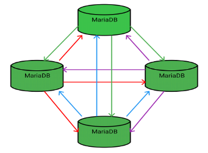
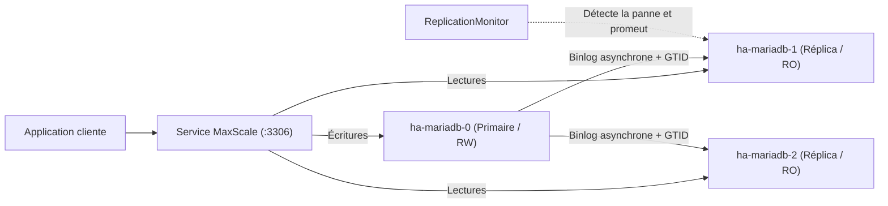
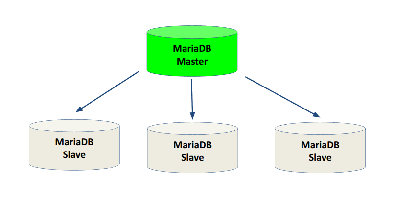

> Vous êtes nouveau sur KubeDB ? Veuillez commencer [ici](https://kubedb.com/docs/v2026.7.10/README).

# Clustering MariaDB

KubeDB prend en charge deux modes de clustering principaux pour MariaDB : le cluster Galera multi-maître MariaDB et la réplication standard maître-esclave MariaDB. Ci-dessous, nous explorons les concepts clés de ces approches de clustering, en mettant en évidence leurs mécanismes, leurs avantages et leurs cas d'utilisation dans un environnement de base de données distribuée.

Ci-dessous, nous explorons les concepts clés du clustering MariaDB, en nous concentrant sur les deux modes de clustering pris en charge par KubeDB : cluster MariaDB Galera multi-maître et réplication standard MariaDB maître-esclave.

## Qu'est-ce que la réplication

La réplication dans MariaDB implique la duplication des données d'un serveur MariaDB (la source) vers un ou plusieurs autres serveurs MariaDB (répliques), plutôt que de les stocker sur un seul serveur. Ce processus améliore la disponibilité des données, l'évolutivité et la tolérance aux pannes. Le mode de réplication détermine les capacités de lecture et d'écriture de chaque serveur du cluster. MariaDB prend en charge deux architectures de réplication principales : multi-maître et maître-esclave.

* Réplication multi-maître : dans une configuration multi-maître, chaque serveur du cluster peut gérer à la fois les opérations de lecture et d'écriture. Cette architecture, illustrée par le cluster MariaDB Galera, garantit une haute disponibilité et une évolutivité en permettant aux applications de répartir les charges de travail sur tous les nœuds.
* Réplication maître-esclave : dans une architecture maître-esclave, le serveur maître prend en charge les opérations de lecture et d'écriture, tandis que les serveurs esclaves sont limités aux opérations de lecture. Cette configuration est idéale pour les charges de travail lourdes en lecture, avec des esclaves offrant une évolutivité pour les requêtes et servant de sauvegardes.

La figure suivante montre un cluster de quatre serveurs MariaDB de réplication multi-maître :

Référence de l'image : <https://mariadb.com/docs/galera-cluster>

## Réplication Galera

Le cluster MariaDB Galera est un [pratiquement synchrone](https://mariadb.com/kb/en/about-galera-replication/#synchronous-vs-asynchronous-replication) cluster multi-maître pour MariaDB. Le serveur réplique une transaction au moment de la validation en diffusant le jeu d'écriture associé à la transaction à chaque nœud du cluster. Le client se connecte directement au SGBD et expérimente un comportement similaire à celui de MariaDB natif dans la plupart des cas. L'API wsrep (Write Set Replication API) définit l'interface entre la réplication Galera et MariaDB.

Réf : [À propos de la réplication Galera](https://mariadb.com/kb/en/about-galera-replication/)

## Fonctionnalités du cluster MariaDB Galera

* Réplication virtuellement synchrone
* Topologie multi-maître actif-actif
* Lire et écrire sur n'importe quel nœud de cluster
* Contrôle automatique des membres, les nœuds défaillants sont supprimés du cluster
* Rejoindre automatiquement les nœuds
* Véritable réplication parallèle, au niveau des lignes
* Connexions client directes, apparence et convivialité natives de MariaDB

Réf : [Qu'est-ce que le cluster MariaDB Galera ?](https://mariadb.com/kb/en/what-is-mariadb-galera-cluster/#features)

### Limites

Certaines limitations du cluster MariaDB Galera sont répertoriées [ici](https://mariadb.com/kb/en/mariadb-galera-cluster-known-limitations/).

## Réplication standard MariaDB

La réplication standard MariaDB est un mécanisme largement utilisé pour copier des données d'un serveur MariaDB (maître) vers un ou plusieurs autres serveurs MariaDB (esclave). Ce mode de réplication garantit la redondance des données, améliore la disponibilité et prend en charge l'évolutivité de la lecture en répartissant les opérations de lecture sur plusieurs serveurs. Il fonctionne dans une architecture à maître unique et esclave, dans laquelle le serveur maître gère à la fois les opérations de lecture et d'écriture, tandis que les serveurs esclaves sont limités aux opérations de lecture.

Réf : [À propos de la réplication standard MariadDB](https://mariadb.com/kb/en/replication-overview/#standard-replication)

## Fonctionnalités du cluster de réplication standard MariaDB

* Réplication asynchrone
* Topologie à maître unique actif-passif
* Lire et écrire sur le maître, et lire uniquement sur le nœud esclave
* Rejoindre automatiquement les nœuds
* Basculement automatique à l'aide du serveur proxy Maxscale
* Réplication basée sur les journaux binaires
* Connexions client directes, apparence et convivialité natives de MariaDB
* Équilibrage de charge à l'aide du serveur proxy Maxscale
* Lecture et écriture partagées à l'aide du serveur proxy Maxscale

### Serveur proxy MariaDB Maxscale

MariaDB MaxScale est un outil qui agit comme intermédiaire entre vos applications et les bases de données MariaDB Server. Cela contribue à améliorer la disponibilité de la base de données, sa capacité à gérer davantage d’utilisateurs et sa sécurité. Cela facilite également la tâche des développeurs en séparant l'application de la configuration de la base de données.

MaxScale a une conception flexible qui prend en charge les modules complémentaires (plugins) pour faire plus qu'un simple équilibrage de charge de base. Par exemple, il peut agir comme un pare-feu de base de données pour protéger vos données. Il est livré avec des plugins intégrés pour acheminer les requêtes, filtrer les données et prendre en charge différents protocoles. Vous pouvez configurer MaxScale pour diriger les requêtes de base de données ou modifier les réponses en fonction de vos besoins, par exemple en masquant des informations sensibles ou en répartissant les requêtes de lecture sur plusieurs serveurs pour gérer davantage de trafic.

L'une de ses fonctionnalités clés est le basculement automatique, qui garantit que votre base de données reste disponible même en cas de panne d'un serveur principal. Le basculement automatique détecte automatiquement un nœud principal défaillant, encourage une réplique à le remplacer et redirige le trafic vers le nouveau nœud principal, minimisant ainsi les temps d'arrêt et assurant le bon fonctionnement de vos applications.

### Comment fonctionne le basculement automatique avec MaxScale

MaxScale utilise un moniteur (comme le plugin MariaDB-Monitor) pour suivre la santé des nœuds de base de données dans une configuration de réplication (par exemple, la réplique principale MariaDB). Si le nœud principal devient indisponible (en raison d'une panne, d'un problème de réseau ou d'une maintenance)

Échelle maximale :

* Détecte l'échec : le moniteur (ReplicationMonitor) vérifie en permanence l'état du nœud (à l'aide de pings MySQL ou de variables d'état).
* Sélectionne un nouveau primaire : il identifie la réplique la plus appropriée en fonction de critères tels que le délai de réplication ou l'état du serveur.
* Favorise la réplique : MaxScale exécute des commandes pour promouvoir la réplique choisie au rang principal (par exemple, STOP SLAVE ; RESET SLAVE ALL ;).
* Reconfigure les réplicas : les autres réplicas sont mis à jour pour être répliqués à partir du nouveau réplica principal.
* Redirige le trafic : le routeur de MaxScale (RW-Split-Router) dirige de manière transparente les requêtes d'écriture vers le nouveau principal et les requêtes de lecture vers les répliques.

Ce processus se déroule automatiquement, généralement en quelques secondes, garantissant ainsi une perturbation minimale.

# Prochaines étapes

* [Déployer le cluster MariaDB Galera](galera-cluster.md) en utilisant KubeDB.