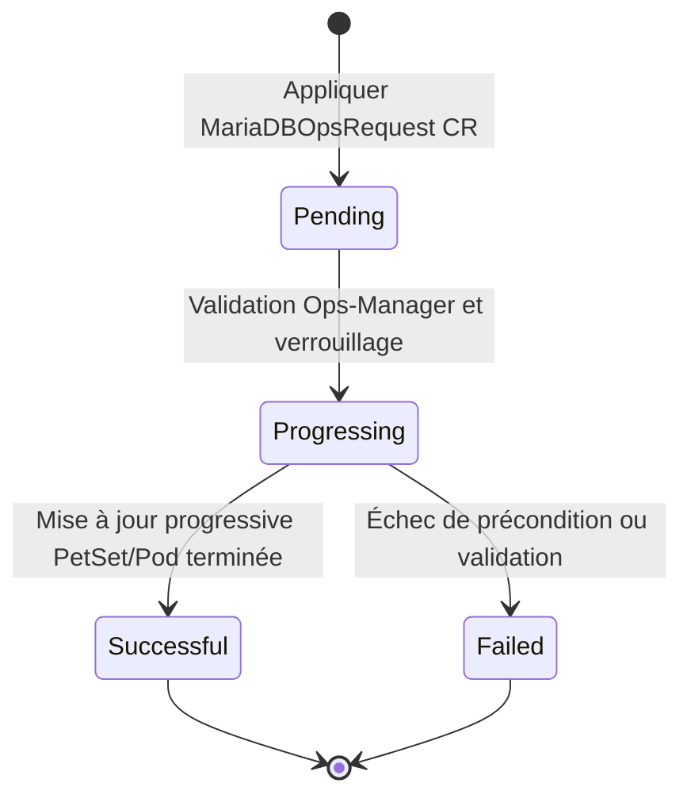

> Vous êtes nouveau sur KubeDB ? Veuillez commencer [ici](https://kubedb.com/docs/v2026.7.10/README).

# MariaDBOpsRequest

## Qu'est-ce que MariaDBOpsRequest




`MariaDBOpsRequest` est un Kubernetes `Custom Resource Definitions` (CRD). Il fournit une configuration déclarative pour les opérations administratives de MariaDB telles que la mise à jour de la version de la base de données, la mise à l'échelle horizontale, la mise à l'échelle verticale, etc. de manière native Kubernetes.

## Spécifications du CRD MariaDBOpsRequest

Comme toute ressource officielle Kubernetes, un `MariaDBOpsRequest` a `TypeMeta`, `ObjectMeta`, `Spec` et `Status` sections.

Ici, un échantillon `MariaDBOpsRequest` Les CR pour différentes opérations administratives sont indiqués ci-dessous :

**Échantillon `MariaDBOpsRequest` pour mettre à jour la base de données :**

```yaml
apiVersion: ops.kubedb.com/v1alpha1
kind: MariaDBOpsRequest
metadata:
  name: mdops-update
  namespace: demo
spec:
  type: UpdateVersion
  databaseRef:
    name: sample-mariadb
  updateVersion:
    targetVersion: 10.5.23
status:
  conditions:
    - lastTransitionTime: "2020-08-25T18:22:38Z"
      message: Successfully completed the modification process
      observedGeneration: 1
      reason: Successful
      status: "True"
      type: Successful
  observedGeneration: 1
  phase: Successful
```

**Échantillon `MariaDBOpsRequest` Objets pour la mise à l'échelle horizontale du cluster de bases de données :**

```yaml
apiVersion: ops.kubedb.com/v1alpha1
kind: MariaDBOpsRequest
metadata:
  name: mdps-scale-horizontal
  namespace: demo
spec:
  type: HorizontalScaling
  databaseRef:
    name: sample-mariadb
  horizontalScaling:
    member : 5
status:
  conditions:
    - lastTransitionTime: "2020-08-25T18:22:38Z"
      message: Successfully completed the modification process
      observedGeneration: 1
      reason: Successful
      status: "True"
      type: Successful
  observedGeneration: 1
  phase: Successful
```

**Échantillon `MariaDBOpsRequest` Objets pour la mise à l'échelle verticale du cluster de bases de données :**

```yaml
apiVersion: ops.kubedb.com/v1alpha1
kind: MariaDBOpsRequest
metadata:
  name: md-scale-vertical
  namespace: demo
spec:
  type: VerticalScaling  
  databaseRef:
    name: sample-mariadb
  verticalScaling:
    mariadb:
      resources:
        requests:
          memory: "600Mi"
          cpu: "0.1"
        limits:
          memory: "600Mi"
          cpu: "0.1"
status:
  conditions:
    - lastTransitionTime: "2020-08-25T18:22:38Z"
      message: Successfully completed the modification process
      observedGeneration: 1
      reason: Successful
      status: "True"
      type: Successful
  observedGeneration: 1
  phase: Successful
```

**Échantillon `MariaDBOpsRequest` Objets pour reconfigurer la base de données MariaDB :**

```yaml
apiVersion: ops.kubedb.com/v1alpha1
kind: MariaDBOpsRequest
metadata:
  name: md-reconfigure
  namespace: demo
spec:
  type: Reconfigure
  databaseRef:
    name: sample-mariadb
  configuration:
    applyConfig:
      my-apply.cnf: |-
        [mysqld]
        max_connections = 300
        read_buffer_size = 1234567        
    restart: "true"
status:
  conditions:
    - lastTransitionTime: "2020-08-25T18:22:38Z"
      message: Successfully completed the modification process
      observedGeneration: 1
      reason: Successful
      status: "True"
      type: Successful
  observedGeneration: 1
  phase: Successful
```

**Échantillon `MariaDBOpsRequest` Objets pour l'expansion du volume de MariaDB :**

```yaml
apiVersion: ops.kubedb.com/v1alpha1
kind: MariaDBOpsRequest
metadata:
  name: md-volume-expansion
  namespace: demo
spec:
  type: VolumeExpansion  
  databaseRef:
    name: sample-mariadb
  volumeExpansion:   
    mode: "Online"
    mariadb: 2Gi
status:
  conditions:
    - lastTransitionTime: "2020-08-25T18:22:38Z"
      message: Successfully completed the modification process
      observedGeneration: 1
      reason: Successful
      status: "True"
      type: Successful
  observedGeneration: 1
  phase: Successful
```

**Échantillon `MariaDBOpsRequest` Objets de reconfiguration TLS de la base de données :**

```yaml
apiVersion: ops.kubedb.com/v1alpha1
kind: MariaDBOpsRequest
metadata:
  name: md-recon-tls-add
  namespace: demo
spec:
  type: ReconfigureTLS
  databaseRef:
    name: sample-mariadb
  tls:
    requireSSL: true
    issuerRef:
      apiGroup: cert-manager.io
      kind: Issuer
      name: md-issuer
    certificates:
    - alias: server
      subject:
        organizations:
        - kubedb:server
      dnsNames:
      - localhost
      ipAddresses:
      - "127.0.0.1"
```

```yaml
apiVersion: ops.kubedb.com/v1alpha1
kind: MariaDBOpsRequest
metadata:
  name: md-recon-tls-rotate
  namespace: demo
spec:
  type: ReconfigureTLS
  databaseRef:
    name: sample-mariadb
  tls:
    rotateCertificates: true
```

Nous allons décrire ici les différentes sections d'un `MariaDBOpsRequest` crd.

A `MariaDBOpsRequest` l'objet comporte les champs suivants dans le `spec` section.

### spec.databaseRef

`spec.databaseRef` est un champ obligatoire qui pointe vers le [MariaDB](mariadb.md) objet pour lequel les opérations administratives seront effectuées. Ce champ est constitué du sous-champ suivant :

* **spec.databaseRef.name :** précise le nom du [MariaDB](mariadb.md) objet.

### spec.type

`spec.type` spécifie le type d'opération qui sera appliqué à la base de données. Actuellement, les types d'opérations suivants sont autorisés dans `MariaDBOpsRequest`.

* `Upgrade` / `UpdateVersion`
* `HorizontalScaling`
* `VerticalScaling`
* `VolumeExpansion`
* `Reconfigure`
* `ReconfigureTLS`
* `Restart`

> Vous ne pouvez effectuer qu'un seul type d'opération sur un seul `MariaDBOpsRequest` CR. Par exemple, si vous souhaitez mettre à jour votre base de données et augmenter sa réplique, vous devez créer deux `MariaDBOpsRequest`. Dans un premier temps, vous devez créer un `MariaDBOpsRequest` pour la mise à jour. Une fois terminé, vous pouvez alors en créer un autre `MariaDBOpsRequest` pour la mise à l'échelle. Il ne faut pas en créer deux `MariaDBOpsRequest` simultanément.

### spec.updateVersion

Si vous souhaitez mettre à jour votre version de MariaDB, vous devez spécifier le `spec.updateVersion` section qui spécifie les informations de version souhaitées. Ce champ est constitué du sous-champ suivant :

* `spec.updateVersion.targetVersion` fait référence à un [Version MariaDB](mariadb-version.md) CR qui contient les informations de version de MariaDB sur laquelle vous souhaitez mettre à jour.

> Vous ne pouvez mettre à jour qu'entre les versions de MariaDB. KubeDB ne prend pas en charge la rétrogradation pour MariaDB.

### spec.horizontalScaling

Si vous souhaitez augmenter ou réduire votre cluster MariaDB ou ses différents composants, vous devez spécifier `spec.horizontalScaling` section. Ce champ est constitué du sous-champ suivant :

* `spec.horizontalScaling.member` indique le nombre souhaité de nœuds pour le cluster MariaDB après la mise à l'échelle. Par exemple, si votre cluster comporte actuellement 4 nœuds et que vous souhaitez ajouter 2 nœuds supplémentaires, vous devez en spécifier 6 dans `spec.horizontalScaling.member` champ. De même, si vous souhaitez supprimer un nœud du cluster, vous devez en spécifier 3 dans `spec.horizontalScaling.` champ.

### spec.verticalScaling

`spec.verticalScaling` est un champ obligatoire précisant les informations de `MariaDB` des ressources comme `cpu`, `memory` etc qui sera mis à l'échelle. Ce champ est constitué du sous-champ suivant :

* `spec.verticalScaling.mariadb` indique les ressources souhaitées pour MariaDB autonome ou en cluster après la mise à l'échelle.
* `spec.verticalScaling.exporter` indique les ressources souhaitées pour le `exporter` récipient.
* `spec.verticalScaling.coordinator` indique les ressources souhaitées pour le `coordinator` récipient.
* `spec.verticalScaling.mode` spécifie comment la mise à l'échelle est actionnée. `Restart` (valeur par défaut) applique les nouvelles ressources en redémarrant les Pods, tandis que `InPlace` redimensionne les Pods en cours d'exécution en place via Kubernetes `pods/resize` sous-ressource (pas de redémarrage), revenant automatiquement à `Restart` pour tout pod dont le nœud ne peut pas accueillir les nouvelles ressources. Facultatif; par défaut `Restart`. Pour un déploiement distribué, le redimensionnement sur place n'est pas possible. `InPlace` se dégrade en `Restart`.

Tous ont la structure ci-dessous :

```yaml
requests:
  memory: "200Mi"
  cpu: "0.1"
limits:
  memory: "300Mi"
  cpu: "0.2"
```

Ici, lorsque vous spécifiez la demande de ressources, le planificateur utilise ces informations pour décider sur quel nœud placer le conteneur du Pod et lorsque vous spécifiez une limite de ressources pour le conteneur, le `kubelet` applique ces limites afin que le conteneur en cours d'exécution ne soit pas autorisé à utiliser plus de cette ressource que la limite que vous avez définie. Vous pouvez trouver plus de détails sur [ici](https://kubernetes.io/docs/concepts/configuration/manage-resources-containers/).

### spec.volumeExpansion

> Pour utiliser la fonctionnalité d'extension de volume, la classe de stockage doit prendre en charge l'extension de volume.

Si vous souhaitez augmenter le volume de votre standalone ou cluster MariaDB, vous devez spécifier `spec.volumeExpansion` section. Ce champ est constitué du sous-champ suivant :

* `spec.volumeExpansion.mariadb` indique la taille souhaitée pour le volume persistant d'une MariaDB.
* `spec.volumeExpansion.mode` indique le mode d’expansion du volume. Cela peut être `online` ou `offline` en fonction de la classe de stockage.

Tous font référence aux types de quantité de Kubernetes.

Un exemple d'utilisation de ce champ est donné ci-dessous :

```yaml
spec:
  volumeExpansion:
    mariadb: "2Gi"
```

Cela augmentera la taille du volume de tous les nœuds mariadb à 2 Go.

### spec.configuration

Si vous souhaitez reconfigurer votre cluster Running MariaDB avec une nouvelle configuration personnalisée, vous devez spécifier `spec.configuration` section. Ce champ est composé des sous-champs suivants :

* `configSecret` pointe vers un secret dans le même espace de noms d'une ressource MariaDB, qui contient les nouvelles configurations personnalisées. S'il y a un configSecret défini auparavant dans la base de données, ce secret le remplacera.
* `applyConfig` contient la nouvelle configuration personnalisée sous forme de chaîne qui sera fusionnée avec la configuration précédente.
* `removeCustomConfig` supprime toutes les configurations personnalisées du serveur MariaDB.
* `restart` réduit considérablement les temps d’arrêt inutiles.
  + `auto` (par défaut) : redémarrer uniquement si nécessaire (déterminé par l'opérateur du gestionnaire d'opérations)
  + `false`: Si l'utilisateur définit le redémarrage sur false, le pod ne sera pas redémarré et la nouvelle configuration ne sera pas synchronisée avec la base de données.
  + `true`: redémarrez toujours

### spec.tls

Si vous souhaitez reconfigurer la configuration TLS de votre base de données, c'est-à-dire ajouter TLS, supprimer TLS, mettre à jour l'émetteur/cluster ou les certificats et faire pivoter les certificats, vous devez spécifier `spec.tls` section. Ce champ est constitué du sous-champ suivant :

* `spec.tls.issuerRef` spécifie le nom de l'émetteur, le type et le groupe d'API.
* `spec.tls.certificates` précise les certificats. Vous pouvez en apprendre davantage sur ce domaine sur [ici](mariadb.md#spectls).
* `spec.tls.rotateCertificates` précise que nous souhaitons faire tourner le certificat de cette base de données.
* `spec.tls.remove` précise que nous souhaitons supprimer tls de cette base de données.

### MariaDBOpsRequest `Status`

`.status` décrit l'état actuel et la progression d'un `MariaDBOpsRequest` opération. Il comporte les champs suivants :

### status.phase

`status.phase` indique la phase globale de l'opération pour cette `MariaDBOpsRequest`. Il peut avoir les trois valeurs suivantes :

| Phase | Signification |
| --- | --- |
| `Successful` | KubeDB a effectué avec succès l'opération demandée dans MariaDBOpsRequest |
| `Failed` | KubeDB a échoué à l'opération demandée dans MariaDBOpsRequest |
| `Denied` | KubeDB a refusé l'opération demandée dans MariaDBOpsRequest |

### status.observedGeneration

`status.observedGeneration` montre la génération la plus récente observée par le `MariaDBOpsRequest` contrôleur.

### status.conditions

`status.conditions` est un tableau qui spécifie les conditions des différentes étapes de `MariaDBOpsRequest` traitement. Chaque entrée de condition comporte les champs suivants :

* `types` spécifie le type de la condition. MariaDBOpsRequest a les types de conditions suivants :

| Type | Signification |
| --- | --- |
| `Progressing` | Spécifie que l'opération est maintenant à l'état en cours |
| `Successful` | Spécifie un état tel que l'opération sur la base de données a réussi. |
| `Failed` | Spécifie un état tel que l'opération sur la base de données a échoué. |
| `ScaleDownCluster` | Spécifie un état tel que l'opération de réduction du jeu de réplicas |
| `ScaleUpCluster` | Spécifie un état tel que l'opération de mise à l'échelle du jeu de réplicas |
| `VolumeExpansion` | Spécifie un état tel que l'opération d'expansion du volume de la base de données |
| `Reconfigure` | Spécifie un état tel que la reconfiguration des nœuds du jeu de réplicas |

* Le `status` le champ est une chaîne, avec des valeurs possibles `True`, `False`, et `Unknown`.
  + `status` sera `True` si la transition actuelle réussissait.
  + `status` sera `False` si la transition en cours échoue.
  + `status` sera `Unknown` si la transition actuelle était refusée.
* Le `message` Le champ est un message lisible par l'homme indiquant des détails sur la condition.
* Le `reason` Le champ est une raison CamelCase unique, composée d'un seul mot, pour la dernière transition de la condition.
* Le `lastTransitionTime` Le champ fournit un horodatage de la dernière transition de l'opération d'un état à un autre.
* Le `observedGeneration` montre la génération de transition de condition la plus récente observée par le contrôleur.