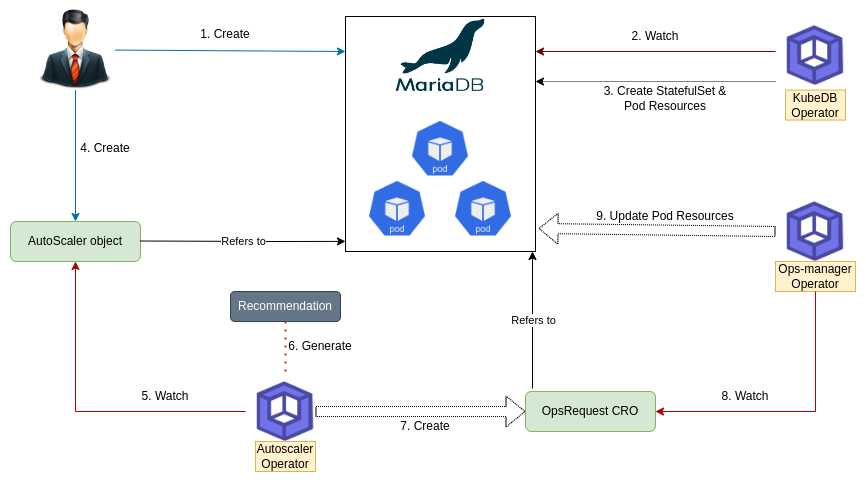

> Vous êtes nouveau sur KubeDB ? Veuillez commencer [ici](https://kubedb.com/docs/v2026.7.10/README).

# Mise à l'échelle automatique des ressources de calcul MariaDB distribuées

Ce guide donnera un aperçu de la façon dont l'opérateur KubeDB Autoscaler met automatiquement à l'échelle les ressources de calcul, c'est-à-dire le processeur et la mémoire d'un **distribué** Cluster MariaDB utilisant `mariadbautoscaler` crd.

## Avant de commencer

* Vous devriez être familier avec ce qui suit `KubeDB` notions :
  + [MariaDB](../../../concepts/mariadb.md)
  + [MariaDBAutoscaler](../../../concepts/autoscaler.md)
  + [MariaDBOpsRequest](../../../concepts/opsrequest.md)
  + [Présentation de MariaDB distribuée](../../overview.md)

## Fonctionnement de la mise à l'échelle automatique du calcul

Le diagramme suivant montre comment l'opérateur KubeDB Autoscaler met automatiquement à l'échelle les ressources de `MariaDB` composants de base de données. Ouvrez l'image dans un nouvel onglet pour voir la version agrandie.

Fig : Processus de mise à l'échelle automatique de MariaDB

Le processus Auto Scaling comprend les étapes suivantes :

1. Dans un premier temps, l'utilisateur crée un `PlacementPolicy` Ressource personnalisée (CR) avec `monitoring.prometheus.url` configuré pour chaque cluster de rayons. Cela permet à l'autoscaler d'extraire les métriques de l'instance Prometheus exécutée dans chaque cluster Spoke.
2. L'utilisateur crée un `MariaDB` Objet de ressource personnalisé (CRO) avec `spec.distributed: true` et une référence à `PlacementPolicy`.
3. `KubeDB` L'opérateur communautaire surveille `MariaDB` CRO.
4. Lorsque l'opérateur trouve un `MariaDB` CRO, il crée le nombre requis de `PetSets` et les distribue sur les clusters de rayons tels que définis par le `PlacementPolicy`.
5. Ensuite, afin de configurer l'autoscaling des ressources CPU et mémoire du `MariaDB` base de données, l'utilisateur crée un `MariaDBAutoscaler` CRO avec la configuration souhaitée.
6. `KubeDB` L'opérateur de l'autoscaler surveille le `MariaDBAutoscaler` CRO.
7. `KubeDB` L'opérateur Autoscaler utilise la version modifiée du responsable Kubernetes [Recommandateur APV](https://github.com/kubernetes/autoscaler/tree/master/vertical-pod-autoscaler/pkg) pour différents composants de la base de données, comme spécifié dans le `mariadbautoscaler` CRO.
   Il génère des recommandations basées sur l'utilisation des ressources en interrogeant les points de terminaison Prometheus configurés dans le `PlacementPolicy`, et les stocke dans le `status` section du CRO de l'autoscaler.
8. Si la recommandation générée ne correspond pas aux ressources actuelles de la base de données, alors `KubeDB` L'opérateur Autoscaler crée un `MariaDBOpsRequest` CRO pour mettre à l'échelle la base de données afin qu'elle corresponde à la recommandation fournie par l'objet VPA.
9. `KubeDB Ops-Manager operator` regarde le `MariaDBOpsRequest` CRO.
10. Enfin, le `KubeDB Ops-Manager operator` mettra à l'échelle le composant de base de données verticalement comme spécifié sur le `MariaDBOpsRequest` CRO.

> **Différence clé par rapport à la mise à l'échelle automatique non distribuée**: Pour MariaDB distribuée, le `PlacementPolicy` doit inclure un `monitoring.prometheus.url` pour chaque cluster de rayons `distributionRules` entrée. L'autoscaler utilise ces points de terminaison Prometheus pour collecter des métriques de ressources à partir de pods exécutés sur plusieurs clusters Kubernetes.

Dans la prochaine documentation, nous allons montrer un guide étape par étape sur la mise à l'échelle automatique de la base de données MariaDB distribuée à l'aide de `MariaDBAutoscaler` CRD.