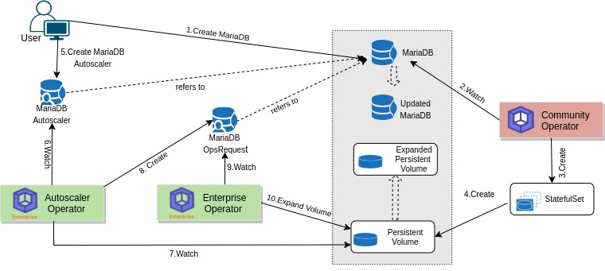

> Vous êtes nouveau sur KubeDB ? Veuillez commencer [ici](https://kubedb.com/docs/v2026.7.10/README).

# Mise à l'échelle automatique du stockage MariaDB distribué

Ce guide donnera un aperçu de la façon dont l'opérateur KubeDB Autoscaler met automatiquement à l'échelle le stockage de base de données d'un **distribué** Cluster MariaDB utilisant `mariadbautoscaler` crd.

## Avant de commencer

* Vous devriez être familier avec ce qui suit `KubeDB` notions :
  + [MariaDB](../../../concepts/mariadb.md)
  + [MariaDBAutoscaler](../../../concepts/autoscaler.md)
  + [MariaDBOpsRequest](../../../concepts/opsrequest.md)
  + [Présentation de MariaDB distribuée](../../overview.md)

## Fonctionnement de la mise à l'échelle automatique du stockage

Le diagramme suivant montre comment l'opérateur KubeDB Autoscaler met automatiquement à l'échelle les ressources de `MariaDB` composants de base de données. Ouvrez l'image dans un nouvel onglet pour voir la version agrandie.

Fig : Processus de mise à l'échelle automatique du stockage de MariaDB

Le processus Auto Scaling comprend les étapes suivantes :

1. Dans un premier temps, l'utilisateur crée un `PlacementPolicy` Ressource personnalisée (CR) avec `monitoring.prometheus.url` configuré pour chaque cluster de rayons. Cela permet à l'autoscaler de surveiller l'utilisation du stockage sur tous les clusters sur lesquels les pods MariaDB sont exécutés.
2. L'utilisateur crée un `MariaDB` Ressource personnalisée (CR) avec `spec.distributed: true` et une référence à `PlacementPolicy`.
3. `KubeDB` L'opérateur communautaire surveille `MariaDB` CR.
4. Lorsque l'opérateur trouve un `MariaDB` CR, il crée le nombre requis de `PetSets` et les distribue sur les clusters de rayons tels que définis par le `PlacementPolicy`.
5. Chaque PetSet crée un volume persistant selon le modèle de réclamation de volume fourni dans la configuration du petset. Ce volume persistant sera étendu par le `KubeDB` Opérateur d'entreprise.
6. Ensuite, afin de configurer l'autoscaling du stockage du `MariaDB` base de données, l'utilisateur crée un `MariaDBAutoscaler` CRO avec la configuration souhaitée.
7. `KubeDB` L'opérateur de l'autoscaler surveille le `MariaDBAutoscaler` CRO.
8. `KubeDB` L'opérateur de mise à l'échelle automatique surveille en permanence les volumes persistants des bases de données sur tous les clusters Spoke pour vérifier si l'utilisation du stockage dépasse le seuil spécifié. Il interroge les points de terminaison Prometheus configurés par cluster dans le `PlacementPolicy` pour collecter des métriques de stockage.
9. Si l'utilisation dépasse le seuil d'utilisation spécifié, alors `KubeDB` L'opérateur Autoscaler crée un `MariaDBOpsRequest` pour étendre le stockage de la base de données.
10. `KubeDB` L'opérateur d'entreprise surveille le `MariaDBOpsRequest` CRO.
11. Puis le `KubeDB` L'opérateur d'entreprise étendra le stockage du composant de base de données comme spécifié sur le `MariaDBOpsRequest` CRO.

> **Différence clé par rapport à la mise à l'échelle automatique non distribuée**: Pour MariaDB distribuée, le `PlacementPolicy` doit inclure un `monitoring.prometheus.url` pour chaque cluster de rayons `distributionRules` entrée. L'autoscaler utilise ces points de terminaison Prometheus pour collecter des métriques d'utilisation du stockage à partir de pods exécutés sur plusieurs clusters Kubernetes.

Dans la documentation suivante, nous allons montrer un guide étape par étape sur la mise à l'échelle automatique du stockage d'une base de données MariaDB distribuée à l'aide de `MariaDBAutoscaler` CRD.