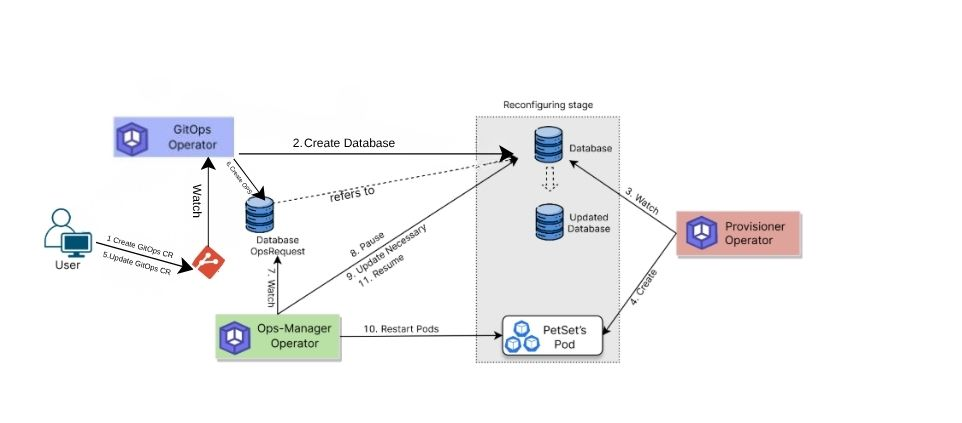

> Vous êtes nouveau sur KubeDB ? Veuillez commencer [ici](https://kubedb.com/docs/v2026.7.10/README).

# Présentation de GitOps pour MariaDB

Ce guide vous donnera un aperçu de la façon dont KubeDB `gitops` L'opérateur fonctionne avec les bases de données MariaDB en utilisant le `gitops.kubedb.com/v1alpha1` API. Cela vous aidera à comprendre le flux de travail GitOps pour
gestion des bases de données MariaDB dans Kubernetes.

## Avant de commencer

* Vous devriez être familier avec ce qui suit `KubeDB` notions :
  + [MariaDB](../concepts/mariadb.md)
  + [MariaDBOpsDemande](../concepts/opsrequest.md)

## Flux de travail GitOps avec MariaDB

Le diagramme suivant montre comment le `KubeDB` Opérateur GitOps utilisé pour se synchroniser avec votre base de données. Ouvrez l'image dans un nouvel onglet pour voir la version agrandie.

Fig : Processus GitOps de MariaDB

1. **Définir GitOps MariaDB**: Créer une ressource personnalisée (CR) de type `MariaDB` en utilisant le `gitops.kubedb.com/v1alpha1` API.
2. **Stocker dans Git**: poussez le CR vers un référentiel Git.
3. **Déploiement automatisé**: Utilisez un outil GitOps (comme `ArgoCD` ou `FluxCD`) pour surveiller le référentiel Git et synchroniser l'état du cluster Kubernetes avec l'état souhaité défini dans Git.
4. **Créer une base de données**: L'opérateur GitOps crée un CR KubeDB MariaDB correspondant dans le cluster Kubernetes pour déployer la base de données.
5. **Gérer les mises à jour**: Lorsque vous mettez à jour le CR MariaDBGitOps, l'opérateur génère une demande Ops pour appliquer la mise à jour en toute sécurité (par ex. `VerticalScaling`, `HorizontalScaling`, `VolumeExapnsion`, `Reconfigure`, `RotateAuth`, `ReconfigureTLS`, `VersionUpdate`, et `Restart`.

Ce flux rend la gestion des bases de données MariaDB efficace, fiable et entièrement intégrée aux pratiques GitOps.

Dans le prochain document, nous allons montrer un guide étape par étape sur l'exécution de MariaDB à l'aide de GitOps.