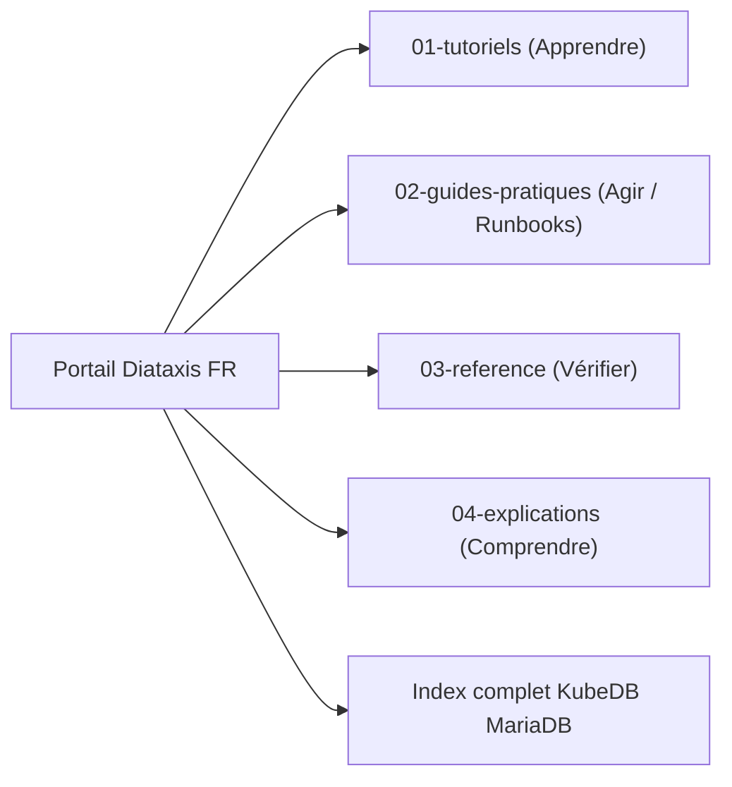

# Portail de documentation KubeDB MariaDB (FR)

Bienvenue dans la documentation structurée en français pour KubeDB MariaDB (`v2026.7.10`), organisée selon l'architecture Diátaxis.

## Quadrants

- [Tutoriels](01-tutoriels/index.md) : parcours guidés et reproductibles pour déployer MariaDB et configurer la sauvegarde PITR KubeStash.
- [Guides pratiques](02-guides-pratiques/index.md) : procédures opérationnelles et runbooks conformes ASD-STF100 (réplication MaxScale, mise à l'échelle, PITR, basculement).
- [Référence](03-reference/index.md) : tables de référence neutres pour les CRD KubeDB, types `MariaDBOpsRequest`, ports réseau et commandes `kubectl`/`maxctrl`.
- [Explications](04-explications/index.md) : analyses d'architecture sur les modes de clustering, la réconciliation `PetSet` et les pipelines de sauvegarde.

## Index complet des guides

Consultez la liste exhaustive des guides dans l'[index complet français](README.md) ou accédez au [portail anglais](../en/index.md).
