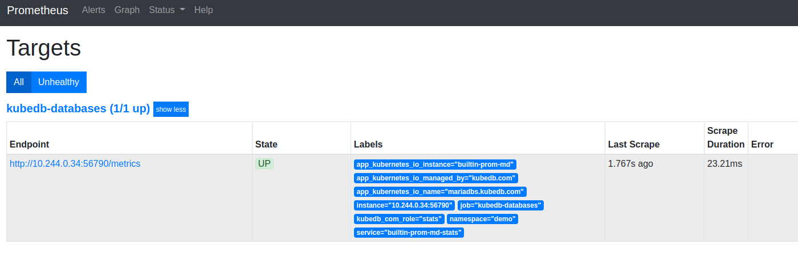

> Vous êtes nouveau sur KubeDB ? Veuillez commencer [ici](https://kubedb.com/docs/v2026.7.10/README).

# Surveillance de MariaDB avec Prometheus intégré

Ce tutoriel va vous montrer comment surveiller la base de données MariaDB à l'aide de la fonction intégrée [Prométhée](https://github.com/prometheus/prometheus) grattoir.

## Avant de commencer

* Dans un premier temps, vous devez disposer d'un cluster Kubernetes et l'outil de ligne de commande kubectl doit être configuré pour communiquer avec votre cluster. Si vous n'avez pas encore de cluster, vous pouvez en créer un en utilisant [gentil](https://kind.sigs.k8s.io/docs/user/quick-start/).
* Installez l'opérateur KubeDB dans votre cluster en suivant les étapes [ici](https://kubedb.com/docs/v2026.7.10/setup/README).
* Si vous ne savez pas comment configurer Prometheus pour récupérer les métriques de diverses ressources Kubernetes, veuillez lire le didacticiel de [ici](https://github.com/appscode/third-party-tools/tree/master/monitoring/prometheus/builtin).
* Pour savoir comment la surveillance Prometheus fonctionne avec KubeDB en général, veuillez visiter [ici](overview.md).
* Pour garder les ressources Prometheus isolées, nous allons utiliser un espace de noms distinct appelé `monitoring` pour déployer les ressources de surveillance respectives. Nous allons déployer la base de données dans `demo` espace de noms.

  ```bash
  $ kubectl create ns monitoring
  namespace/monitoring created

  $ kubectl create ns demo
  namespace/demo created
  ```

> Remarque : les fichiers YAML utilisés dans ce didacticiel sont stockés dans [docs/guides/mariadb/monitoring/builtin-prometheus/examples](https://github.com/kubedb/docs/tree/v2026.7.10/docs/guides/mariadb/monitoring/builtin-prometheus/examples) dossier dans le référentiel GitHub [kubedb/docs](https://github.com/kubedb/docs).

## Déployer MariaDB avec la surveillance activée

Dans un premier temps, déployons une base de données MariaDB avec la surveillance activée. Ci-dessous se trouve l'objet MariaDB que nous allons créer.

```yaml
apiVersion: kubedb.com/v1
kind: MariaDB
metadata:
  name: builtin-prom-md
  namespace: demo
spec:
  version: "12.1.2"
  deletionPolicy: WipeOut
  storage:
    storageClassName: "standard"
    accessModes:
    - ReadWriteOnce
    resources:
      requests:
        storage: 1Gi
  monitor:
    agent: prometheus.io/builtin
```

Ici,

* `spec.monitor.agent: prometheus.io/builtin` précise que nous allons surveiller ce serveur à l'aide du scraper Prometheus intégré.

Créons le crd MariaDB que nous avons montré ci-dessus.

```bash
$ kubectl apply -f https://github.com/kubedb/docs/raw/v2026.7.10/docs/guides/mariadb/monitoring/builtin-prometheus/examples/builtin-prom-md.yaml
mariadb.kubedb.com/builtin-prom-md created
```

Maintenant, attendez que la base de données entre dans `Running` État.

```bash
$ kubectl get mariadb -n demo builtin-prom-md
NAME              VERSION   STATUS   AGE
builtin-prom-md   11.8.5    Ready    76s
```

KubeDB créera un service de statistiques distinct avec le nom `{MariaDB crd name}-stats` à des fins de surveillance.

```bash
$ kubectl get svc -n demo --selector="app.kubernetes.io/instance=builtin-prom-md"
NAME                    TYPE        CLUSTER-IP      EXTERNAL-IP   PORT(S)     AGE
builtin-prom-md         ClusterIP   10.106.32.194   <none>        3306/TCP    2m3s
builtin-prom-md-pods    ClusterIP   None            <none>        3306/TCP    2m3s
builtin-prom-md-stats   ClusterIP   10.109.106.92   <none>        56790/TCP   2m2s
```

Ici, `builtin-prom-md-stats` Le service a été créé à des fins de surveillance. Décrivons le service.

```bash
$ kubectl describe svc -n demo builtin-prom-md-stats
Name:              builtin-prom-md-stats
Namespace:         demo
Labels:            app.kubernetes.io/instance=builtin-prom-md
                   app.kubernetes.io/managed-by=kubedb.com
                   app.kubernetes.io/name=mariadbs.kubedb.com
                   kubedb.com/role=stats
Annotations:       monitoring.appscode.com/agent: prometheus.io/builtin
                   prometheus.io/path: /metrics
                   prometheus.io/port: 56790
                   prometheus.io/scrape: true
Selector:          app.kubernetes.io/instance=builtin-prom-md,app.kubernetes.io/managed-by=kubedb.com,app.kubernetes.io/name=mariadbs.kubedb.com
Type:              ClusterIP
IP:                10.109.106.92
Port:              metrics  56790/TCP
TargetPort:        metrics/TCP
Endpoints:         10.244.0.34:56790
Session Affinity:  None
Events:            <none>
```

Vous pouvez voir que le service contient les annotations suivantes.

```bash
prometheus.io/path: /metrics
prometheus.io/port: 56790
prometheus.io/scrape: true
```

Le serveur Prometheus découvrira le point de terminaison du service à l'aide de ces spécifications et récupérera les métriques de l'exportateur.

## Configurer le serveur Prometheus

Nous devons maintenant configurer une tâche de scraping Prometheus pour récupérer les métriques à l'aide de ce service. Nous allons configurer un travail de scraping similaire à celui-ci [points de terminaison du service Kubernetes](https://github.com/appscode/third-party-tools/tree/master/monitoring/prometheus/builtin#kubernetes-service-endpoints) travail qui récupère les métriques des points de terminaison d’un service.

Configurons une tâche de scraping Prometheus pour collecter les métriques de ce service.

```yaml
- job_name: 'kubedb-databases'
  honor_labels: true
  scheme: http
  kubernetes_sd_configs:
  - role: endpoints
  # by default Prometheus server select all Kubernetes services as possible target.
  # relabel_config is used to filter only desired endpoints
  relabel_configs:
  # keep only those services that has "prometheus.io/scrape","prometheus.io/path" and "prometheus.io/port" annotations
  - source_labels: [__meta_kubernetes_service_annotation_prometheus_io_scrape, __meta_kubernetes_service_annotation_prometheus_io_port]
    separator: ;
    regex: true;(.*)
    action: keep
  # currently KubeDB supported databases uses only "http" scheme to export metrics. so, drop any service that uses "https" scheme.
  - source_labels: [__meta_kubernetes_service_annotation_prometheus_io_scheme]
    action: drop
    regex: https
  # only keep the stats services created by KubeDB for monitoring purpose which has "-stats" suffix
  - source_labels: [__meta_kubernetes_service_name]
    separator: ;
    regex: (.*-stats)
    action: keep
  # service created by KubeDB will have "app.kubernetes.io/name" and "app.kubernetes.io/instance" annotations. keep only those services that have these annotations.
  - source_labels: [__meta_kubernetes_service_label_app_kubernetes_io_name]
    separator: ;
    regex: (.*)
    action: keep
  # read the metric path from "prometheus.io/path: <path>" annotation
  - source_labels: [__meta_kubernetes_service_annotation_prometheus_io_path]
    action: replace
    target_label: __metrics_path__
    regex: (.+)
  # read the port from "prometheus.io/port: <port>" annotation and update scraping address accordingly
  - source_labels: [__address__, __meta_kubernetes_service_annotation_prometheus_io_port]
    action: replace
    target_label: __address__
    regex: ([^:]+)(?::\d+)?;(\d+)
    replacement: $1:$2
  # add service namespace as label to the scraped metrics
  - source_labels: [__meta_kubernetes_namespace]
    separator: ;
    regex: (.*)
    target_label: namespace
    replacement: $1
    action: replace
  # add service name as a label to the scraped metrics
  - source_labels: [__meta_kubernetes_service_name]
    separator: ;
    regex: (.*)
    target_label: service
    replacement: $1
    action: replace
  # add stats service's labels to the scraped metrics
  - action: labelmap
    regex: __meta_kubernetes_service_label_(.+)
```

### Configurer le serveur Prometheus existant

Si vous disposez déjà d'un serveur Prometheus en cours d'exécution, vous devez ajouter la tâche de scraping ci-dessus dans le fichier `ConfigMap` utilisé pour configurer le serveur Prometheus. Ensuite, vous devez le redémarrer pour que la configuration mise à jour prenne effet.

> Si vous n'utilisez pas de volume persistant pour le stockage Prometheus, vous perdrez vos données précédemment récupérées au redémarrage.

### Déployer un nouveau serveur Prometheus

Si aucun serveur Prometheus n’est en cours d’exécution, vous devez en déployer un. Dans cette section, nous allons déployer un serveur Prometheus dans `monitoring` espace de noms pour collecter des métriques à l’aide de ce service de statistiques.

**Créez une ConfigMap :**

Dans un premier temps, créez un ConfigMap avec la configuration de scraping. Ci-dessous, le YAML de ConfigMap que nous allons créer dans ce tutoriel.

```yaml
apiVersion: v1
kind: ConfigMap
metadata:
  name: prometheus-config
  labels:
    app: prometheus-demo
  namespace: monitoring
data:
  prometheus.yml: |-
    global:
      scrape_interval: 5s
      evaluation_interval: 5s
    scrape_configs:
    - job_name: 'kubedb-databases'
      honor_labels: true
      scheme: http
      kubernetes_sd_configs:
      - role: endpoints
      # by default Prometheus server select all Kubernetes services as possible target.
      # relabel_config is used to filter only desired endpoints
      relabel_configs:
      # keep only those services that has "prometheus.io/scrape","prometheus.io/path" and "prometheus.io/port" anootations
      - source_labels: [__meta_kubernetes_service_annotation_prometheus_io_scrape, __meta_kubernetes_service_annotation_prometheus_io_port]
        separator: ;
        regex: true;(.*)
        action: keep
      # currently KubeDB supported databases uses only "http" scheme to export metrics. so, drop any service that uses "https" scheme.
      - source_labels: [__meta_kubernetes_service_annotation_prometheus_io_scheme]
        action: drop
        regex: https
      # only keep the stats services created by KubeDB for monitoring purpose which has "-stats" suffix
      - source_labels: [__meta_kubernetes_service_name]
        separator: ;
        regex: (.*-stats)
        action: keep
      # service created by KubeDB will have "app.kubernetes.io/name" and "app.kubernetes.io/instance" annotations. keep only those services that have these annotations.
      - source_labels: [__meta_kubernetes_service_label_app_kubernetes_io_name]
        separator: ;
        regex: (.*)
        action: keep
      # read the metric path from "prometheus.io/path: <path>" annotation
      - source_labels: [__meta_kubernetes_service_annotation_prometheus_io_path]
        action: replace
        target_label: __metrics_path__
        regex: (.+)
      # read the port from "prometheus.io/port: <port>" annotation and update scraping address accordingly
      - source_labels: [__address__, __meta_kubernetes_service_annotation_prometheus_io_port]
        action: replace
        target_label: __address__
        regex: ([^:]+)(?::\d+)?;(\d+)
        replacement: $1:$2
      # add service namespace as label to the scraped metrics
      - source_labels: [__meta_kubernetes_namespace]
        separator: ;
        regex: (.*)
        target_label: namespace
        replacement: $1
        action: replace
      # add service name as a label to the scraped metrics
      - source_labels: [__meta_kubernetes_service_name]
        separator: ;
        regex: (.*)
        target_label: service
        replacement: $1
        action: replace
      # add stats service's labels to the scraped metrics
      - action: labelmap
        regex: __meta_kubernetes_service_label_(.+)
```

Créons ci-dessus `ConfigMap`,

```bash
$ kubectl apply -f https://github.com/kubedb/docs/raw/v2026.7.10/docs/guides/mariadb/monitoring/builtin-prometheus/examples/prom-config.yaml
configmap/prometheus-config created
```

**Créer un RBAC :**

Si vous utilisez un cluster compatible RBAC, vous devez accorder les autorisations RBAC nécessaires pour Prometheus. Créons les éléments RBAC nécessaires pour Prometheus,

```bash
$ kubectl apply -f https://github.com/appscode/third-party-tools/raw/master/monitoring/prometheus/builtin/artifacts/rbac.yaml
clusterrole.rbac.authorization.k8s.io/prometheus created
serviceaccount/prometheus created
clusterrolebinding.rbac.authorization.k8s.io/prometheus created
```

> YAML pour les ressources RBAC créées ci-dessus peut être trouvé [ici](https://github.com/appscode/third-party-tools/blob/master/monitoring/prometheus/builtin/artifacts/rbac.yaml).

**Déployez Prometheus :**

Nous sommes maintenant prêts à déployer le serveur Prometheus. Nous allons utiliser ce qui suit [déploiement](https://github.com/appscode/third-party-tools/blob/master/monitoring/prometheus/builtin/artifacts/deployment.yaml) pour déployer le serveur Prometheus.

Déployons le serveur Prometheus.

```bash
$ kubectl apply -f https://github.com/appscode/third-party-tools/raw/master/monitoring/prometheus/builtin/artifacts/deployment.yaml
deployment.apps/prometheus created
```

### Vérifier les métriques de surveillance

Le serveur Prometheus écoute le port `9090`. Nous allons utiliser [redirection de port](https://kubernetes.io/docs/tasks/access-application-cluster/port-forward-access-application-cluster/) pour accéder au tableau de bord Prometheus.

Dans un premier temps, vérifions si le pod Prometheus est présent `Running` État.

```bash
$ kubectl get pod -n monitoring -l=app=prometheus
NAME                          READY   STATUS    RESTARTS   AGE
prometheus-5dff66b455-cz9td   1/1     Running   0          42s
```

Maintenant, exécutez la commande suivante sur un terminal séparé pour transférer le port 9090 de `prometheus-8568c86d86-95zhn` cosse,

```bash
$ kubectl port-forward -n monitoring prometheus-8568c86d86-95zhn 9090
Forwarding from 127.0.0.1:9090 -> 9090
Forwarding from [::1]:9090 -> 9090
```

Maintenant, nous pouvons accéder au tableau de bord à l'adresse `localhost:9090`. Ouvrir <http://localhost:9090> dans votre navigateur. Vous devriez voir le point final de `builtin-prom-md-stats` service comme l’une des cibles.



Vérifiez les étiquettes marquées d'un rectangle rouge. Ces étiquettes confirment que les métriques proviennent de `MariaDB` base de données `builtin-prom-md` via le service de statistiques `builtin-prom-md-stats`.

Vous pouvez désormais afficher les métriques collectées et créer un graphique à partir de la page d'accueil de ce tableau de bord Prometheus. Vous pouvez également utiliser ce serveur Prometheus comme source de données pour [Grafana](https://grafana.com/) et créez un magnifique tableau de bord avec les métriques collectées.

## Nettoyage

Pour nettoyer les ressources Kubernetes créées par ce didacticiel, exécutez les commandes suivantes

```bash
kubectl delete mariadb -n demo builtin-prom-md

kubectl delete -n monitoring deployment.apps/prometheus

kubectl delete -n monitoring clusterrole.rbac.authorization.k8s.io/prometheus
kubectl delete -n monitoring serviceaccount/prometheus
kubectl delete -n monitoring clusterrolebinding.rbac.authorization.k8s.io/prometheus

kubectl delete ns demo
kubectl delete ns monitoring
```