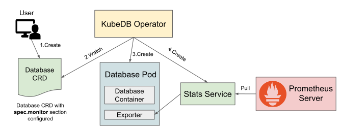

> Vous êtes nouveau sur KubeDB ? Veuillez commencer [ici](https://kubedb.com/docs/v2026.7.10/README).

# Surveillance de MariaDB avec KubeDB

KubeDB prend en charge nativement la surveillance via [Prométhée](https://prometheus.io/). Vous pouvez utiliser le module intégré [Prométhée](https://github.com/prometheus/prometheus) grattoir ou [Opérateur Prométhée](https://github.com/prometheus-operator/prometheus-operator) pour surveiller les bases de données gérées par KubeDB. Ce didacticiel vous montrera comment fonctionne la surveillance de base de données avec KubeDB et comment configurer Database crd pour activer la surveillance.

## Aperçu

KubeDB utilise Prometheus [exportateur](https://prometheus.io/docs/instrumenting/exporters/#databases) images pour exporter les métriques Prometheus pour les bases de données respectives. Le diagramme suivant montre le flux logique de la surveillance de la base de données avec KubeDB.



Lorsqu'un utilisateur crée un crd de base de données avec `spec.monitor` configurée, l'opérateur KubeDB provisionne la base de données respective et injecte une image d'exportateur comme side-car dans le pod de base de données. Il crée également un service de statistiques dédié avec le nom `{database-crd-name}-stats` pour le suivi. Le serveur Prometheus peut récupérer des métriques à l'aide de ce service de statistiques.

## Configurer la surveillance

Afin d'activer la surveillance d'une base de données, vous devez configurer `spec.monitor` section. KubeDB fournit les options suivantes à configurer `spec.monitor` section:

| Champ | Type | Utilisations |
| --- | --- | --- |
| `spec.monitor.agent` | `Required` | Type de l'agent de surveillance qui sera utilisé pour surveiller cette base de données. Cela peut être `prometheus.io/builtin` ou `prometheus.io/operator`. |
| `spec.monitor.prometheus.exporter.port` | `Optional` | Numéro de port où le side-car de l'exportateur fournira des mesures. |
| `spec.monitor.prometheus.exporter.args` | `Optional` | Arguments à transmettre au side-car de l’exportateur. |
| `spec.monitor.prometheus.exporter.env` | `Optional` | Liste des variables d'environnement à définir dans le conteneur side-car de l'exportateur. |
| `spec.monitor.prometheus.exporter.resources` | `Optional` | Ressources requises par le conteneur side-car de l'exportateur. |
| `spec.monitor.prometheus.exporter.securityContext` | `Optional` | Options de sécurité avec lesquelles l’exportateur doit fonctionner. |
| `spec.monitor.prometheus.serviceMonitor.labels` | `Optional` | Étiquettes pour `ServiceMonitor` crd. |
| `spec.monitor.prometheus.serviceMonitor.interval` | `Optional` | Intervalle auquel les métriques doivent être récupérées. |

## Exemple de configuration

Un exemple de YAML pour le crd MariaDB avec `spec.monitor` section configurée pour permettre la surveillance avec [Opérateur Prométhée](https://github.com/prometheus-operator/prometheus-operator) est montré ci-dessous.

```yaml
apiVersion: kubedb.com/v1
kind: MariaDB
metadata:
  name: coreos-prom-md
  namespace: demo
spec:
  version: "12.1.2"
  deletionPolicy: WipeOut
  storage:
    accessModes:
      - ReadWriteOnce
    resources:
      requests:
        storage: 1Gi
  monitor:
    agent: prometheus.io/operator
    prometheus:
      serviceMonitor:
        labels:
          release: prometheus
        interval: 10s
```

Supposons que MariaDB ci-dessus soit configurée pour utiliser l'authentification de base. Ainsi, l’image de l’exportateur doit également fournir un mot de passe pour collecter des métriques. Nous l'avons fourni à travers `spec.monitor.prometheus.exporter.args` champ.

Ici, nous avons précisé que nous allons surveiller ce serveur à l'aide de l'opérateur Prometheus via `spec.monitor.agent: prometheus.io/operator`. KubeDB créera un `ServiceMonitor` crédit dans `monitoring` espace de noms et ceci `ServiceMonitor` aura `release: prometheus` étiquette.

## Prochaines étapes

* Apprenez à surveiller `MariaDB` base de données avec KubeDB en utilisant [intégré-Prométhée](builtin-prometheus.md) et en utilisant [Opérateur Prométhée](prometheus-operator.md).
* Apprenez à surveiller une base de données `Elasticsearch` avec KubeDB en utilisant [Prometheus intégré](https://kubedb.com/docs/v2026.7.10/guides/elasticsearch/monitoring/using-builtin-prometheus) et en utilisant [Opérateur Prométhée](https://kubedb.com/docs/v2026.7.10/guides/elasticsearch/monitoring/using-prometheus-operator).
* Apprenez à surveiller `PostgreSQL` base de données avec KubeDB en utilisant [intégré-Prométhée](https://kubedb.com/docs/v2026.7.10/guides/postgres/monitoring/using-builtin-prometheus) et en utilisant [Opérateur Prométhée](https://kubedb.com/docs/v2026.7.10/guides/postgres/monitoring/using-prometheus-operator).
* Apprenez à surveiller une base de données `MySQL` avec KubeDB en utilisant [intégré-Prométhée](https://kubedb.com/docs/v2026.7.10/guides/mysql/monitoring/builtin-prometheus/) et en utilisant [Opérateur Prométhée](https://kubedb.com/docs/v2026.7.10/guides/mysql/monitoring/prometheus-operator/).
* Apprenez à surveiller `MongoDB` base de données avec KubeDB en utilisant [intégré-Prométhée](https://kubedb.com/docs/v2026.7.10/guides/mongodb/monitoring/using-builtin-prometheus) et en utilisant [Opérateur Prométhée](https://kubedb.com/docs/v2026.7.10/guides/mongodb/monitoring/using-prometheus-operator).
* Apprenez à surveiller `Redis` serveur avec KubeDB utilisant [intégré-Prométhée](https://kubedb.com/docs/v2026.7.10/guides/redis/monitoring/using-builtin-prometheus) et en utilisant [Opérateur Prométhée](https://kubedb.com/docs/v2026.7.10/guides/redis/monitoring/using-prometheus-operator).
* Apprenez à surveiller `Memcached` serveur avec KubeDB utilisant [intégré-Prométhée](https://kubedb.com/docs/v2026.7.10/guides/memcached/monitoring/using-builtin-prometheus) et en utilisant [Opérateur Prométhée](https://kubedb.com/docs/v2026.7.10/guides/memcached/monitoring/using-prometheus-operator).