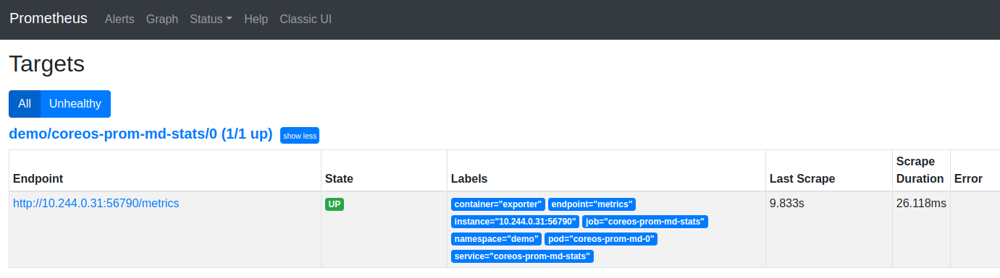

> Vous êtes nouveau sur KubeDB ? Veuillez commencer [ici](https://kubedb.com/docs/v2026.7.10/README).

# Surveillance de MariaDB à l'aide de l'opérateur Prometheus

[Opérateur Prométhée](https://github.com/prometheus-operator/prometheus-operator) fournit un moyen simple et natif de Kubernetes de déployer et de configurer le serveur Prometheus. Ce didacticiel vous montrera comment utiliser l'opérateur Prometheus pour surveiller la base de données MariaDB déployée avec KubeDB.

## Avant de commencer

* Dans un premier temps, vous devez disposer d'un cluster Kubernetes et l'outil de ligne de commande kubectl doit être configuré pour communiquer avec votre cluster. Si vous n'avez pas encore de cluster, vous pouvez en créer un en utilisant [gentil](https://kind.sigs.k8s.io/docs/user/quick-start/).
* Pour savoir comment la surveillance Prometheus fonctionne avec KubeDB en général, veuillez visiter [ici](overview.md).
* Pour conserver les ressources de base de données isolées, ce didacticiel utilise un espace de noms distinct appelé `demo` tout au long de ce tutoriel. Exécutez la commande suivante pour préparer votre cluster :

  ```bash
  $ kubectl create ns demo
  namespace/demo created
  ```
* Nous avons besoin d'un [Opérateur Prométhée](https://github.com/prometheus-operator/prometheus-operator) instance en cours d'exécution. Si vous n'avez pas encore d'instance en cours d'exécution, déployez-en une en suivant la documentation de [ici](https://github.com/appscode/third-party-tools/blob/master/monitoring/prometheus/operator/README.md).
* Si vous n'avez pas encore de serveur Prometheus en cours d'exécution, déployez le didacticiel suivant à partir de [ici](https://github.com/appscode/third-party-tools/blob/master/monitoring/prometheus/operator/README.md#deploy-prometheus-server).

> Remarque : les fichiers YAML utilisés dans ce didacticiel sont stockés dans [/docs/guides/mariadb/monitoring/prometheus-operator/examples](https://github.com/kubedb/docs/tree/v2026.7.10/docs/guides/mariadb/monitoring/prometheus-operator/examples) dossier dans le référentiel GitHub [kubedb/docs](https://github.com/kubedb/docs).

## Découvrez les étiquettes requises pour ServiceMonitor

Nous devons connaître les étiquettes utilisées pour sélectionner `ServiceMonitor` par un `Prometheus` crd. Nous allons fournir ces étiquettes dans `spec.monitor.prometheus.labels` champ de MariaDB crd pour que KubeDB crée `ServiceMonitor` objecter en conséquence.

Dans un premier temps, découvrons le serveur Prometheus disponible dans notre cluster.

```bash
$ kubectl get prometheus --all-namespaces
NAMESPACE   NAME         VERSION   REPLICAS   AGE
default     prometheus             1          2m19s
```

> Si aucun serveur Prometheus n'est en cours d'exécution dans votre cluster, déployez-en un en suivant le guide spécifié dans **Avant de commencer** section.

Voyons maintenant le YAML du serveur Prometheus disponible `prometheus` dans `default` espace de noms.

```bash
$ kubectl get prometheus -n default prometheus -o yaml
```

```yaml
apiVersion: monitoring.coreos.com/v1
kind: Prometheus
metadata:
  annotations:
    kubectl.kubernetes.io/last-applied-configuration: |
      {"apiVersion":"monitoring.coreos.com/v1","kind":"Prometheus","metadata":{"annotations":{},"labels":{"prometheus":"prometheus"},"name":"prometheus","namespace":"default"},"spec":{"replicas":1,"resources":{"requests":{"memory":"400Mi"}},"serviceAccountName":"prometheus","serviceMonitorNamespaceSelector":{"matchLabels":{"prometheus":"prometheus"}},"serviceMonitorSelector":{"matchLabels":{"release":"prometheus"}}}}      
  creationTimestamp: "2020-08-25T04:02:07Z"
  generation: 1
  labels:
    prometheus: prometheus
    manager: kubectl
    operation: Update
  name: prometheus
  namespace: default
  resourceVersion: "2087"
  selfLink: /apis/monitoring.coreos.com/v1/namespaces/default/prometheuses/prometheus
  uid: 972a50cb-b751-418b-b2bc-e0ecc9232730
spec:
  replicas: 1
  resources:
    requests:
      memory: 400Mi
  serviceAccountName: prometheus
  serviceMonitorNamespaceSelector:
    matchLabels:
      prometheus: prometheus
  serviceMonitorSelector:
    matchLabels:
      release: prometheus
```

* `spec.serviceMonitorSelector` Le champ spécifie quels ServiceMonitors doivent être inclus. L'étiquette ci-dessus `release: prometheus` est utilisé pour sélectionner `ServiceMonitors` par son sélecteur. Nous allons donc utiliser cette étiquette dans `spec.monitor.prometheus.labels` champ de MariaDB crd.
* `spec.serviceMonitorNamespaceSelector` champ précise que le `ServiceMonitors` peut être sélectionné en dehors de l'espace de noms Prometheus par Prometheus à l'aide du sélecteur d'espace de noms. L'étiquette ci-dessus `prometheus: prometheus` est utilisé pour sélectionner l'espace de noms où le `ServiceMonitor` est créé.

### Ajouter une étiquette à l'espace de noms de la base de données

KubeDB crée un `ServiceMonitor` dans l'espace de noms de la base de données `demo`. Nous devons ajouter une étiquette à `demo` espace de noms. Prometheus sélectionnera cet espace de noms en utilisant son `spec.serviceMonitorNamespaceSelector` champ.

Ajoutons une étiquette `prometheus: prometheus` à `demo` espace de noms,

```bash
$ kubectl patch namespace demo -p '{"metadata":{"labels": {"prometheus":"prometheus"}}}'
namespace/demo patched
```

## Déployer MariaDB avec la surveillance activée

Dans un premier temps, déployons une base de données MariaDB avec la surveillance activée. Ci-dessous se trouve l'objet MariaDB que nous allons créer.

```yaml
apiVersion: kubedb.com/v1
kind: MariaDB
metadata:
  name: coreos-prom-md
  namespace: demo
spec:
  version: "12.1.2"
  deletionPolicy: WipeOut
  storage:
    storageClassName: "standard"
    accessModes:
    - ReadWriteOnce
    resources:
      requests:
        storage: 1Gi
  monitor:
    agent: prometheus.io/operator
    prometheus:
      serviceMonitor:
        labels:
          release: prometheus
        interval: 10s
```

Ici,

* `monitor.agent: prometheus.io/operator` indique que nous allons surveiller ce serveur à l'aide de l'opérateur Prometheus.
* `monitor.prometheus.labels` spécifie que KubeDB doit créer `ServiceMonitor` avec ces étiquettes.
* `monitor.prometheus.interval` indique que le serveur Prometheus doit extraire les métriques de cette base de données avec un intervalle de 10 secondes.

Créons l'objet MariaDB que nous avons montré ci-dessus,

```bash
$ kubectl create -f https://github.com/kubedb/docs/raw/v2026.7.10/docs/guides/mariadb/monitoring/prometheus-operator/examples/prom-operator-md.yaml
mariadb.kubedb.com/coreos-prom-md created
```

Maintenant, attendez que la base de données entre dans `Ready` État.

```bash
$ kubectl get mariadb -n demo coreos-prom-md
NAME             VERSION   STATUS   AGE
coreos-prom-md   10.5.23    Ready    59s
```

KubeDB créera un service de statistiques distinct avec le nom `{MariaDB crd name}-stats` à des fins de surveillance.

```bash
$ kubectl get svc -n demo --selector="app.kubernetes.io/instance=coreos-prom-md"
NAME                   TYPE        CLUSTER-IP      EXTERNAL-IP   PORT(S)     AGE
coreos-prom-md         ClusterIP   10.99.96.226    <none>        3306/TCP    107s
coreos-prom-md-pods    ClusterIP   None            <none>        3306/TCP    107s
coreos-prom-md-stats   ClusterIP   10.101.190.67   <none>        56790/TCP   107s
```

Ici, `coreos-prom-md-stats` Le service a été créé à des fins de surveillance.

Décrivons ce service de statistiques.

```bash
$ kubectl describe svc -n demo coreos-prom-md-stats
```

```text
Name:              coreos-prom-md-stats
Namespace:         demo
Labels:            app.kubernetes.io/instance=coreos-prom-md
                   app.kubernetes.io/managed-by=kubedb.com
                   app.kubernetes.io/name=mariadbs.kubedb.com
                   kubedb.com/role=stats
Annotations:       monitoring.appscode.com/agent: prometheus.io/operator
Selector:          app.kubernetes.io/instance=coreos-prom-md,app.kubernetes.io/managed-by=kubedb.com,app.kubernetes.io/name=mariadbs.kubedb.com
Type:              ClusterIP
IP:                10.101.190.67
Port:              metrics  56790/TCP
TargetPort:        metrics/TCP
Endpoints:         10.244.0.31:56790
Session Affinity:  None
Events:            <none>
```

Remarquez le `Labels` et `Port` champs. `ServiceMonitor` utilisera ces informations pour cibler ses points de terminaison.

KubeDB créera également un `ServiceMonitor` crédit dans `demo` espace de noms qui sélectionne les points de terminaison de `coreos-prom-md-stats` service. Vérifiez que le `ServiceMonitor` crd a été créé.

```bash
$ kubectl get servicemonitor -n demo
NAME                   AGE
coreos-prom-md-stats   4m8s
```

Vérifions que le `ServiceMonitor` porte l'étiquette que nous avions spécifiée dans `spec.monitor` section du crd MariaDB.

```bash
$ kubectl get servicemonitor -n demo coreos-prom-md-stats -o yaml
```

```yaml
apiVersion: monitoring.coreos.com/v1
kind: ServiceMonitor
metadata:
  creationTimestamp: "2021-03-19T10:09:03Z"
  generation: 1
  labels:
    app.kubernetes.io/component: database
    app.kubernetes.io/instance: coreos-prom-md
    app.kubernetes.io/managed-by: kubedb.com
    app.kubernetes.io/name: mariadbs.kubedb.com
    release: prometheus
  managedFields:
  - apiVersion: monitoring.coreos.com/v1
    fieldsType: FieldsV1
    fieldsV1:
      f:metadata:
        f:labels:
          .: {}
          f:app.kubernetes.io/component: {}
          f:app.kubernetes.io/instance: {}
          f:app.kubernetes.io/managed-by: {}
          f:app.kubernetes.io/name: {}
          f:release: {}
        f:ownerReferences: {}
      f:spec:
        .: {}
        f:endpoints: {}
        f:namespaceSelector:
          .: {}
          f:matchNames: {}
        f:selector:
          .: {}
          f:matchLabels:
            .: {}
            f:app.kubernetes.io/instance: {}
            f:app.kubernetes.io/managed-by: {}
            f:app.kubernetes.io/name: {}
            f:kubedb.com/role: {}
    manager: mariadb-operator
    operation: Update
    time: "2021-03-19T10:09:03Z"
  name: coreos-prom-md-stats
  namespace: demo
  ownerReferences:
  - apiVersion: v1
    blockOwnerDeletion: true
    controller: true
    kind: Service
    name: coreos-prom-md-stats
    uid: 08260a99-0984-4d90-bf68-34080ad0ee5b
  resourceVersion: "241637"
  selfLink: /apis/monitoring.coreos.com/v1/namespaces/demo/servicemonitors/coreos-prom-md-stats
  uid: 4f022d98-d2d8-490f-9548-f6367d03ae1f
spec:
  endpoints:
  - bearerTokenSecret:
      key: ""
    honorLabels: true
    interval: 10s
    path: /metrics
    port: metrics
  namespaceSelector:
    matchNames:
    - demo
  selector:
    matchLabels:
      app.kubernetes.io/instance: coreos-prom-md
      app.kubernetes.io/managed-by: kubedb.com
      app.kubernetes.io/name: mariadbs.kubedb.com
      kubedb.com/role: stats
```

Notez que le `ServiceMonitor` a une étiquette `release: prometheus` que nous avions spécifié dans MariaDB crd.

Notez également que le `ServiceMonitor` a un sélecteur qui correspond aux étiquettes que nous avons vues dans le `coreos-prom-md-stats` service. Il cible également les `prom-http` port que nous avons vu dans le service de statistiques.

## Vérifier les métriques de surveillance

Dans un premier temps, découvrons le pod Prometheus respectif pour `prometheus` Serveur Prometheus.

```bash
$ kubectl get pod -n default -l=app=prometheus
NAME                      READY   STATUS    RESTARTS   AGE
prometheus-prometheus-0   3/3     Running   1          16m
```

Le serveur Prometheus écoute le port `9090` de `prometheus-prometheus-0` cosse. Nous allons utiliser [redirection de port](https://kubernetes.io/docs/tasks/access-application-cluster/port-forward-access-application-cluster/) pour accéder au tableau de bord Prometheus.

Exécutez la commande suivante sur un terminal séparé pour transférer le port 9090 de `prometheus-prometheus-0` cosse,

```bash
$ kubectl port-forward -n default prometheus-prometheus-0 9090
Forwarding from 127.0.0.1:9090 -> 9090
Forwarding from [::1]:9090 -> 9090
```

Maintenant, nous pouvons accéder au tableau de bord à l'adresse `localhost:9090`. Ouvrir <http://localhost:9090> dans votre navigateur. Tu devrais voir `prom-http` point final de `coreos-prom-md-stats` service comme l’une des cibles.



Vérifiez le `endpoint` et `service` étiquettes. Il vérifie que la cible est notre base de données attendue. Vous pouvez désormais afficher les métriques collectées et créer un graphique à partir de la page d'accueil de ce tableau de bord Prometheus. Vous pouvez également utiliser ce serveur Prometheus comme source de données pour [Grafana](https://grafana.com/) et créez un magnifique tableau de bord avec les métriques collectées.

## Nettoyage

Pour nettoyer les ressources Kubernetes créées par ce didacticiel, exécutez les commandes suivantes

```bash
# cleanup database
kubectl delete mariadb -n demo coreos-prom-md

# cleanup Prometheus resources
kubectl delete -f https://raw.githubusercontent.com/appscode/third-party-tools/master/monitoring/prometheus/operator/artifacts/prometheus.yaml

kubectl delete -f https://raw.githubusercontent.com/appscode/third-party-tools/master/monitoring/prometheus/operator/artifacts/prometheus-rbac.yaml

# cleanup Prometheus operator resources
kubectl delete -f https://raw.githubusercontent.com/prometheus-operator/prometheus-operator/release-0.41/bundle.yaml

# delete namespace
kubectl delete ns demo
```