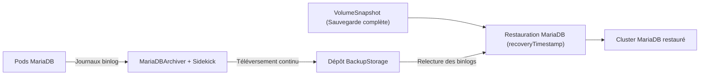

> Vous débutez avec KubeDB ? Commencez [ici](https://kubedb.com/docs/v2026.7.10/README).

# KubeDB MariaDB - Archivage continu et récupération ponctuelle (PITR)

Ici, nous allons vous montrer comment utiliser KubeDB pour provisionner une MariaDB afin d'archiver en continu et de restaurer à un moment donné.

## Avant de commencer

Dans un premier temps, vous devez disposer d'un cluster Kubernetes et l'outil de ligne de commande kubectl doit être configuré pour communiquer avec votre cluster. Pour cette démonstration, j'utilise le cluster linode.

Maintenant, installez `KubeDB` opérateur dans votre cluster en suivant les étapes [ici](https://kubedb.com/docs/v2026.7.10/setup/README).

Pour installer `KubeStash` opérateur dans votre cluster en suivant les étapes [ici](https://github.com/kubestash/installer/tree/master/charts/kubestash).

Pour installer `External-snapshotter` dans votre cluster en suivant les étapes [ici](https://github.com/kubernetes-csi/external-snapshotter/tree/release-5.0).

Pour isoler cet exercice, ce tutoriel utilise un espace de noms dédié appelé `demo`.

```bash
$ kubectl create ns demo
namespace/demo created
```

> Remarque : Les fichiers yaml utilisés dans ce didacticiel sont stockés dans [docs/guides/mariadb/pitr/overview/yamls](https://github.com/kubedb/docs/tree/v2026.7.10/docs/guides/mariadb/remote-replica/yamls) dossier dans le référentiel GitHub [kubedb/docs](https://github.com/kubedb/docs).

## Archivage continu



L'archivage continu implique la réalisation de copies régulières (ou « archives ») des fichiers journaux des transactions MariaDB. Pour garantir un archivage continu vers un emplacement distant, nous devons préparer `BackupStorage`,`RetentionPolicy`,`MariaDBArchiver` pour les bases de données MariaDB gérées par KubeDB.

### BackupStorage

BackupStorage est un CR fourni par KubeStash qui peut gérer le stockage de divers fournisseurs tels que GCS, S3, etc.
Nous allons stocker nos données de sauvegarde dans un `S3` seau. Nous devons créer un `Secret` avec les informations d'identification nécessaires et un `BackupStorage` CR pour utiliser ce backend. Si vous souhaitez utiliser un autre backend, veuillez lire le document de configuration du backend correspondant à partir de [ici](https://kubestash.com/docs/latest/guides/backends/overview/).

```yaml
apiVersion: storage.kubestash.com/v1alpha1
kind: BackupStorage
metadata:
  name: linode-storage
  namespace: demo
spec:
  storage:
    provider: s3
    s3:
      bucket: test-archiver
      endpoint: https://ap-south-1.linodeobjects.com
      region: ap-south-1
      prefix: backup
      secretName: storage
  usagePolicy:
    allowedNamespaces:
      from: All
  default: true
  deletionPolicy: WipeOut
```

```bash
$ kubectl apply -f backupstorage.yaml
   backupstorage.storage.kubestash.com/linode-storage created
```

### Secrets pour BackupStorage

```yaml
apiVersion: v1
kind: Secret
type: Opaque
metadata:
  name: storage
  namespace: demo
stringData:
  AWS_ACCESS_KEY_ID: "*************26CX"
  AWS_SECRET_ACCESS_KEY: "************jj3lp"
  AWS_ENDPOINT: https://ap-south-1.linodeobjects.com
```

```bash
$ kubectl apply -f storage-secret.yaml 
  secret/storage created
```

### Politique de rétention (`RetentionPolicy`)

RetentionPolicy est une ressource personnalisée (CR) fournie par KubeStash qui vous permet de définir la durée pendant laquelle vous souhaitez conserver les données de sauvegarde.

```yaml
apiVersion: storage.kubestash.com/v1alpha1
kind: RetentionPolicy
metadata:
  name: mariadb-retention-policy
  namespace: demo
spec:
  maxRetentionPeriod: "30d"
  successfulSnapshots:
    last: 100
  failedSnapshots:
    last: 2
```

```bash
$ kubectl apply -f  https://github.com/kubedb/docs/raw/v2026.7.10/docs/guides/mariadb/pitr/overview/yamls/retention-policy.yaml 
retentionpolicy.storage.kubestash.com/mariadb-retention-policy created
```

### MariaDBArchiver

MariaDBArchiver est une ressource personnalisée (CR) fournie par KubeDB pour gérer l'archivage des fichiers binlog MariaDB et effectuer des sauvegardes au niveau du volume.

```yaml
apiVersion: archiver.kubedb.com/v1alpha1
kind: MariaDBArchiver
metadata:
  name: mariadbarchiver-sample
  namespace: demo
spec:
  pause: false
  databases:
    namespaces:
      from: Selector
      selector:
        matchLabels:
          kubernetes.io/metadata.name: demo
    selector:
      matchLabels:
        archiver: "true"
  retentionPolicy:
    name: mariadb-retention-policy
    namespace: demo
  encryptionSecret:
    name: "encrypt-secret"
    namespace: "demo"
  fullBackup:
    driver: "VolumeSnapshotter"
    task:
      params:
        volumeSnapshotClassName: "longhorn-snapshot-vsc"
    scheduler:
      successfulJobsHistoryLimit: 1
      failedJobsHistoryLimit: 1
      schedule: "*/30 * * * *"
    sessionHistoryLimit: 2
  manifestBackup:
    scheduler:
      successfulJobsHistoryLimit: 1
      failedJobsHistoryLimit: 1
      schedule: "*/30 * * * *"
    sessionHistoryLimit: 2
  backupStorage:
    ref:
      name: "linode-storage"
      namespace: "demo"
```

### EncryptionSecret

```yaml
apiVersion: v1
kind: Secret
type: Opaque
metadata:
  name: encrypt-secret
  namespace: demo
stringData:
  RESTIC_PASSWORD: "changeit"
```

```bash
$ kubectl create -f https://github.com/kubedb/docs/raw/v2026.7.10/docs/guides/mariadb/pitr/overview/yamls/mariadbarchiver.yaml
 mariadbarchiver.archiver.kubedb.com/mariadbarchiver-sample created
 $ kubectl create -f https://github.com/kubedb/docs/raw/v2026.7.10/docs/guides/mariadb/pitr/overview/yamls/encryptionSecret.yaml
```

## Ensure volumeSnapshotClass

```bash
$ kubectl get volumesnapshotclasses
NAME                    DRIVER               DELETIONPOLICY   AGE
longhorn-snapshot-vsc   driver.longhorn.io   Delete           7d22h
```

Si ce n'est pas le cas, essayez d'utiliser `longhorn` ou tout autre [volumeSnapshotClass](https://kubernetes.io/docs/concepts/storage/volume-snapshot-classes/).

```yaml
kind: VolumeSnapshotClass
apiVersion: snapshot.storage.k8s.io/v1
metadata:
  name: longhorn-snapshot-vsc
driver: driver.longhorn.io
deletionPolicy: Delete
parameters:
  type: snap
```

```bash
$ helm install longhorn longhorn/longhorn --namespace longhorn-system --create-namespace

$ kubectl apply -f volumesnapshotclass.yaml
  volumesnapshotclass.snapshot.storage.k8s.io/longhorn-snapshot-vsc unchanged
```

# Déployer MariaDB

Jusqu'à présent, nous sommes prêts à configurer l'archivage continu de MariaDB. Nous déployons un mariadb faisant référence à l'objet archiveur MariaDB. Pour configurer correctement MariaDB pour l'archivage, vous devez transmettre des arguments spécifiques au conteneur MariaDB dans le fichier `spec.podTemplate.containers["mariadb"].args` champ. Vous trouverez ci-dessous un exemple de configuration YAML pour une instance MariaDB gérée par KubeDB, avec l'archivage activé.

```yaml
apiVersion: kubedb.com/v1
kind: MariaDB
metadata:
  name: mariadb
  namespace: demo
  labels:
    archiver: "true"
spec:
  version: "12.1.2"
  replicas: 3
  storageType: Durable
  storage:
    storageClassName: "longhorn"
    accessModes:
      - ReadWriteOnce
    resources:
      requests:
        storage: 10Gi
  archiver:
    ref:
      name: mariadbarchiver-sample
      namespace: demo
  deletionPolicy: WipeOut
  podTemplate:
    spec:
      containers:
        - name: mariadb
          args:
            - "--log-bin"
            - "--log-slave-updates"
            - "--wsrep-gtid-mode=ON"
```

```bash
$ kubectl get pod -n demo
NAME                                                              READY   STATUS      RESTARTS        AGE
mariadb-0                                                         2/2     Running     0               4m12s
mariadb-1                                                         2/2     Running     0               4m12s
mariadb-2                                                         2/2     Running     0               3m12s
mariadb-backup-full-backup-1726549703-bjk9w                       0/1     Completed   0               3m22s
mariadb-backup-manifest-backup-1726549703-fx9kx                   0/1     Completed   0               3m22s
mariadb-sidekick                                                  1/1     Running
retention-policy-mariadb-backup-full-backup-1726549703-wg7wt      0/1     Completed   0               3m42s
retention-policy-mariadb-backup-manifest-backup-17265497038pvjd   0/1     Completed   0               3m55s
```

`mariadb-sidekick` est chargé de téléverser les fichiers binlog.

`mariadb-backup-full-backup-1726549703-bjk9w` sont le pod de sauvegardes de niveaux de volumes pour MariaDB.

`mariadb-backup-manifest-backup-1726549703-fx9kx` sont le pod de la sauvegarde du manifeste lié à l'objet MariaDB

### Valider BackupConfiguration et VolumeSnapshots

```bash
$ kubectl get backupconfigurations -n demo

NAME                    PHASE   PAUSED   AGE
mariadb-backup          Ready            2m43s

$ kubectl get backupsession -n demo
NAME                                           INVOKER-TYPE          INVOKER-NAME            PHASE       DURATION   AGE
mariadb-backup-full-backup-1726549703          BackupConfiguration   mariadb-backup          Succeeded   33s        11m
mariadb-backup-manifest-backup-1726549703      BackupConfiguration   mariadb-backup          Succeeded   20s        11m

kubectl get volumesnapshots -n demo
NAME                    READYTOUSE   SOURCEPVC        SOURCESNAPSHOTCONTENT   RESTORESIZE   SNAPSHOTCLASS           SNAPSHOTCONTENT                                    CREATIONTIME   AGE
mariadb-1726549985      true         data-mariadb-0                           10Gi          longhorn-snapshot-vsc   snapcontent-317aaac9-ae4f-438b-9763-4eb81ff828af    11m            11m
```

## Insertion de données et changement de fichier binlog

Après chaque changement de binlog, les fichiers binlog seront téléchargés vers le stockage de sauvegarde.

```bash
$ kubectl exec -it -n demo  mariadb-0 -- bash
```

```mysql
bash-4.4$ mariadb -uroot -p$MYSQL_ROOT_PASSWORD

MariaDB> create database hello;

MariaDB> use hello;

MariaDB [hello]> CREATE TABLE `demo_table`(
    ->     `id` BIGINT(20) NOT NULL,
    ->     `name` VARCHAR(255) DEFAULT NULL,
    ->     PRIMARY KEY (`id`)
    -> );

MariaDB [hello]> INSERT INTO `demo_table` (`id`, `name`)
    -> VALUES
    ->     (1, 'John'),
    ->     (2, 'Jane'),
    ->     (3, 'Bob'),
    ->     (4, 'Alice'),
    ->     (5, 'Charlie'),
    ->     (6, 'Diana'),
    ->     (7, 'Eve'),
    ->     (8, 'Frank'),
    ->     (9, 'Grace'),
    ->     (10, 'Henry');

MariaDB [hello]> select now();
+---------------------+
| now()               |
+---------------------+
| 2024-09-17 05:28:26 |
+---------------------+

MariaDB [hello]> select count(*) from demo_table;
+----------+
| count(*) |
+----------+
|       10 |
+----------+
```

> À ce stade, nous avons 10 lignes dans notre tableau nouvellement créé `demo_table` on database `hello`

## Récupération ponctuelle

La récupération ponctuelle (PITR) permet de restaurer une base de données MariaDB à un instant précis à l'aide des journaux de transactions archivés. Ce mécanisme est particulièrement utile pour revenir à un état juste avant une erreur ou une corruption des données.
Supposons que notre DBA supprime accidentellement la table `demo_table` et souhaite la restaurer.

```bash
$ kubectl exec -it -n demo  mariadb-0 -- bash

MariaDB [hello]> drop table demo_table;

MariaDB [hello]> flush logs;
```

Nous ne pouvons pas restaurer à partir d'une sauvegarde complète car à ce stade, aucune sauvegarde complète n'a été effectuée. nous pouvons donc choisir une heure spécifique à laquelle nous voulons restaurer. Nous pouvons obtenir l'heure spécifique à partir du journal binaire archivé dans le stockage de sauvegarde. Accédez au fichier binlog et trouvez où stocker. Vous pouvez analyser les fichiers binlog en utilisant `mariadbbinlog`.

Pour cette démonstration, nous utilisons l'horodatage précédent obtenu avec `select now()`.

```mysql
MariaDB [hello]> select now();
+---------------------+
| now()               |
+---------------------+
| 2024-09-17 05:28:26 |
+---------------------+
```

### Restaurer MariaDB

```yaml
apiVersion: kubedb.com/v1
kind: MariaDB
metadata:
  name: restore-mariadb
  namespace: demo
spec:
  init:
    archiver:
      encryptionSecret:
        name: encrypt-secret
        namespace: demo
      fullDBRepository:
        name: mariadb-full
        namespace: demo
      recoveryTimestamp: "2024-09-17T05:28:26Z"
  version: "12.1.2"
  replicas: 3
  storageType: Durable
  storage:
    storageClassName: "longhorn"
    accessModes:
      - ReadWriteOnce
    resources:
      requests:
        storage: 10Gi
  deletionPolicy: WipeOut
  podTemplate:
    spec:
      containers:
        - name: mariadb
          args:
            - "--log-bin"
            - "--log-slave-updates"
            - "--wsrep-gtid-mode=ON"
```

```bash
$ kubectl apply -f mariadbrestore.yaml
mariadb.kubedb.com/restore-mariadb created
```

**vérifier MariaDB restaurée**

```bash
$ kubectl get pod -n demo
restore-mariadb-0                                          1/1     Running     0             44s
restore-mariadb-1                                          1/1     Running     0             42s
restore-mariadb-2                                          1/1     Running     0             41s
restore-mariadb-restorer-z4brz                             0/2     Completed   0             113s
restore-mariadb-restoresession-lk6jq                       0/1     Completed   0             2m6s
```

```bash
$ kubectl get mariadb -n demo
NAME              VERSION   STATUS   AGE
mariadb           11.1.3    Ready    14m
restore-mariadb   11.1.3    Ready    5m37s
```

**Validation des données sur MariaDB restaurée**

```bash
$ kubectl exec -it -n demo restore-mariadb-0 -- bash
```

```mysql
bash-4.4$ mariadb -uroot -p$MYSQL_ROOT_PASSWORD

mariadb> use hello

MariaDB [hello]> select count(*) from demo_table;
+----------+
| count(*) |
+----------+
|       10 |
+----------+
1 row in set (0.00 sec)
```

**Nous avons ainsi réussi la récupération après sinistre.**

## Nettoyage

Pour nettoyer les ressources Kubernetes créées dans ce tutoriel, exécutez :

```bash
$ kubectl delete -n demo mariadb/mariadb
$ kubectl delete -n demo mariadb/restore-mariadb
$ kubectl delete -n demo backupstorage
$ kubectl delete -n demo mariadbarchiver
$ kubectl delete ns demo
```

## Prochaines étapes

* En savoir plus sur [backup and restore](../backup/kubestash/overview.md) Base de données MariaDB utilisant KubeStash.
* En savoir plus sur l'initialisation [MariaDB with Script](../initialization/using-script.md).
* Vous souhaitez configurer le cluster MariaDB ? Vérifiez comment [configurer le cluster MariaDB hautement disponible](../clustering/galera-cluster.md)
* Surveillez votre base de données MariaDB avec KubeDB à l'aide de [Prometheus intégré](../monitoring/builtin-prometheus.md).
* Surveillez votre base de données MariaDB avec KubeDB à l'aide de [l'opérateur Prometheus](../monitoring/prometheus-operator.md).
* Consultez les concepts détaillés de l'[objet MariaDB](../concepts/mariadb.md).
* Utilisez un [registre Docker privé](../private-registry/quickstart.md) pour déployer MariaDB avec KubeDB.
* Vous souhaitez contribuer à KubeDB ? Consultez nos [directives de contribution](https://kubedb.com/docs/v2026.7.10/CONTRIBUTING).