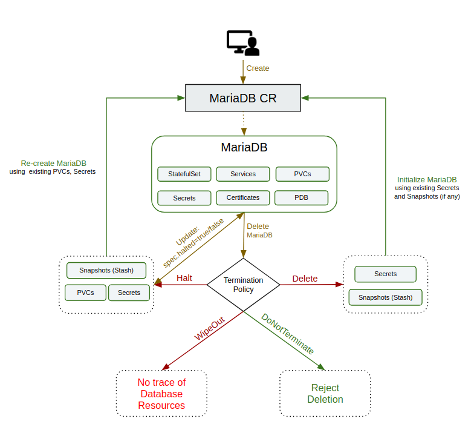

> Vous êtes nouveau sur KubeDB ? Veuillez commencer [ici](https://kubedb.com/docs/v2026.7.10/README).

# Démarrage rapide de MariaDB

Ce tutoriel vous montrera comment utiliser KubeDB pour exécuter une base de données MariaDB.



> Remarque : Les fichiers yaml utilisés dans ce didacticiel sont stockés dans [ici](https://github.com/kubedb/docs/tree/v2026.7.10/docs/guides/mariadb/quickstart/overview/examples).

## Avant de commencer

* Dans un premier temps, vous devez disposer d'un cluster Kubernetes et l'outil de ligne de commande kubectl doit être configuré pour communiquer avec votre cluster. Si vous n'avez pas encore de cluster, vous pouvez en créer un en utilisant [gentil](https://kind.sigs.k8s.io/docs/user/quick-start/).
* Maintenant, installez KubeDB cli sur votre poste de travail et l'opérateur KubeDB dans votre cluster en suivant les étapes [ici](https://kubedb.com/docs/v2026.7.10/setup/README).
* [Classe de stockage](https://kubernetes.io/docs/concepts/storage/storage-classes/) est requis pour exécuter KubeDB. Vérifiez la StorageClass disponible dans le cluster.

```bash
$ kubectl get storageclasses
NAME                 PROVISIONER             RECLAIMPOLICY     VOLUMEBINDINGMODE      ALLOWVOLUMEEXPANSION   AGE
standard (default)   rancher.io/local-path   Delete            WaitForFirstConsumer   false                  6h22m
```

* Pour garder les choses isolées, ce didacticiel utilise un espace de noms distinct appelé `demo` tout au long de ce tutoriel.

```
$ kubectl create ns demo
namespace/demo created
```

## Rechercher la version MariaDB disponible

Lorsque vous avez installé KubeDB, il a créé `MariaDBVersion` crd pour toutes les versions de MariaDB prises en charge. Vérifiez-le en utilisant la commande suivante,

```bash
$ kubectl get mariadbversions
NAME      VERSION   DB_IMAGE                                        DEPRECATED   AGE
10.10.7   10.10.7   ghcr.io/appscode-images/mariadb:10.10.7-jammy                12d
10.11.6   10.11.6   ghcr.io/appscode-images/mariadb:10.11.6-jammy                12d
10.4.32   10.4.32   ghcr.io/appscode-images/mariadb:10.4.32-focal                12d
10.5.23   10.5.23   ghcr.io/appscode-images/mariadb:10.5.23-focal                12d
10.6.16   10.6.16   ghcr.io/appscode-images/mariadb:10.6.16-focal                12d
11.0.4    11.0.4    ghcr.io/appscode-images/mariadb:11.0.4-jammy                 12d
11.1.3    11.1.3    ghcr.io/appscode-images/mariadb:11.1.3-jammy                 12d
11.2.2    11.2.2    ghcr.io/appscode-images/mariadb:11.2.2-jammy                 12d
11.3.2    11.3.2    ghcr.io/appscode-images/mariadb:11.3.2-jammy                 12d
11.4.3    11.4.3    ghcr.io/appscode-images/mariadb:11.4.3-noble                 12d
11.5.2    11.5.2    ghcr.io/appscode-images/mariadb:11.5.2-noble                 12d
11.6.2    11.6.2    ghcr.io/appscode-images/mariadb:11.6.2-noble                 12d
11.8.5    11.8.5    ghcr.io/appscode-images/mariadb:11.8.5-noble                 12d
12.1.2    12.1.2    ghcr.io/appscode-images/mariadb:12.1.2-noble                 12d
```

## Créer une base de données MariaDB

KubeDB implémente un CRD `MariaDB` pour définir la spécification d'une base de données MariaDB. Vous trouverez ci-dessous l'objet `MariaDB` créé dans ce tutoriel.

`Note` : Si votre version de `KubeDB` est inférieure ou égale à `v2024.6.4`, utilisez la version d'API `v1alpha2`.

```yaml
apiVersion: kubedb.com/v1
kind: MariaDB
metadata:
  name: sample-mariadb
  namespace: demo
spec:
  version: "12.1.2"
  storageType: Durable
  storage:
    storageClassName: "standard"
    accessModes:
      - ReadWriteOnce
    resources:
      requests:
        storage: 1Gi
  deletionPolicy: Delete
```

```bash
$ kubectl apply -f https://github.com/kubedb/docs/raw/v2026.7.10/docs/guides/mariadb/quickstart/overview/examples/sample-mariadb-v1.yaml
mariadb.kubedb.com/sample-mariadb created
```

```yaml
apiVersion: kubedb.com/v1alpha2
kind: MariaDB
metadata:
  name: sample-mariadb
  namespace: demo
spec:
  version: "12.1.2"
  storageType: Durable
  storage:
    storageClassName: "standard"
    accessModes:
    - ReadWriteOnce
    resources:
      requests:
        storage: 1Gi
  terminationPolicy: Delete
```

```bash
$ kubectl apply -f https://github.com/kubedb/docs/raw/v2026.7.10/docs/guides/mariadb/quickstart/overview/examples/sample-mariadb-v1alpha2.yaml
mariadb.kubedb.com/sample-mariadb created
```

Ici,

* `spec.version` est le nom du CRD MariaDBVersion où les images Docker sont spécifiées. Dans ce tutoriel, un MariaDB `12.1.2` la base de données va créer.
* `spec.storageType` spécifie le type de stockage qui sera utilisé pour la base de données MariaDB. Cela peut être `Durable` ou `Ephemeral`. La valeur par défaut de ce champ est `Durable`. Si `Ephemeral` est utilisé, KubeDB créera la base de données MariaDB en utilisant `EmptyDir` volume. Dans ce cas, vous n’êtes pas obligé de préciser `spec.storage` champ. Ceci est utile à des fins de test.
* `spec.storage` spécifie la StorageClass de PVC allouée dynamiquement pour stocker les données de cette base de données. Cette spécification de stockage sera transmise au PetSet créé par l'opérateur KubeDB pour exécuter les pods de base de données. Vous pouvez spécifier n'importe quelle StorageClass disponible dans votre cluster avec les demandes de ressources appropriées.
* `spec.terminationPolicy` ou `spec.deletionPolicy` donne la flexibilité de savoir s'il faut `nullify`(rejeter) l'opération de suppression de `MariaDB` crd ou quelles ressources KubeDB doit conserver ou supprimer lorsque vous supprimez `MariaDB` crd. Si le webhook d'admission est activé, il empêche les utilisateurs de supprimer la base de données tant que le `spec.terminationPolicy` est réglé sur `DoNotTerminate`.

> Remarque : la section spec.storage est utilisée pour créer un PVC pour le pod de base de données. Il créera un PVC avec une taille de stockage spécifiée dans le champ storage.resources.requests. Ne spécifiez pas de limites ici. Le PVC n'est pas redimensionné automatiquement.

L'opérateur KubeDB surveille `MariaDB` objets utilisant l’API Kubernetes. Quand un `MariaDB` est créé, l'opérateur KubeDB créera un nouveau PetSet et un service avec le nom d'objet MariaDB correspondant. L'opérateur KubeDB créera également un service de gouvernance pour les PetSets avec le nom `kubedb`, s'il n'y en a pas déjà un.

```bash
$ kubectl describe -n demo mariadb sample-mariadb
Name:         sample-mariadb
Namespace:    demo
Labels:       <none>
Annotations:  <none>
API Version:  kubedb.com/v1
Kind:         MariaDB
Metadata:
  Creation Timestamp:  2022-06-06T04:42:27Z
  Finalizers:
    kubedb.com
  Generation:  2
  ...
  Resource Version:  2673
  UID:               2f9c9453-6e78-4521-91ea-34ad2da398bc
Spec:
  Allowed Schemas:
    Namespaces:
      From:  Same
  Auth Secret:
    Name:  sample-mariadb-auth
  Pod Template:
    ...
  Replicas:                  1
  Storage:
    Access Modes:
      ReadWriteOnce
    Resources:
      Requests:
        Storage:         1Gi
    Storage Class Name:  standard
  Storage Type:          Durable
  Termination Policy:    WipeOut
  Version:               11.8.5
Status:
  Conditions:
    Last Transition Time:  2022-06-06T04:42:27Z
    Message:               The KubeDB operator has started the provisioning of MariaDB: demo/sample-mariadb
    Reason:                DatabaseProvisioningStartedSuccessfully
    Status:                True
    Type:                  ProvisioningStarted
    Last Transition Time:  2022-06-06T04:43:37Z
    Message:               database sample-mariadb/demo is ready
    Reason:                AllReplicasReady
    Status:                True
    Type:                  Ready
    Last Transition Time:  2022-06-06T04:43:37Z
    Message:               database sample-mariadb/demo is accepting connection
    Reason:                AcceptingConnection
    Status:                True
    Type:                  AcceptingConnection
    Last Transition Time:  2022-06-06T04:43:26Z
    Message:               All desired replicas are ready.
    Reason:                AllReplicasReady
    Status:                True
    Type:                  ReplicaReady
    Last Transition Time:  2022-06-06T04:43:37Z
    Message:               The MariaDB: demo/sample-mariadb is successfully provisioned.
    Observed Generation:   2
    Reason:                DatabaseSuccessfullyProvisioned
    Status:                True
    Type:                  Provisioned
  Observed Generation:     2
  Phase:                   Ready
Events:
  Type    Reason      Age    From             Message
  ----    ------      ----   ----             -------
  Normal  Successful  3m49s  KubeDB Operator  Successfully created governing service
  Normal  Successful  3m49s  KubeDB Operator  Successfully created Service
  Normal  Successful  3m49s  KubeDB Operator  Successfully created PetSet demo/sample-mariadb
  Normal  Successful  3m49s  KubeDB Operator  Successfully created MariaDB
  Normal  Successful  3m49s  KubeDB Operator  Successfully created appbinding

  
  
$ kubectl get petset -n demo
NAME             READY   AGE
sample-mariadb   1/1     27m

$ kubectl get pvc -n demo
NAME                    STATUS   VOLUME                                     CAPACITY   ACCESS MODES   STORAGECLASS   AGE
data-sample-mariadb-0   Bound    pvc-10651900-d975-467f-80ff-9c4755bdf917   1Gi        RWO            standard       27m

$ kubectl get pv -n demo
NAME                                       CAPACITY   ACCESS MODES   RECLAIM POLICY   STATUS   CLAIM                        STORAGECLASS   REASON   AGE
pvc-10651900-d975-467f-80ff-9c4755bdf917   1Gi        RWO            Delete           Bound    demo/data-sample-mariadb-0   standard                27m

$ kubectl get service -n demo
NAME                  TYPE        CLUSTER-IP       EXTERNAL-IP   PORT(S)    AGE
sample-mariadb        ClusterIP   10.105.207.172   <none>        3306/TCP   28m
sample-mariadb-pods   ClusterIP   None             <none>        3306/TCP   28m
```

L'opérateur KubeDB définit le `status.phase` à `Running` une fois la base de données créée avec succès. Exécutez la commande suivante pour voir l'objet MariaDB modifié :

```bash
$ kubectl get mariadb -n demo sample-mariadb -o yaml
```

```text
apiVersion: kubedb.com/v1
kind: MariaDB
metadata:
  annotations:
    kubectl.kubernetes.io/last-applied-configuration: |
      {"apiVersion":"kubedb.com/v1","kind":"MariaDB","metadata":{"annotations":{},"name":"sample-mariadb","namespace":"demo"},"spec":{"storage":{"accessModes":["ReadWriteOnce"],"resources":{"requests":{"storage":"1Gi"}},"storageClassName":"standard"},"storageType":"Durable","deletionPolicy":"WipeOut","version":"11.8.5"}}      
  creationTimestamp: "2021-03-10T04:31:09Z"
  finalizers:
  - kubedb.com
  generation: 2
  ...
  name: sample-mariadb
  namespace: demo
  resourceVersion: "7952"
  selfLink: /apis/kubedb.com/v1/namespaces/demo/mariadbs/sample-mariadb
  uid: 412a4739-ac65-4b5a-a943-5e148f3222b1
spec:
  authSecret:
    name: sample-mariadb-auth
  ...
  replicas: 1
  storage:
    accessModes:
    - ReadWriteOnce
    resources:
      requests:
        storage: 1Gi
    storageClassName: standard
  storageType: Durable
  deletionPolicy: Delete
  version: 12.1.2
status:
  observedGeneration: 2
  phase: Ready
```

## Connectez-vous à la base de données MariaDB

L'opérateur KubeDB a créé un nouveau secret appelé `mariadb-quickstart-auth` *(format : {mariadb-object-name}-auth)* pour stocker le mot de passe pour `mariadb` superutilisateur. Ce secret contient un `username` clé qui contient le *nom d'utilisateur* pour le superutilisateur MariaDB et un `password` clé qui contient le *mot de passe* pour le superutilisateur MariaDB.

Si vous souhaitez utiliser un secret existant, veuillez le préciser lors de la création de l'objet MariaDB à l'aide de `spec.authSecret.name`. Lors de la création manuelle de ce secret, assurez-vous que le secret contient ces deux clés contenant des données `username` et `password` et assurez-vous également d'utiliser `root` comme valeur de `username`.

Maintenant, nous avons besoin de `username` et `password` pour nous connecter à cette base de données avec la commande `kubectl exec`. Dans cet exemple, le secret `sample-mariadb-auth` contient le nom d'utilisateur et le mot de passe.

```bash
$ kubectl get secrets -n demo sample-mariadb-auth -o jsonpath='{.data.username}' | base64 -d
root

$ kubectl get secrets -n demo sample-mariadb-auth -o jsonpath='{.data.password}' | base64 -d
w*yOU$b53dTbjsjJ
```

Nous exécuterons dans le pod `sample-mariadb-0` et connectez-vous à la base de données en utilisant `username` et `password`.

```bash
$ kubectl exec -it -n demo sample-mariadb-0 -- mariadb -u root --password='w*yOU$b53dTbjsjJ'
```

```mysql
Welcome to the MariaDB monitor.  Commands end with ; or \g.
Your MariaDB connection id is 335
Server version: 11.8.5-MariaDB-1:11.8.5+maria~focal mariadb.org binary distribution

Copyright (c) 2000, 2018, Oracle, MariaDB Corporation Ab and others.

Type 'help;' or '\h' for help. Type '\c' to clear the current input statement.

MariaDB [(none)]> show databases;
+--------------------+
| Database           |
+--------------------+
| information_schema |
| mysql              |
| performance_schema |
+--------------------+
3 rows in set (0.001 sec)
```

## Politique de suppression de base de données

Ce champ est utilisé pour réguler le processus de suppression des ressources associées lorsque `MariaDB` l'objet est supprimé. L'utilisateur peut définir la valeur de ce champ en fonction de ses besoins. Les options disponibles et leur scénario d'utilisation sont décrits ci-dessous :

**Ne pas terminer :**

Quand `deletionPolicy` est réglé sur `DoNotTerminate`, KubeDB profite de `ValidationWebhook` fonctionnalité dans les clusters Kubernetes 1.9.0 ou version ultérieure à implémenter `DoNotTerminate` fonctionnalité. Si le webhook d'admission est activé, il empêche les utilisateurs de supprimer la base de données tant que le `spec.deletionPolicy` est réglé sur `DoNotTerminate`. Si vous créez une base de données avec `deletionPolicy` `DoNotTerminate` et essayez de le supprimer, vous verrez ceci :

```bash
$ kubectl delete mariadb sample-mariadb -n demo
Error from server (BadRequest): admission webhook "mariadb.validators.kubedb.com" denied the request: mariadb "mariadb-quickstart" can't be halted. To delete, change spec.deletionPolicy
```

Exécutez maintenant `kubectl edit mariadb sample-mariadb -n demo` pour définir `spec.deletionPolicy` sur `Halt` (qui supprime l'objet mariadb et conserve le PVC, les instantanés et les secrets intacts) ou supprimez ce champ (qui est par défaut `Delete`). Vous pourrez ensuite supprimer/arrêter la base de données.

**Arrêt:**

Supposons que vous souhaitiez réutiliser le volume et les informations d'identification de votre base de données pour déployer votre base de données à l'avenir en utilisant les mêmes configurations. Mais pour le moment, vous souhaitez simplement supprimer la base de données, à l’exception des volumes et des informations d’identification de la base de données. Dans ce scénario, vous devez définir le `MariaDB` objet `deletionPolicy` à `Halt`.

Quand le `DeletionPolicy` est réglé sur `Halt` et l'objet MariaDB est supprimé, l'opérateur KubeDB supprimera le PetSet et ses pods mais laisse le `PVCs`, `secrets` et les données de sauvegarde de la base de données (`snapshots`) intact. Vous pouvez définir le `deletionPolicy` à `Halt` dans la base de données existante en utilisant `edit` commande pour tester.

Dans un premier temps, exécutez `kubectl edit mariadb sample-mariadb -n demo` pour définir `spec.deletionPolicy` sur `Halt`. Supprimez ensuite l'objet mariadb,

```bash
$ kubectl delete mariadb sample-mariadb -n demo
mariadb.kubedb.com "sample-mariadb" deleted
```

Maintenant, exécutez la commande suivante pour obtenir toutes les ressources mariadb dans `demo` les espaces de noms,

```bash
$ kubectl get petset,svc,secret,pvc -n demo
NAME                         TYPE                                  DATA   AGE
secret/default-token-w2pgw   kubernetes.io/service-account-token   3      31m
secret/sample-mariadb-auth   kubernetes.io/basic-auth              2      39s

NAME                                          STATUS   VOLUME                                     CAPACITY   ACCESS MODES   STORAGECLASS   AGE
persistentvolumeclaim/data-sample-mariadb-0   Bound    pvc-7502c222-2b02-4363-9027-91ab0e7b76dc   1Gi        RWO            standard       39s
```

À partir du résultat ci-dessus, vous pouvez voir que toutes les ressources mariadb (`PetSet`, `Service`, etc.) sont supprimés sauf `PVC` et `Secret`. Vous pouvez recréer à nouveau votre mariadb en utilisant ces ressources.

**Supprimer:**

Si vous souhaitez supprimer la base de données existante ainsi que les volumes utilisés, mais que vous souhaitez restaurer la base de données à partir d'une base de données précédemment prise `snapshots` et `secrets` alors vous voudrez peut-être définir le `MariaDB` objet `deletionPolicy` à `Delete`. Dans ce cadre, `PetSet` et les volumes seront supprimés. Si vous décidez de restaurer la base de données, vous pouvez le faire à l'aide des instantanés et des informations d'identification.

Quand le `DeletionPolicy` est réglé sur `Delete` et l'objet MariaDB est supprimé, l'opérateur KubeDB supprimera le PetSet et ses pods ainsi que les PVC mais laisse le `secret` et les données de sauvegarde de la base de données (`snapshots`) intact.

Supposons que nous ayons une base de données avec `deletionPolicy` réglé sur `Delete`. Maintenant, nous allons supprimer la base de données à l'aide de la commande suivante :

```bash
$ kubectl delete mariadb sample-mariadb -n demo
mariadb.kubedb.com "sample-mariadb" deleted
```

Maintenant, exécutez la commande suivante pour obtenir toutes les ressources mariadb dans `demo` les espaces de noms,

```bash
$ kubectl get petset,svc,secret,pvc -n demo
NAME                         TYPE                                  DATA   AGE
secret/default-token-w2pgw   kubernetes.io/service-account-token   3      31m
secret/sample-mariadb-auth   kubernetes.io/basic-auth              2      39s
```

À partir du résultat ci-dessus, vous pouvez voir que toutes les ressources mariadb (`PetSet`, `Service`, `PVCs` etc.) sont supprimés sauf `Secret`. Vous pouvez initialiser votre mariadb en utilisant `snapshots`(si pris précédemment) et `secret`.

> Si vous ne définissez pas deletionPolicy, kubeDB définit DeletionPolicy sur Supprimer par défaut.

**Anéantir:**

Vous pouvez totalement supprimer le `MariaDB` base de données et ressources pertinentes sans aucun suivi par paramètre `deletionPolicy` à `WipeOut`. L'opérateur KubeDB supprimera toutes les ressources pertinentes de ce `MariaDB` base de données (c'est-à-dire `PVCs`, `Secrets`, `Snapshots`) lorsque le `deletionPolicy` est réglé sur `WipeOut`.

Supposons que nous ayons une base de données avec `deletionPolicy` réglé sur `WipeOut`. Maintenant, nous allons supprimer la base de données à l'aide de la commande suivante :

```bash
$ kubectl delete mariadb sample-mariadb -n demo
```

```text
mariadb.kubedb.com "sample-mariadb" deleted
```

Maintenant, exécutez la commande suivante pour obtenir toutes les ressources mariadb dans `demo` les espaces de noms,

```bash
$ kubectl get petset,svc,secret,pvc -n demo
No resources found in demo namespace.
```

À partir du résultat ci-dessus, vous pouvez voir que toutes les ressources mariadb sont supprimées. il n'y a pas d'option pour recréer/réinitialiser votre base de données si `deletionPolicy` est réglé sur `Delete`.

> Soyez prudent lorsque vous réglez le `deletionPolicy` à `Delete`. Parce qu'il n'y a aucune option pour retracer les ressources de la base de données si une fois la base de données supprimée.

## Base de données arrêtée

Si vous souhaitez supprimer les ressources MariaDB (`PetSet`,`Service`, etc.) sans supprimer le `MariaDB` objet, `PVCs` et `Secret` vous devez définir le `spec.halted` à `true`. L'opérateur KubeDB pourra supprimer les ressources liées à MariaDB à l'exception de `MariaDB` objet, `PVCs` et `Secret`.

Supposons que nous ayons une base de données en cours d'exécution `mariadb-quickstart` dans notre cluster. Maintenant, nous allons définir `spec.halted` à `true` dans `MariaDB` objet en exécutant `kubectl edit -n demo mariadb-quickstart` commande.

Exécutez la commande suivante pour obtenir les ressources MariaDB,

```bash
$ kubectl get mariadb,sts,secret,svc,pvc -n demo
NAME                                VERSION   STATUS   AGE
mariadb.kubedb.com/mariadb-quickstart   11.8.5    Halted   22m

NAME                           TYPE                                  DATA   AGE
secret/default-token-lgbjm     kubernetes.io/service-account-token   3      27h
secret/mariadb-quickstart-auth   Opaque                                2      22m

NAME                                            STATUS   VOLUME                                     CAPACITY   ACCESS MODES   STORAGECLASS   AGE
persistentvolumeclaim/data-mariadb-quickstart-0   Bound    pvc-7ab0ebb0-bb2e-45c1-9af1-4f175672605b   1Gi        RWO            standard       22m
```

À partir du résultat ci-dessus, vous pouvez voir que `MariaDB` objet, `PVCs`, `Secret` sont toujours en vie. Ensuite, vous pouvez recréer votre `MariaDB` avec la même configuration.

> Lorsque vous définissez `spec.halted` à `true` dans `MariaDB` objet alors le `deletionPolicy` est également réglé sur `Halt` par l'opérateur KubeDB.

## Nettoyage

Pour nettoyer les ressources Kubernetes créées par ce tutoriel, exécutez :

```bash
kubectl delete -n demo mariadb/sample-mariadb

kubectl delete ns demo
```

## Conseils pour les tests

Si vous testez simplement quelques fonctionnalités de base, vous souhaiterez peut-être éviter des tracas supplémentaires dus à certaines fonctionnalités de sécurité idéales pour l'environnement de production. Vous pouvez suivre ces conseils pour les éviter.

1. **Utiliser `storageType: Ephemeral`**. Les bases de données sont précieuses. Vous ne souhaiterez peut-être pas perdre vos données dans votre environnement de production en cas de panne du pod de base de données. Nous recommandons donc d'utiliser `spec.storageType: Durable` et fournir des spécifications de stockage dans `spec.storage` section. À des fins de test, vous pouvez simplement utiliser `spec.storageType: Ephemeral`. KubeDB utilisera [videDir](https://kubernetes.io/docs/concepts/storage/volumes/#emptydir) pour le stockage. Vous n'aurez pas besoin de fournir `spec.storage` section.
2. **Utiliser `deletionPolicy: WipeOut`**. C'est bien de pouvoir supprimer tout ce qui est créé par KubeDB pour un crd MariaDB particulier lorsque vous supprimez le crd.

## Prochaines étapes

* Vous souhaitez contribuer à KubeDB ? Consultez nos [directives de contribution](https://kubedb.com/docs/v2026.7.10/CONTRIBUTING).