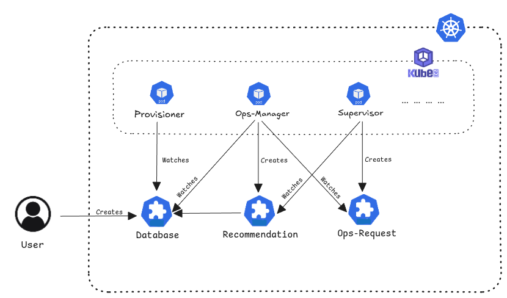

> Vous êtes nouveau sur KubeDB ? Veuillez commencer [ici](https://kubedb.com/docs/v2026.7.10/README).

# Recommandation MariaDB

## Aperçu

A `Recommendation` est un CRD natif de Kubernetes créé par le **KubeDB Ops-Manager** et réconcilié par le **Superviseur KubeDB**. Pour une instance MariaDB gérée par KubeDB, Ops-Manager surveille l'état de la base de données et émet une recommandation chaque fois qu'il détecte une action que vous devez entreprendre : une version plus récente, un certificat TLS expirant ou un secret d'authentification proche de sa date limite de rotation.

Rien ne fonctionne tant que la recommandation n'est pas approuvée — soit par vous (`status.approvalStatus: Approved`) ou automatiquement via un `ApprovalPolicy` lié à un `MaintenanceWindow`. Une fois approuvé, le Superviseur crée le `MariaDBOpsRequest` et le suit jusqu'à son achèvement.

Cette page est la **Introduction spécifique à MariaDB**: quelles recommandations s'appliquent à MariaDB et quels champs de spécifications les déclenchent. Pour connaître les conditions préalables, les indicateurs Helm qui contrôlent le timing de génération et le cycle de vie complet de la recommandation, voir :

* [Configuration des recommandations](https://kubedb.com/docs/v2026.7.10/operatormanual/recommendation/configuration) - les prérequis, l'installation du superviseur CRD et tous les indicateurs Helm.
* [Présentation des recommandations](https://kubedb.com/docs/v2026.7.10/operatormanual/recommendation) — présentation pas à pas de l'architecture et du cycle de vie.



---

## Concepts KubeDB pertinents

* [MariaDBOpsDemande](../concepts/opsrequest.md)
* [MariaDBRotateAuth](../rotate-auth/overview.md)
* [MariaDBReconfigureTLS](../tls/overview.md)
* [MariaDBUpdateVersion](../update-version/overview.md)

---

## Types de recommandations pour MariaDB

| Taper | Déclenché lorsque | Procédure pas à pas |
| --- | --- | --- |
| **Mise à jour de la version** | Une nouvelle version majeure, mineure ou corrective devient disponible | [Recommandation de mise à jour de version](https://kubedb.com/docs/v2026.7.10/operatormanual/recommendation/version-update-recommendation) |
| **Mise à jour de la même version** | L'image du conteneur pour votre *actuel* la version est actualisée (par exemple, correctif de sécurité) | [Recommandation de mise à jour de version](https://kubedb.com/docs/v2026.7.10/operatormanual/recommendation/version-update-recommendation) |
| **Rotation des certificats TLS** | Un certificat émis approche de son seuil d’expiration | [Recommandation de rotation des certificats TLS](https://kubedb.com/docs/v2026.7.10/operatormanual/recommendation/rotate-tls-recommendation) |
| **Rotation du secret d’authentification** | Le secret d'authentification approche de son terme `rotateAfter` date limite | [Recommandation de rotation des secrets d'authentification](https://kubedb.com/docs/v2026.7.10/operatormanual/recommendation/rotate-auth-recommendation) |

---

## Déclencheurs spécifiques à MariaDB

Cette section montre les champs minimaux MariaDB CR qui entraînent la génération de chaque recommandation. Pour des procédures pas à pas plus approfondies de bout en bout, utilisez les liens dans le tableau ci-dessus.

### Rotation du secret d’authentification

```yaml
apiVersion: kubedb.com/v1
kind: MariaDB
metadata:
  name: mariadb-recommendation
  namespace: demo
spec:
  version: "10.5.23"
  authSecret:
    kind: Secret
    name: mariadb-auth
    rotateAfter: 1h
```

Dans cette configuration :

* Le `rotateAfter` le champ définit la durée pendant laquelle le secret d'authentification reste valide

KubeDB surveille le cycle de vie configuré et génère une recommandation RotateAuth basée sur les conditions suivantes :

* Si la durée de vie du secret est supérieure à un mois, une recommandation est générée lorsqu'il reste moins d'un mois de validité
* Si la durée de vie du secret est inférieure à un mois, une recommandation est générée lorsqu'il reste environ un tiers de sa validité.

Une fois approuvé, KubeDB crée une requête opérationnelle pour alterner automatiquement les informations d'identification, garantissant :

* Aucun identifiant expiré
* Posture de sécurité amélioré
* Intervention manuelle réduite

### Rotation des certificats TLS

```yaml
apiVersion: kubedb.com/v1
kind: MariaDB
metadata:
  name: mariadb-recommendation
  namespace: demo
spec:
  version: "10.5.23"
  tls:
    issuerRef:
      apiGroup: cert-manager.io
      kind: Issuer
      name: mariadb-ca-issuer
    certificates:
      - alias: client
        duration: 1h20m
      - alias: server
        duration: 2h10m
```

Dans cette configuration :

* Le `spec.tls.certificates.duration` le champ définit la durée pendant laquelle chaque certificat reste valide

KubeDB surveille le cycle de vie configuré et génère une recommandation RotateTLS basée sur les conditions suivantes :

* Si la durée du certificat est supérieure à un mois, une recommandation est générée lorsqu'il reste moins d'un mois de validité
* Si la durée du certificat est inférieure à un mois, une recommandation est générée lorsqu'il reste environ un tiers de sa validité.

Une fois approuvé, KubeDB crée une requête opérationnelle pour reconfigurer automatiquement TLS, garantissant :

* Communication sécurisée continue
* Aucune expiration inattendue du certificat
* Renouvellement fluide du certificat

### Mise à jour de la version

```yaml
apiVersion: kubedb.com/v1
kind: MariaDB
metadata:
  name: mariadb-recommendation
  namespace: demo
spec:
  version: "10.5.23"
```

Dans cette configuration :

* KubeDB surveille la version en cours d'exécution de la base de données

KubeDB surveille le cycle de vie configuré et génère une recommandation VersionUpdate basée sur les conditions suivantes :

* Si une image de conteneur plus récente est disponible pour la version actuelle, une recommandation est générée
* Si une version de correctif est publiée, une recommandation est générée
* Si une version mineure ou majeure plus récente devient disponible, une recommandation est générée
* Si des modifications sont introduites dans l'image de version existante (par exemple, des correctifs de sécurité ou des mises à jour d'image sans changement de version), une recommandation est générée

Par exemple : Recommander une mise à jour de version à partir de `10.5.23` à `10.6.16`

Une fois approuvé, KubeDB crée une requête opérationnelle pour effectuer automatiquement la mise à niveau de la version, garantissant :

* Adoption en temps opportun des correctifs et correctifs de sécurité
* Accès aux nouvelles fonctionnalités et améliorations
* Performances et stabilité constantes dans tous les déploiements

### Mise à jour de la même version

```yaml
apiVersion: kubedb.com/v1
kind: MariaDB
metadata:
  name: mariadb-recommendation
  namespace: demo
spec:
  version: "10.5.23"
```

Dans cette configuration :

* KubeDB surveille l'image du conteneur de la version actuelle de la base de données

KubeDB surveille le cycle de vie configuré et génère une recommandation SameVersionUpdate basée sur les conditions suivantes :

* Si l'image du conteneur supportant la version actuelle est mise à jour (par exemple, correctifs de sécurité ou reconstructions sans changement de version), une recommandation est générée

Une fois approuvé, KubeDB crée une requête opérationnelle pour mettre à jour automatiquement la charge de travail en cours d'exécution, garantissant :

* Les correctifs de sécurité sont appliqués sans nécessiter de mise à niveau de version
* Cohérence avec la dernière image de conteneur disponible
* Fiabilité et maintenabilité améliorées

---

Pour connaître les conditions préalables, les indicateurs de configuration Helm et le cycle de vie complet des recommandations inter-bases de données, consultez le [Configuration des recommandations](https://kubedb.com/docs/v2026.7.10/operatormanual/recommendation/configuration) et [Présentation des recommandations](https://kubedb.com/docs/v2026.7.10/operatormanual/recommendation) dans le manuel d'utilisation.