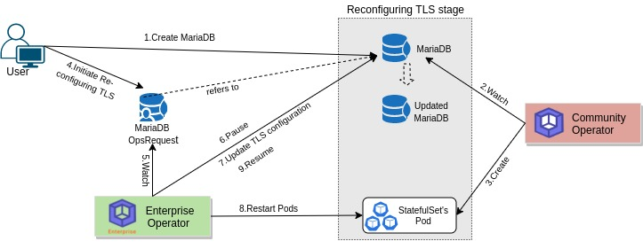

> Vous êtes nouveau sur KubeDB ? Veuillez commencer [ici](https://kubedb.com/docs/v2026.7.10/README).

# Reconfiguration de TLS de la base de données MariaDB

Ce guide donnera un aperçu de la façon dont KubeDB Ops Manager reconfigure la configuration TLS, c'est-à-dire ajouter TLS, supprimer TLS, mettre à jour l'émetteur/émetteur de cluster ou les certificats et faire pivoter les certificats d'un `MariaDB` base de données.

## Avant de commencer

* Vous devriez être familier avec ce qui suit `KubeDB` notions :
  + [MariaDB](../concepts/mariadb.md)
  + [MariaDBOpsRequest](../concepts/opsrequest.md)

## Fonctionnement de la reconfiguration du processus de configuration MariaDB TLS

Le diagramme suivant montre comment KubeDB Ops Manager reconfigure TLS d'un `MariaDB` base de données. Ouvrez l'image dans un nouvel onglet pour voir la version agrandie.

  

Fig : Reconfiguration du processus TLS de MariaDB

Le processus de reconfiguration de MariaDB TLS comprend les étapes suivantes :

1. Dans un premier temps, un utilisateur crée un `MariaDB` Objet de ressource personnalisé (CRO).
2. `KubeDB` L'opérateur communautaire surveille `MariaDB` CRO.
3. Lorsque l'opérateur trouve un `MariaDB` CR, il crée le nombre requis de `PetSets` et les éléments nécessaires connexes comme les secrets, les services, etc.
4. Ensuite, afin de reconfigurer la configuration TLS du `MariaDB` base de données, l'utilisateur crée un `MariaDBOpsRequest` CR avec les informations souhaitées.
5. `KubeDB` L'opérateur d'entreprise surveille le `MariaDBOpsRequest` CR.
6. Lorsqu'il trouve un `MariaDBOpsRequest` CR, il met en pause le `MariaDB` objet auquel fait référence le `MariaDBOpsRequest`. Ainsi, le `KubeDB` L’opérateur communautaire n’effectue aucune opération sur le `MariaDB` objet pendant le processus de reconfiguration de TLS.
7. Puis le `KubeDB` L’opérateur d’entreprise ajoutera, supprimera, mettra à jour ou fera pivoter la configuration TLS en fonction du yaml Ops Request.
8. Puis le `KubeDB` L'opérateur Enterprise redémarrera tous les Pods de la base de données afin qu'ils redémarrent avec la nouvelle configuration TLS définie dans le `MariaDBOpsRequest` CR.
9. Après la reconfiguration réussie du `MariaDB` TLS, le `KubeDB` L'opérateur d'entreprise reprend le `MariaDB` objet afin que le `KubeDB` L'opérateur communautaire reprend ses opérations habituelles.

Dans la prochaine documentation, nous allons montrer un guide étape par étape sur la reconfiguration de la configuration TLS d'une base de données MariaDB à l'aide de `MariaDBOpsRequest` CRD.