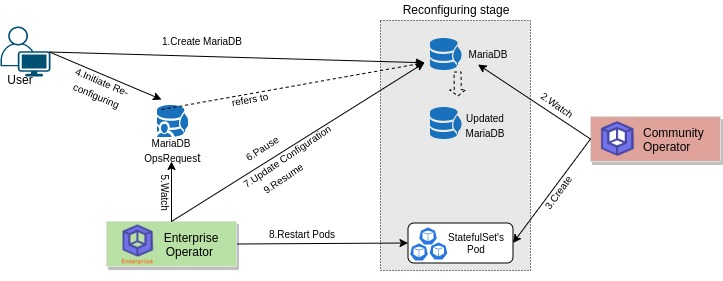

> Vous êtes nouveau sur KubeDB ? Veuillez commencer [ici](https://kubedb.com/docs/v2026.7.10/README).

# Reconfiguration de MariaDB

Ce guide donnera un aperçu de la façon dont KubeDB Ops Manger reconfigure `MariaDB`.

## Avant de commencer

* Vous devriez être familier avec ce qui suit `KubeDB` notions :
  + [MariaDB](../concepts/mariadb.md)
  + [MariaDBOpsDemande](../concepts/opsrequest.md)

## Comment fonctionne la reconfiguration du processus MariaDB

Le diagramme suivant montre comment KubeDB Ops Manager reconfigure `MariaDB` composants de base de données. Ouvrez l'image dans un nouvel onglet pour voir la version agrandie.

  

Fig : Processus de reconfiguration de MariaDB

Le processus de reconfiguration de MariaDB comprend les étapes suivantes :

1. Dans un premier temps, un utilisateur crée un `MariaDB` Ressource personnalisée (CR).
2. `KubeDB` L'opérateur communautaire surveille `MariaDB` CR.
3. Lorsque l'opérateur trouve un `MariaDB` CR, il crée le nombre requis de `PetSets` et les éléments nécessaires connexes comme les secrets, les services, etc.
4. Ensuite, afin de reconfigurer le `MariaDB` autonome ou en cluster, l'utilisateur crée un `MariaDBOpsRequest` CR avec les informations souhaitées.
5. `KubeDB` L'opérateur d'entreprise surveille le `MariaDBOpsRequest` CR.
6. Lorsqu'il trouve un `MariaDBOpsRequest` CR, il arrête le `MariaDB` objet auquel fait référence le `MariaDBOpsRequest`. Ainsi, le `KubeDB` L’opérateur communautaire n’effectue aucune opération sur le `MariaDB` objet pendant le processus de reconfiguration.
7. Puis le `KubeDB` L'opérateur d'entreprise remplacera la configuration existante par la nouvelle configuration fournie ou fusionnera la nouvelle configuration avec la configuration existante selon les `MariaDBOpsRequest` CR.
8. Puis le `KubeDB` L'opérateur d'entreprise redémarrera les pods PetSet associés afin qu'ils redémarrent avec la nouvelle configuration définie dans le `MariaDBOpsRequest` CR.
9. Après la reconfiguration réussie du `MariaDB`, le `KubeDB` L'opérateur d'entreprise reprend le `MariaDB` objet afin que le `KubeDB` L'opérateur communautaire reprend ses opérations habituelles.

Dans la prochaine documentation, nous allons montrer un guide étape par étape sur la reconfiguration des composants de la base de données MariaDB à l'aide de `MariaDBOpsRequest` CRD.