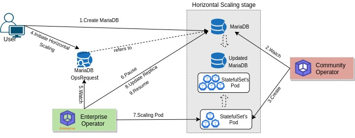

> Vous êtes nouveau sur KubeDB ? Veuillez commencer [ici](https://kubedb.com/docs/v2026.7.10/README).

# Mise à l'échelle horizontale de MariaDB

Ce guide donnera un aperçu de la manière dont KubeDB Ops Manager évolue vers le haut ou vers le bas. `MariaDB Cluster`.

## Avant de commencer

* Vous devriez être familier avec ce qui suit `KubeDB` notions :
  + [MariaDB](../../concepts/mariadb.md)
  + [MariaDBOpsDemande](../../concepts/opsrequest.md)

## Comment fonctionne le processus de mise à l'échelle horizontale

Le diagramme suivant montre comment KubeDB Ops Manager évolue vers le haut ou vers le bas `MariaDB` composants de base de données. Ouvrez l'image dans un nouvel onglet pour voir la version agrandie.

  

Fig : Processus de mise à l'échelle horizontale de MariaDB

Le processus de mise à l'échelle horizontale comprend les étapes suivantes :

1. Dans un premier temps, un utilisateur crée un `MariaDB` Ressource personnalisée (CR).
2. `KubeDB` L'opérateur communautaire surveille `MariaDB` CR.
3. Lorsque l'opérateur trouve un `MariaDB` CR, il crée le nombre requis de `PetSets` et les éléments nécessaires connexes comme les secrets, les services, etc.
4. Ensuite, afin d'augmenter l'échelle `MariaDB` base de données, l'utilisateur crée un `MariaDBOpsRequest` CR avec les informations souhaitées.
5. `KubeDB` L'opérateur d'entreprise surveille le `MariaDBOpsRequest` CR.
6. Lorsqu'il trouve un `MariaDBOpsRequest` CR, il met en pause le `MariaDB` objet auquel fait référence le `MariaDBOpsRequest`. Ainsi, le `KubeDB` L’opérateur communautaire n’effectue aucune opération sur le `MariaDB` objet pendant le processus de mise à l’échelle horizontale.
7. Puis le `KubeDB` L'opérateur d'entreprise mettra à l'échelle les pods PetSet associés pour atteindre le nombre attendu de répliques défini dans le `MariaDBOpsRequest` CR.
8. Après avoir mis à l'échelle avec succès les répliques des pods PetSet, le `KubeDB` L'opérateur d'entreprise met à jour le nombre de répliques dans le `MariaDB` objet pour refléter l’état mis à jour.
9. Après la mise à l'échelle réussie du `MariaDB` répliques, les `KubeDB` L'opérateur d'entreprise reprend le `MariaDB` objet afin que le `KubeDB` L'opérateur communautaire reprend ses opérations habituelles.

Dans la prochaine documentation, nous allons montrer un guide étape par étape sur la mise à l'échelle horizontale de la base de données MariaDB à l'aide de `MariaDBOpsRequest` CRD.