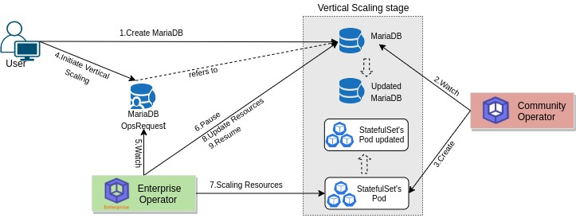

> Vous êtes nouveau sur KubeDB ? Veuillez commencer [ici](https://kubedb.com/docs/v2026.7.10/README).

# Mise à l'échelle verticale de MariaDB

Ce guide donnera un aperçu de la façon dont KubeDB Ops Manager évolue verticalement `MariaDB`.

## Avant de commencer

* Vous devriez être familier avec ce qui suit `KubeDB` notions :
  + [MariaDB](../../concepts/mariadb.md)
  + [MariaDBOpsRequest](../../concepts/opsrequest.md)

## Comment fonctionne le processus de mise à l'échelle verticale

Le diagramme suivant montre comment KubeDB Ops Manager évolue vers le haut ou vers le bas `MariaDB` composants de base de données. Ouvrez l'image dans un nouvel onglet pour voir la version agrandie.

  

Fig : Processus de mise à l'échelle verticale de MariaDB

Le processus de mise à l'échelle verticale comprend les étapes suivantes :

1. Dans un premier temps, un utilisateur crée un `MariaDB` Ressource personnalisée (CR).
2. `KubeDB` L'opérateur communautaire surveille `MariaDB` CR.
3. Lorsque l'opérateur trouve un `MariaDB` CR, il crée le nombre requis de `PetSets` et les éléments nécessaires connexes comme les secrets, les services, etc.
4. Ensuite, afin de mettre à jour les ressources(par exemple `CPU`, `Memory` etc.) du `MariaDB` base de données, l'utilisateur crée un `MariaDBOpsRequest` CR avec les informations souhaitées.
5. `KubeDB` L'opérateur d'entreprise surveille le `MariaDBOpsRequest` CR.
6. Lorsqu'il trouve un `MariaDBOpsRequest` CR, il arrête le `MariaDB` objet auquel fait référence le `MariaDBOpsRequest`. Ainsi, le `KubeDB` L’opérateur communautaire n’effectue aucune opération sur le `MariaDB` objet pendant le processus de mise à l’échelle verticale.
7. Puis le `KubeDB` L'opérateur d'entreprise mettra à jour les ressources des pods PetSet pour atteindre l'état souhaité.
8. Après la mise à jour réussie des ressources de la réplique du PetSet, le `KubeDB` L'opérateur d'entreprise met à jour le `MariaDB` objet pour refléter l’état mis à jour.
9. Après la mise à jour réussie du `MariaDB` ressources, les `KubeDB` L'opérateur d'entreprise reprend le `MariaDB` objet afin que le `KubeDB` L'opérateur communautaire reprend ses opérations habituelles.

## Modes de mise à l'échelle verticale

KubeDB active la mise à l'échelle verticale dans l'un des deux modes, sélectionnés via le `spec.verticalScaling.mode`
domaine de la `MariaDBOpsRequest`:

* **`Restart`** (par défaut) : l'opérateur corrige le `PetSet` avec les nouvelles ressources et redémarre le
  Pods (un à la fois, respectant les règles de basculement de la base de données) afin qu'ils reviennent avec le processeur mis à jour
  et Mémoire. Cela fonctionne sur chaque cluster Kubernetes.
* **`InPlace`**: L'opérateur redimensionne les conteneurs en cours d'exécution en place à l'aide du Kubernetes
  [Redimensionnement du pod sur place](https://kubernetes.io/docs/tasks/configure-pod-container/resize-container-resources/)
  (`pods/resize` sous-ressource) : pas de redémarrage du pod, la mise à l'échelle s'effectue donc sans temps d'arrêt ni basculement. Si un
  Le nœud ne peut pas accueillir les nouvelles ressources (le redimensionnement est signalé `Infeasible`), l'opérateur
  revient automatiquement au `Restart` comportement pour ce Pod. Pour un **distribué** `MariaDB`
  déploiement, le redimensionnement sur place n'est pas possible, donc `InPlace` se dégrade automatiquement en `Restart`.

Si `spec.verticalScaling.mode` est omis, la valeur par défaut est `Restart`.

> **Note:** `InPlace` le mode s'appuie sur Kubernetes `InPlacePodVerticalScaling` porte de fonctionnalité, qui est
> activé par défaut à partir de Kubernetes v1.33. Sur les clusters plus anciens, ou lorsque la porte de fonctionnalités est désactivée,
> utiliser `Restart` mode.

Dans la prochaine documentation, nous allons montrer un guide étape par étape sur la mise à jour des ressources de la base de données MariaDB à l'aide de `MariaDBOpsRequest` CRD.