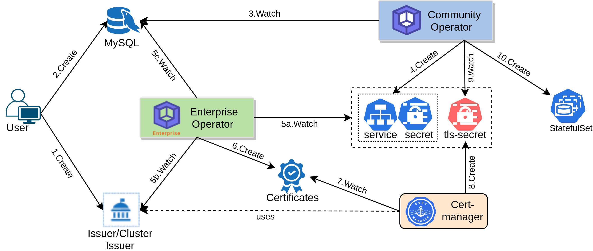

> Vous êtes nouveau sur KubeDB ? Veuillez commencer [ici](https://kubedb.com/docs/v2026.7.10/README).

# Cryptage MariaDB TLS/SSL

**Prérequis :** Pour configurer TLS/SSL dans `MariaDB`, `KubeDB` utilise `cert-manager` de délivrer des certificats. Vous devez donc d'abord vous assurer que le cluster a `cert-manager` installé. Pour installer `cert-manager` dans votre cluster, suivez les étapes [ici](https://cert-manager.io/docs/installation/kubernetes/).

Pour délivrer un certificat, le cr suivant de `cert-manager` est utilisé :

* `Issuer/ClusterIssuer`: Les émetteurs et les ClusterIssuers représentent des autorités de certification (CA) capables de générer des certificats signés en honorant les demandes de signature de certificat. Tous les certificats cert-manager nécessitent un émetteur référencé prêt à tenter d'honorer la demande. Vous pouvez en savoir plus [ici](https://cert-manager.io/docs/concepts/issuer/).
* `Certificate`: `cert-manager` a le concept de Certificats qui définissent le certificat x509 souhaité qui sera renouvelé et tenu à jour. Vous pouvez en savoir plus [ici](https://cert-manager.io/docs/concepts/certificate/).

**Spécification MariaDB CRD :**

KubeDB utilise les champs cr suivants pour activer le chiffrement SSL/TLS dans `MariaDB`.

* `spec:`
  + `requireSSL`
  + `tls:`
    - `issuerRef`
    - `certificates`

Découvrez les champs en détail sur [concept mariadb](../concepts/mariadb.md#spectls),

Quand, `requireSSL` est défini, les utilisateurs doivent spécifier le `tls.issuerRef` champ. `KubeDB` utilise le `issuer` ou `clusterIssuer` référencé dans le `tls.issuerRef` champ et les spécifications du certificat fournies dans `tls.certificate` pour générer des secrets de certificat à l'aide de `Issuer/ClusterIssuers` spécification. Ces certificats secrets comprennent `ca.crt`, `tls.crt` et `tls.key` etc. sont utilisés pour configurer `MariaDB` serveur, exportateur, etc. respectivement.

## Comment TLS/SSL se configure dans MariaDB

La figure suivante montre comment `KubeDB` Enterprise est utilisé pour configurer TLS/SSL dans MariaDB. Ouvrez l'image dans un nouvel onglet pour voir la version agrandie.

Fig : Déployer MariaDB avec TLS/SSL

Le déploiement de MariaDB avec le processus de configuration TLS/SSL comprend les étapes suivantes :

1. Dans un premier temps, un utilisateur crée un `Issuer/ClusterIssuer` cr.
2. Ensuite, l'utilisateur crée un `MariaDB` cr.
3. `KubeDB` un opérateur communautaire surveille le `MariaDB` cr.
4. Quand il en trouve un, il crée `Secret`, `Service`, etc. pour le `MariaDB` base de données.
5. `KubeDB` Ops Manager surveille `MariaDB`(5c), `Issuer/ClusterIssuer`(5b), `Secret` et `Service`(5a).
6. Quand il trouve toutes les ressources (`MariaDB`, `Issuer/ClusterIssuer`, `Secret`, `Service`), cela crée `Certificates` en utilisant `tls.issuerRef` et `tls.certificates` spécification de champ de `MariaDB` cr.
7. `cert-manager` surveille les certificats.
8. Lorsqu'il en trouve un, il crée des secrets de certificat `tls-secrets`(secrets du serveur, du client, de l'exportateur, etc.) qui contiennent le véritable certificat auto-signé.
9. `KubeDB` l'opérateur communautaire surveille les secrets du certificat `tls-secrets`.
10. Lorsqu'il trouve tout le secret tls, il crée un `PetSet` afin que le serveur MariaDB soit configuré avec TLS/SSL.

Dans le prochain document, nous allons montrer un guide étape par étape sur la façon de configurer un `MariaDB` base de données avec TLS/SSL.