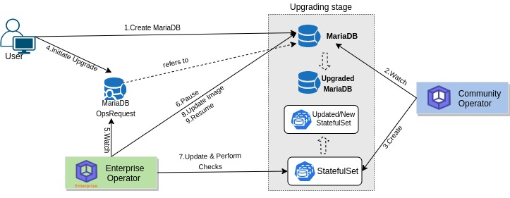

> Vous êtes nouveau sur KubeDB ? Veuillez commencer [ici](https://kubedb.com/docs/v2026.7.10/README).

# mise à jour de la version de MariaDB

Ce guide vous donnera un aperçu de la façon dont KubeDB Ops Manager met à jour la version de `MariaDB` base de données.

## Avant de commencer

* Vous devriez être familier avec ce qui suit `KubeDB` notions :
  + [MariaDB](../concepts/mariadb.md)
  + [MariaDBOpsRequest](../concepts/opsrequest.md)

## Comment fonctionne le processus de mise à jour de la version

Le diagramme suivant montre comment KubeDB Ops Manager a utilisé pour mettre à jour la version de `MariaDB`. Ouvrez l'image dans un nouvel onglet pour voir la version agrandie.

  

Fig : processus de mise à jour de MariaDB

Le processus de mise à jour comprend les étapes suivantes :

1. Dans un premier temps, un utilisateur crée un `MariaDB` Ressource personnalisée (CR).
2. `KubeDB` L'opérateur communautaire surveille `MariaDB` CR.
3. Lorsque l'opérateur trouve un `MariaDB` CR, il crée le nombre requis de `PetSets` et les éléments nécessaires connexes comme les secrets, les services, etc.
4. Ensuite, afin de mettre à jour la version du `MariaDB` base de données, l'utilisateur crée un `MariaDBOpsRequest` CR avec la version souhaitée.
5. `KubeDB` L'opérateur d'entreprise surveille le `MariaDBOpsRequest` CR.
6. Lorsqu'il trouve un `MariaDBOpsRequest` CR, il arrête le `MariaDB` objet auquel fait référence le `MariaDBOpsRequest`. Ainsi, le `KubeDB` L’opérateur communautaire n’effectue aucune opération sur le `MariaDB` objet pendant le processus de mise à jour.
7. En regardant la version cible de `MariaDBOpsRequest` CR, `KubeDB` L'opérateur d'entreprise met à jour les images de tous les `PetSets`. Après chaque mise à jour d'image, l'opérateur effectue certaines vérifications, par exemple si l'oplog est synchronisé et si la taille de la base de données est presque la même ou non.
8. Après avoir mis à jour avec succès le `PetSets` et leur `Pods` des images, les `KubeDB` L'opérateur d'entreprise met à jour l'image du `MariaDB` objet pour refléter l’état mis à jour de la base de données.
9. Après une mise à jour réussie de `MariaDB` objet, le `KubeDB` L'opérateur d'entreprise reprend le `MariaDB` objet afin que le `KubeDB` L'opérateur communautaire peut reprendre ses opérations habituelles.

Dans le prochain document, nous allons montrer un guide étape par étape sur la mise à jour d'une base de données MariaDB à l'aide de l'opération de mise à jour.