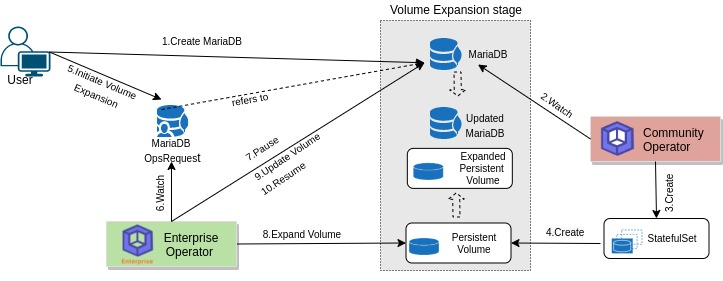

> Vous êtes nouveau sur KubeDB ? Veuillez commencer [ici](https://kubedb.com/docs/v2026.7.10/README).

# Extension du volume MariaDB

Ce guide donnera un aperçu de la façon dont KubeDB Ops Manager augmente le volume de `MariaDB`.

## Avant de commencer

* Vous devriez être familier avec ce qui suit `KubeDB` notions :
  + [MariaDB](../concepts/mariadb.md)
  + [MariaDBOpsRequest](../concepts/opsrequest.md)

## Comment fonctionne le processus d'expansion du volume

Le diagramme suivant montre comment KubeDB Ops Manager augmente les volumes de `MariaDB` composants de base de données. Ouvrez l'image dans un nouvel onglet pour voir la version agrandie.

  

Fig : Processus d'expansion du volume de MariaDB

Le processus d'expansion du volume comprend les étapes suivantes :

1. Dans un premier temps, un utilisateur crée un `MariaDB` Ressource personnalisée (CR).
2. `KubeDB` L'opérateur communautaire surveille `MariaDB` CR.
3. Lorsque l'opérateur trouve un `MariaDB` CR, il crée requis `PetSet` et les éléments nécessaires connexes comme les secrets, les services, etc.
4. Le petSet crée des volumes persistants selon le modèle de réclamation de volume fourni dans la configuration du petset. Ce volume persistant sera étendu par le `KubeDB` Opérateur d'entreprise.
5. Ensuite, afin d'augmenter le volume du `MariaDB` base de données, l'utilisateur crée un `MariaDBOpsRequest` CR avec les informations souhaitées.
6. `KubeDB` L'opérateur d'entreprise surveille le `MariaDBOpsRequest` CR.
7. Lorsqu'il trouve un `MariaDBOpsRequest` CR, il met en pause le `MariaDB` objet auquel fait référence le `MariaDBOpsRequest`. Ainsi, le `KubeDB` L’opérateur communautaire n’effectue aucune opération sur le `MariaDB` objet pendant le processus d’expansion du volume.
8. Puis le `KubeDB` L'opérateur d'entreprise augmentera le volume persistant pour atteindre la taille attendue définie dans le `MariaDBOpsRequest` CR.
9. Après l'expansion réussie du volume des PetSet Pods associés, le `KubeDB` L'opérateur d'entreprise met à jour la nouvelle taille du volume dans le `MariaDB` objet pour refléter l’état mis à jour.
10. Après l'expansion réussie du volume du `MariaDB`, le `KubeDB` L'opérateur d'entreprise reprend le `MariaDB` objet afin que le `KubeDB` L'opérateur communautaire reprend ses opérations habituelles.

Dans la prochaine documentation, nous allons montrer un guide étape par étape sur l'expansion du volume de diverses bases de données MariaDB à l'aide de `MariaDBOpsRequest` CRD.